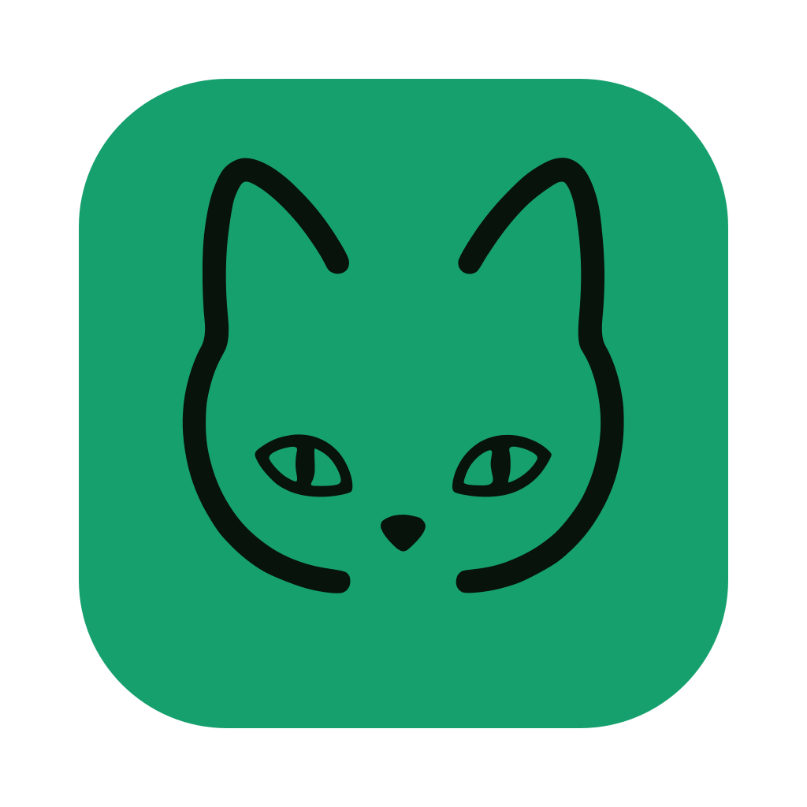
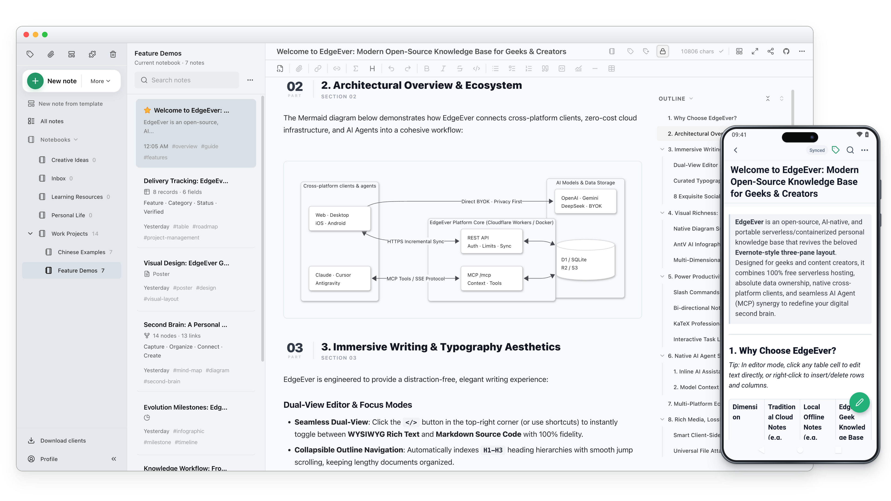

<div align="center">
  <h1>
     EdgeEver
  </h1>
  <p>
    <b>KI-native Wissensdatenbank & Evernote/Obsidian-Alternative. Sofortige plattformübergreifende Synchronisierung, vielfältige Notizen (Tabellen, Mindmaps, Diagramme, Poster), Web Clipper & MCP. 100% kostenlos auf Cloudflare oder via Docker.</b>
  </p>
  <p>
    <a href="https://github.com/tianma-if/edgeever/stargazers"></a>
    <a href="https://github.com/tianma-if/edgeever/network/members"></a>
    <a href="https://github.com/tianma-if/edgeever/releases"></a>
    <a href="https://github.com/tianma-if/edgeever/pkgs/container/edgeever"></a>
    <a href="https://www.producthunt.com/products/edgeever?utm_source=other&utm_medium=social"></a>
    <a href="https://hellogithub.com/repository/tianma-if/edgeever" target="_blank"></a>
    <a href="#sponsoring--unterstutzung"></a>
  </p>
  <p>
    <a href="README.zh-CN.md">简体中文</a> | <a href="README.zh-TW.md">繁體中文</a> | <a href="README.md">English</a> | <a href="README.es.md">Español</a> | <b>Deutsch</b> | <a href="README.fr.md">Français</a> | <a href="README.ja.md">日本語</a> | <a href="README.pl-PL.md">Polski</a> | <a href="README.ru.md">Русский</a>
  </p>
  <p>
    <a href="https://t.me/+GvKYnL37feUwOTNl"> Telegram-Gruppe</a> &nbsp;|&nbsp;
    <a href="https://demo.edgeever.org">🌐 Live-Demo</a> &nbsp;|&nbsp;
    <a href="https://github.com/users/tianma-if/projects/1">🗺️ Roadmap</a> &nbsp;|&nbsp;
    <a href="#clients-und-erweiterung">📱 Clients & Erweiterung</a> &nbsp;|&nbsp;
    <a href="#features">Funktionsmatrix & Möglichkeiten</a> &nbsp;|&nbsp;
    <a href="docs/note-migration-guide.en-US.md">📥 Notiz-Migration</a>
  </p>
  <p align="center">
    
  </p>
</div>

EdgeEver ist ein moderner, quelloffener Arbeitsbereich für Notizen und persönliches Wissensmanagement. Es bewahrt den klassischen, hocheffizienten Drei-Spalten-Produktivitäts-Workflow (Verzeichnisbaum · Notizliste · Editor) und bietet gleichzeitig eine offene Datenarchitektur sowie nahtlose KI-Agenten-Integration für vollständige Datenhoheit und intelligente Produktivität.

> 💡 **Serverless & dauerhaft 100 % kostenlos**
> EdgeEver kann innerhalb des kostenlosen Kontingents von Cloudflare betrieben werden – ganz ohne Serverkauf oder VPS-Wartung. Nutzer, die einen VPS, ein NAS oder einen Heimserver bevorzugen, können dieselbe Anwendung mit Docker bereitstellen.

> ⭐ Wenn dir EdgeEver gefällt, freuen wir uns über einen Stern auf GitHub. Deine Unterstützung hilft mehr Menschen, das Projekt zu entdecken.

## Warum EdgeEver

Viele Nutzer von **Notiz-Apps und persönlichen Wissensdatenbanken** suchen schlicht nach einer **zuverlässigen, offenen und schnellen** Wissensbasis. Die gängigen Lösungen bringen jedoch alle Kompromisse mit sich:

* **Evernote**: Bietet die reibungsloseste und nahtloseste geräteübergreifende Cloud-Synchronisierung. Mit der Entwicklung zu einer vollumfänglichen kommerziellen Suite nahmen jedoch Werbung und Zusatzmodule zu, während die Systemauslastung stieg. Zudem wurden die Kontingente des kostenlosen Tarifs drastisch gekürzt, Premium-KI-Abonnements wurden teuer und die Einbindung in moderne, selbst gehostete und private KI-Workflows bleibt schwierig.
* **Obsidian**: Offene Dateien, aber proprietärer Kern. Die offizielle Synchronisierung ist kostenpflichtig und Drittanbieter-Synchronisierungen sind mühsam. Das vollständige Vertrauen auf das Scannen lokaler flacher Dateien führt bei tausenden Notizen oder vielen Plugins zu spürbaren Verzögerungen beim Kaltstart und bei der Suche. Werden Bilder und Anhänge im Notiz-Tresor gespeichert, bläht sich dieser schnell auf, was die mobile Synchronisierung verlangsamt und verwaiste Dateien hinterlässt. Für schnelles, unkompliziertes Festhalten von Gedanken von unterwegs ist es oft zu schwerfällig.
* **Joplin**: Eine bewährte Open-Source-Notiz-App mit Drei-Spalten-Ansicht, doch Benutzeroberfläche und Editor wirken wie aus dem vergangenen Jahrzehnt – es fehlt an modernem Schliff und Leichtigkeit. Eine schnelle offizielle Synchronisierung (Joplin Cloud) erfordert ein kostenpflichtiges Abonnement. Die kostenlose Synchronisierung über WebDAV oder Cloud-Speicher fragt Dateien einzeln nacheinander ab, was auf Mobilgeräten mit wachsender Notiz- und Anhangsanzahl träge wird. Ein eigener Joplin Server erfordert zudem die Wartung eines eigenen Servers ohne kostenlose Serverless-Alternative. Zudem fehlen ein vollwertiger Web-Arbeitsbereich im Browser und native KI-Agenten-Funktionen (MCP/ACP).
* **Memos & Stream-Notizen**: Minimalistisch und übersichtlich, aber das Layout im Social-Media-Timeline-Stil unterscheidet sich grundlegend von der strukturierten Produktivität des klassischen Drei-Spalten-Workflows.
* **SiYuan & blockbasierte PKMs**: Leistungsstark und selbst hostbar, doch ihre granulare Block-Architektur erfordert beim schnellen täglichen Erfassen und flüssigen Schreiben längerer Texte eine spürbare kognitive Belastung. Zudem fehlt ihnen eine echte, kostenlose Serverless-Bereitstellungsoption, und die geräteübergreifende Synchronisierung erfordert entweder offizielle kostenpflichtige Abonnements oder einen Aufpreis zur Freischaltung von S3/WebDAV-Synchronisierungsfunktionen mit eigenem Speicher.

**EdgeEver schließt diese Lücke**: Der gesamte Stack ist quelloffen und bietet eine wahrhaft **nahtlose, latenzarme Sofort-Cloud-Synchronisierung über alle Geräte hinweg** bei voller Self-Hosting-Freiheit. Es behält das vertraute Drei-Spalten-Layout bei, läuft selbst bei über 10.000 Notizen butterweich und leichtgewichtig und bringt native KI-Agenten mit – bei null Serverkosten.

## Online-Demo

- Demo: [https://demo.edgeever.org](https://demo.edgeever.org)

Die öffentliche Demo wird täglich um 03:00 Uhr morgens (Peking-Zeit, UTC+8) automatisch zurückgesetzt und stellt die Beispielnotizen wieder her. Bitte speichere dort keine vertraulichen Inhalte.

<a id="clients-und-erweiterung"></a>
## Plattformübergreifende Clients & Browser-Erweiterung

### Client-Downloads

<p>
  <a href="https://github.com/tianma-if/edgeever/releases/latest"></a>&nbsp;&nbsp;
  <a href="https://github.com/tianma-if/edgeever/releases/latest"></a>&nbsp;&nbsp;
  <a href="https://github.com/tianma-if/edgeever/releases/latest"></a>&nbsp;&nbsp;
  <a href="https://play.google.com/store/apps/details?id=org.edgeever.mobile"></a>&nbsp;&nbsp;
  <a href="https://apps.apple.com/us/app/edgeever/id6792625631"></a>
</p>

> Die iOS-App erfordert eine Apple-ID von außerhalb des chinesischen Festlands.

### Web Clipper Browser-Erweiterung

<p>
  <a href="https://chromewebstore.google.com/detail/edgeever-web-clipper/gjadpfmanienmlofajibkfkkpfdkclgo"></a>&nbsp;&nbsp;
  <a href="https://chromewebstore.google.com/detail/edgeever-web-clipper/gjadpfmanienmlofajibkfkkpfdkclgo"></a>&nbsp;&nbsp;
  <a href="https://addons.mozilla.org/firefox/addon/edgeever-web-clipper/"></a>
</p>

- Sauberes Markdown aus Web-Artikeln extrahieren oder markierten Text und Bilder direkt in deine selbst gehostete Instanz clippen.
- Tiefgreifendes, strukturiertes Clipping für über 20 Plattformen: soziale Netzwerke (X, Xiaohongshu, WeChat, Jike, Douban, Threads, Bluesky), Entwickler- und Lese-Communitys (Zhihu, Reddit, GitHub, V2EX, Hacker News, Medium, Substack) sowie Medien/Podcasts (Bilibili, YouTube, Xiaoyuzhou).

<a id="features"></a>
## Funktionsmatrix & Möglichkeiten

Ein All-in-One-Arbeitsbereich, der Inspiration, tiefgründiges Erstellen und Wissensaufbau nahtlos verbindet (👉 **[Entdecke 19 Schritt-für-Schritt-Praxisbeispiele mit Screenshots](docs/best-practices.md)**):

| Modul | Kernfunktionen | Erweiterte Funktionen |
| :--- | :--- | :--- |
| **Schreiben & Bearbeiten** | • Klassisches 3-Spalten-Layout mit anpassbarer Spaltenbreite<br>• Nahtloses Umschalten zwischen Rich-Text-WYSIWYG und reinem Markdown<br>• Syntax-Highlighting, mathematische Formeln, Aufgabenlisten & Fokus-Modus<br>• Sekundenschnelles automatisches Speichern, sofortige geräteübergreifende Synchronisierung & Versionshistorie | • **Native Plakat-Notizen**: Canvas-basierte, strukturierte visuelle Kartenlayouts, Doppelklick zum Bearbeiten<br>• **WeChat Official Account Formatter**: 1-Klick-Kopieren mit Inline-CSS direkt in Newsletter/Blogs<br>• **Plakat-Bildexport**: Stilvolle Themes, Monogramm-Avatare; Export als MD, HTML oder PDF |
| **Organisation & Suche** | • Beliebig tief verschachtelbare Notizbücher & Ordnerbaum-Navigation<br>• Tag-System, Drag-and-Drop-Sortierung, stapelweises Zusammenführen/Verschieben von Notizen<br>• Millisekundenschnelle Volltextsuche mit Verlaufsfilterung | • **Eigenständige Wissensdatenbank-Veröffentlichung**: Notizbücher mit einem Klick als statische Dokumentationsseiten mit Baum-Navigation und Passwortschutz veröffentlichen<br>• Mehrbenutzer-Bereiche & physische Mandantendaten-Isolation |
| **Erfassen & Medien** | • Universeller Datei-Upload (PDF, Office, Audio/Video, Archive)<br>• Präzises Web-Clipping von Texten & Bildern per Browser-Erweiterung<br>• Speichern von Fotos und Artikeln über das Teilen-Menü des Mobilgeräts | • **Tiefgreifendes plattformübergreifendes strukturiertes Clipping**: Tief angepasst für Xiaohongshu, X (Twitter), Zhihu, Reddit, GitHub, YouTube, Bilibili und über 20 Quellen<br>• **WeChat-Chatverlauf-Archivierung**: 1-Klick-Import des gesamten Chatverlaufs unter macOS mit Zeitstempeln, Zitaten, Emojis und Medien<br>• **Clientseitige Bildkomprimierung**: Automatische, unmerkliche Reduzierung der Dateigröße um 50 %–90 %; Streaming-Uploads unterstützen Dateien bis zu 1 GiB |
| **Daten & Visualisierung** | • Native Tabellenbearbeitung & Markdown-Tabellen-Rendering<br>• Native Mermaid-Diagramme (Flussdiagramme, Sequenzdiagramme, Architektur) | • **Mehrdimensionale KI-Tabellen**: Prompt-zu-Datenbank mit automatischer Feldtypisierung (Tags, Daten, Auswahllisten)<br>• **Öffentliche Online-Erfassungsformulare**: 1-Klick-Teilen von Formularen ohne Login, Antworten synchronisieren in Echtzeit in Tabellen<br>• **KI-Diagramm- & Infografik-Generierung**: Direktes Erstellen von Zeitachsen, Vergleichsdiagrammen, Quadranten-Matrizen & Mindmaps |
| **KI & Ökosystem** | • Begleitender KI-Assistent in der Seitenleiste für Zusammenfassungen, Korrekturlesen & Übersetzungen<br>• BYOK (Bring Your Own Key): kompatibel mit OpenAI, Claude, Gemini & benutzerdefinierten Endpunkten | • **Native Agenten-Protokolle (MCP & ACP)**: Integriertes MCP für Lese-/Schreibzugriff externer Agenten; ACP in der Desktop-App zur direkten Steuerung lokaler Agenten wie Codex, Claude Code und CodeBuddy<br>• **Tägliche KI-RSS-Zusammenfassung**: Automatische Feed-Aggregation, KI-Rauschfilterung und Erstellung strukturierter Zusammenfassungen<br>• Erweiterbare Plugin-Entwicklungs-API |
| **Multi-Geräte-Sync & Basis** | • Nahtlose, latenzarme Synchronisierung über Desktop, Mobilgeräte und Web ohne Gerätelimits<br>• Offizielle Clients für Web, macOS, Windows, Linux, iOS und Android<br>• Offline-First mit automatischer Sync-Warteschlange: offline flüssig schreiben, bei Wiederverbindung automatisch fortsetzen und synchronisieren<br>• Standardmäßige SQLite-Datenbank, verlustfreies ZIP-Backup & Markdown-Export/-Import | • **Dauerhaft null Serverkosten**: 100 % lauffähig im kostenlosen Cloudflare-Tarif (~150.000 kurze Notizen & ~50.000 Bilder)<br>• **Flexibles Docker-Self-Hosting**: 1-Klick-Bereitstellung für VPS, NAS oder Heimserver für Millionen von Notizen mit Sofort-Synchronisierung<br>• Serverseitiger Brute-Force-Schutz und Mandantensicherheit |

## Bereitstellung

Cloudflare ist die empfohlene Bereitstellungsmethode ohne eigenen Server. Docker steht für Nutzer bereit, die einen VPS, ein NAS oder einen Heimserver bevorzugen.

Wähle für Cloudflare eine der beiden folgenden Online-Bereitstellungsoptionen:

### Option A: Bereitstellung mit einem KI-Agenten (empfohlen)

Kopiere den folgenden Prompt direkt in einen KI-Agenten (z. B. Codex, Claude, Cursor, WorkBuddy, Antigravity, OpenClaw, Hermes Agent usw.). Falls während der Ausführung Zugriff auf GitHub oder Cloudflare erforderlich ist, überprüfe die angeforderten Berechtigungen und folge den Anweisungen zur Autorisierung.

```text
Stelle EdgeEver vollständig über GitHub und Cloudflare bereit:
1. Forke https://github.com/tianma-if/edgeever.
2. Erstelle D1 `edgeever` und R2 `edgeever-resources` in Cloudflare.
3. Wähle in Workers & Pages „Start with Hello World!“ und erstelle einen Worker namens `edgeever`.
4. Trage das vom Nutzer gewählte Passwort als Runtime-Secret `EDGE_EVER_AUTH_PASSWORD`
   unter Settings → Variables and Secrets ein und stelle das Secret bereit (vorzugsweise mindestens
   32 Zeichen). Der Benutzername lautet standardmäßig `admin`.
5. Öffne erst nach der Bereitstellung des Secrets Settings → Builds → Connect dieses Workers
   und verbinde den Branch `main` des Forks.
6. Wähle oder erstelle unter Settings → Builds → API token dieses Workers das für die Bereitstellung verwendete Cloudflare-API-Token mit Lese-/Schreibberechtigung für D1 im Zielkonto.
7. Öffne im GitHub-Repository des Forks Actions → Update deployed EdgeEver, aktiviere den Workflow bei Aufforderung und wähle Run workflow auf `main`. Nachdem in Cloudflare bestätigt wurde, dass der entsprechende Build erfolgreich war und die Bereitstellung abgeschlossen ist, prüfe `/api/health` und `/api/openapi.json` und melde dich anschließend mit dem Administrator-Benutzernamen und Passwort an.
   Dieser Workflow synchronisiert zukünftige stabile Releases und Fehlerbehebungen automatisch.
```

> Detaillierte Anforderungen: [Cloudflare-Bereitstellung mit KI-Agenten](docs/agent-deploy-cloudflare.md).

### Option B: Manuelle Online-Bereitstellung

<details>
<summary>📖 Klicken zum Ausklappen: 7-Schritte-Web-Anleitung zur manuellen Bereitstellung</summary>

Führe die folgenden 7 Schritte im Webbrowser exakt in dieser Reihenfolge durch:

1. **Repository forken**: Klicke oben rechts auf GitHub auf **Fork**, um EdgeEver in dein persönliches Konto zu forken.
2. **Cloudflare-Ressourcen erstellen**: Erstelle D1 `edgeever` und R2 `edgeever-resources`.
3. **Worker erstellen**: Wähle in Cloudflare Workers & Pages Create application → Start with Hello World!, benenne den Worker `edgeever` und stelle ihn bereit. Dies erstellt einen Platzhalter; EdgeEver wird in Schritt 7 bereitgestellt.
4. **Administrator-Passwort festlegen**: Füge unter Settings → Variables and Secrets des Workers `EDGE_EVER_AUTH_PASSWORD` als Typ Secret hinzu und klicke auf Deploy. Der Wert ist dein frei gewähltes Anmeldekennwort, vorzugsweise mindestens 32 Zeichen lang. Schließe dies ab, bevor du den Fork verbindest.
5. **Fork verbinden**: Wähle in Settings → Builds → Connect des bestehenden Workers den Fork und den Produktionsbranch `main` aus.
6. **Bereitstellungsberechtigungen konfigurieren**: Wähle oder erstelle unter Settings → Builds → API token dieses Workers das Cloudflare-API-Token für die Bereitstellung mit Lese-/Schreibberechtigung für D1 im Zielkonto.
7. **Bauen & Verifizieren**: Öffne im GitHub-Repository des Forks Actions → Update deployed EdgeEver, aktiviere den Workflow bei Aufforderung und wähle Run workflow auf `main`. Nachdem in Cloudflare bestätigt wurde, dass der Build erfolgreich durchgelaufen und die Bereitstellung abgeschlossen ist, stelle sicher, dass `/api/health` den Status `200` zurückgibt, und überprüfe die Anmeldung. Dieser Workflow synchronisiert künftige stabile Releases und Fixes automatisch.

> 📖 Die vollständige Schritt-für-Schritt-Anleitung und alle Konfigurationsdetails findest du im [Online-Bereitstellungsleitfaden](docs/deploy-cloudflare-button.md).

</details>

<details>
<summary>📌 Hinweise zur Cloudflare-Bereitstellung anzeigen (Eigene Domain & kostenloses R2-Kontingent)</summary>

> **Eigene Domain & Zugriff**: Nach der Bereitstellung kannst du direkt die von Cloudflare zugewiesene Standard-Domain `*.workers.dev` nutzen oder in den Worker-Einstellungen unter **Settings → Domains & Routes** eine eigene Domain einbinden.
>
> **Cloudflare R2-Aktivierung**: Obwohl Cloudflare R2 ein großzügiges [kostenloses Speicherkontingent](https://developers.cloudflare.com/r2/pricing/#free-tier) bietet, innerhalb dessen typische Notiz-Workloads vollständig verbleiben, musst du zunächst ein R2-Abonnement aktivieren und eine Zahlungsmethode hinterlegen. Cloudflare [unterstützt offiziell](https://developers.cloudflare.com/billing/get-started/update-billing-info/#supported-payment-methods) UnionPay, Visa, Mastercard und weitere Karten sowie PayPal, Apple Pay, Google Pay und andere Zahlungsmethoden.

</details>

### Option C: Docker auf einem VPS oder NAS

Docker führt exakt dasselbe Frontend, dieselben API-Routen, Dienste, Authentifizierungen, MCP-Implementierungen und Datenbankmigrationen wie Cloudflare aus. Der Container verwendet SQLite mit lokalen Dateien oder S3-kompatiblem Anhangsspeicher und unterstützt `amd64` und `arm64`. Siehe [EdgeEver mit Docker bereitstellen](docs/deploy-docker.md) und [Self-Hosting- und Docker-Architektur](docs/self-hosting-architecture.md).

Verwende das auf GitHub gehostete Installationsskript und das offizielle GHCR-Image:

```sh
curl -fsSL https://edgeever.org/install.sh | bash
```

Der Befehl lädt das neueste Image herunter, generiert ein Administrator-Passwort und startet EdgeEver via Docker Compose.

Informationen zur manuellen Bereitstellung und Konfiguration findest du im [Docker-Bereitstellungsleitfaden](docs/deploy-docker.md).

Nach der Installation laufen Updates standardmäßig täglich automatisch. Um manuell zu aktualisieren, führe `~/edgeever/update.sh` auf dem Server aus.

---

## Erweiterte Konfiguration & Verwaltung

### Datensicherung, Export & Migration

Ob für regelmäßige Datensicherungen, die nahtlose Migration zwischen Instanzen oder den Wechsel von bestehenden Notizplattformen – EdgeEver bietet zuverlässige und vollständige Datenmobilität:

- **Natives EdgeEver-Backup & Wiederherstellung**: Navigiere in der App zu **Profil** -> **Import und Export**, um jederzeit ein EdgeEver-ZIP-Archiv zu exportieren oder zu importieren. Das entpackte Verzeichnis `notes/` enthält saubere Markdown-Klartextdateien und Anhänge zur lokalen Archivierung oder zum direkten Lesen, während interne strukturierte Metadaten eine verlustfreie vollständige Wiederherstellung auf anderen EdgeEver-Instanzen ermöglichen. Beim Import bleiben bestehende, nicht betroffene Daten auf der Zielinstanz erhalten und Datensätze mit übereinstimmenden IDs werden automatisch aktualisiert.
- **Reibungslose Migration von Drittanbieter-Apps**: Ob beim 1-Klick-Import über die native grafische Benutzeroberfläche (mit Unterstützung für vollständige Notizen, Hierarchien und Anhänge aus Evernote, Obsidian und Joplin) oder bei der Migration von Notion, flomo, Memos und anderen Plattformen via KI-Agent & MCP – EdgeEver bietet nahtlose, verifizierte Datenmobilität. Siehe den [Migrationsleitfaden für Notizen von Drittanbietern](docs/note-migration-guide.en-US.md).

### KI- & MCP-Protokoll-Integration

Erstelle ein API-Token unter **Profil** -> **API / MCP** und kopiere die Remote-MCP-Konfiguration mit einem Klick, damit KI-Agenten wie Claude Code, Cursor, Antigravity und OpenClaw deine Wissensbasis innerhalb der Kontoberechtigungen sicher verwalten können. EdgeEver unterstützt vollständige CRUD-Operationen für Textnotizen, visuelle Diagramm-Notizen (Mindmaps, Flussdiagramme und Architekturdiagramme), strukturierte Tabellennotizen und native Plakat-Notizen. Agenten können zudem Notizbuch-Hierarchien, Tags, Anhänge, die Versionshistorie, Notizvorlagen und KI-Instruktionen verwalten.

Einrichtung der Clients, Zugriffsstufen der Tokens, Fehlerbehebung und empfohlene Regeln für Agenten beschreibt [Using EdgeEver with MCP clients](docs/mcp-guide.md) (auf Englisch).

> 💡 **Inspiration:**
> Mache KI zu deinem echten Wissensorchestrator und kreativen Co-Piloten – verwandle Konzepte augenblicklich in interaktive Mindmaps, Flussdiagramme, Architekturdiagramme und strukturierte Tabellen, während du deinen KI-Agenten privaten Kontext bereitstellst. In Kombination mit den leistungsstarken Rich-Text-Bearbeitungsfunktionen und der eleganten Typografie von EdgeEver werden KI-unterstützte Inhalte zu ansprechend strukturierten, verfeinerten und publikationsreifen Wissenswerten.

### Multi-Account-Anmeldung & Speicherverwaltung

Einmal bereitgestellt, unterstützt eine einzelne Instanz die Anmeldung mehrerer Konten.

Der Administrator der Instanz kann unter **Profil** -> **Benutzerkonten** Mitgliedskonten erstellen, deaktivieren oder zurücksetzen. Jedes Mitglied erhält einen vollständig isolierten persönlichen Arbeitsbereich inklusive Notizbüchern, Notizen, Anhängen, Papierkorb, Import/Export und MCP-Tokens. Ein intuitives Speicher-Dashboard bietet Echtzeit-Einblick in den Anhangsspeicher der gesamten Instanz sowie der einzelnen Konten.

### Speichererweiterung & Drittanbieter-Bilderhosting

- **OSS-Objektspeicher**: Der Instanzinhaber kann S3-kompatiblen Objektspeicher unter **Einstellungen → Erweitert → OSS-Objektspeicher** konfigurieren. Ein Wechsel des Speichers migriert oder beeinträchtigt bestehende Anhänge nicht.
- **PicGo-Integration der Desktop-App**: Die Desktop-App kann eingefügte Bilder an einen PicGo- oder PicList-Server auf diesem Computer oder auf einem anderen vertrauenswürdigen Rechner (z. B. einem NAS) übergeben. Dieser Server lädt sie auf GitHub, SM.MS, Upyun, Qiniu oder einen benutzerdefinierten Bildhoster hoch. Die Adresse muss lediglich auf `/upload` enden, sodass auch ein PicList hinter einem Reverse-Proxy funktioniert.
- **CloudFlare ImgBed der Desktop-App**: Die Desktop-App kann eingefügte Bilder auch direkt mit einem API-Token auf dein selbst gehostetes [CloudFlare ImgBed](https://github.com/MarSeventh/CloudFlare-ImgBed) hochladen. Der Upload-Ordner unterstützt Platzhalter im PicList-Stil wie `{Y}/{m}/{d}` und `{memoId}`.

### Plugins und Themes

Die Web- und Desktop-Apps unterstützen funktionale Plugins und benutzerdefinierte Themes, die über den offiziellen Marktplatz, GitHub oder eine Manifest-URL installiert und nahtlos über deinen gesamten Arbeitsbereich synchronisiert werden können. Entwickler können die Funktionen über `@edgeever/plugin-api` erweitern; siehe den [Plugin-Entwicklungsleitfaden](docs/plugin-development.md) und die [Richtlinien für Marktplatz-Einreichungen](docs/plugin-marketplace-policy.md).

---

## Entwickler-Leitfaden & Mitwirken

### Schnellstart

```sh
bun install
bun run dev
```

In der lokalen Entwicklungsumgebung erfolgt die Anmeldung automatisch; frische Datenbanken verwenden `owner` / `edgeever-local-dev`. Melde dich ab, um den Anmeldebildschirm zu testen.

### Architektur & Tech-Stack

#### Tech-Stack

- Bun-Workspace-Monorepo mit Web, API, offizieller Website und gemeinsam genutztem Typenpaket.
- Frontend: Vite, React, React Router, TanStack Query, Tailwind CSS, shadcn/ui und Radix UI.
- Editor: TipTap / ProseMirror mit Markdown-Unterstützung; PWA nutzt vite-plugin-pwa, Workbox und Dexie.
- Android-App: Expo + React Native in `apps/mobile`, mit lokalem SQLite-Speicher und inkrementeller Synchronisierung.
- iOS-App: Natives SwiftUI in `apps/ios` (iOS 17+), mit gebündeltem TipTap-EditorBundle, lokalem GRDB-Spiegel/Outbox und an Android angepasster UI-Shell.
- Native Desktop-App: Electron + Rust-Sidecar kombiniert ein konsistentes plattformübergreifendes Erlebnis mit hochperformanten lokalen Datendiensten; SQLite ermöglicht Offline-Bearbeitung, inkrementelle Synchronisierung bei Wiederverbindung und lokale Backups.
- Web Clipper: Manifest V3, Mozilla Readability und Turndown für Chrome, Microsoft Edge und Firefox.
- Backend: Eine einheitliche Hono/Zod-Geschäftsanwendung mit REST-API und Remote-MCP; Cloudflare nutzt Workers/D1/R2, während Docker Bun/SQLite/lokale Dateien oder S3 verwendet.
- Offizielle Website: Statische Astro-Website in `apps/site`, unabhängig auf Cloudflare Pages bereitstellbar.

#### Projektstruktur

<details>
<summary>📁 Ausklappen: Monorepo-Projektstruktur anzeigen</summary>

```text
apps/web          Vite + React Frontend, PWA, Offline-Entwürfe und Synchronisierungs-Warteschlange
apps/extension    Chrome/Edge/Firefox Manifest V3 Web Clipper
apps/api          Cloudflare Worker + Hono API, MCP-Endpunkt
apps/mobile       Expo + React Native Android-App
apps/ios          Native SwiftUI iOS-App (TipTap EditorBundle, GRDB)
apps/desktop      Electron Desktop-Shell, Preload-Bridge und natives Packaging
apps/site         Offizielle Astro-Website, unabhängig bereitstellbar
packages/client   Gemeinsamer API-Client für Web- und mobile Apps
packages/shared   Gemeinsame Typen, Zod-Schemas, TipTap / Markdown-Konvertierung
crates/desktop-sidecar
                  Rust-Sidecar für lokales SQLite, Offline-Daten, Backups und Ressourcen
scripts           Wrangler-Wrapper, Passwort-Hash, CLI, MCP-stdio-Bridge, Evernote-ENEX-Import
migrations        Gemeinsame Append-Only D1/SQLite-Datenbankmigrationen
docs              Architektur-, Migrations- und Bereitstellungsdokumentation
.github/workflows CI für Web, Mobile, iOS, Desktop-Packaging, Bereitstellung und Releases
wrangler.toml     Cloudflare Workers, Assets, D1, R2 Konfiguration
```

</details>

#### Datenspeichermodell

EdgeEver speichert Notizinhalte gleichzeitig in drei Formaten, um Bearbeitungsleistung, offene Portabilität und Volltextsuchgeschwindigkeit in Einklang zu bringen:

```text
content_json      TipTap/ProseMirror-Dokument, maßgebliche Quelle für den Editor
content_markdown  Format für API, Agenten, Export und Interoperabilität im externen Ökosystem
content_text      Format für Volltextsuche, Zusammenfassungserstellung und Indizierung
```

### Kernmechanismen & Designentscheidungen

- **Clientseitige unmerkliche Komprimierung**: Um die Rechenzeitkontingente auf Serverless-Laufzeitumgebungen wie Cloudflare Workers zu schonen, erfolgt die Bildkomprimierung vollständig im Web-Client vor dem Upload (Konvertierung von PNG/JPEG/WebP/AVIF nach WebP, sofern vorteilhaft, max. Kantenlänge 2560px; das Original bleibt erhalten, falls eine Komprimierung die Größe nicht reduziert). REST-API- und MCP-Endpunkte speichern die vom Client übergebenen Binärdaten direkt ohne serverseitige Neucodierung.
- **Offline-First & Synchronisierungs-Timing**: Web-, PWA- und Desktop-Clients laden Änderungen an Notizen nach 30 Sekunden Inaktivität beim Tippen automatisch hoch und fragen bei sichtbarem Fenster alle 5 Minuten nach Remote-Änderungen. Das erneute Fokussieren des Fensters und manuelle Aktualisierungen lösen eine sofortige Synchronisierung aus. Konfigurierbar über `DEFERRED_MEMO_SYNC_DELAY_MS` und `BACKGROUND_WORKSPACE_REFRESH_INTERVAL_MS` in [`apps/web/src/lib/workspace-refresh.ts`](apps/web/src/lib/workspace-refresh.ts).

### Code beisteuern

Beiträge aus der Community sind herzlich willkommen! Bitte beachte dabei folgende Richtlinien:

- Bitte lies den [Leitfaden für Beiträge](CONTRIBUTING.md), bevor du Code einreichst.
- **Isolierung der Bereitstellung**: Wenn dein GitHub-Fork auch zur Bereitstellung von EdgeEver verwendet wird, halte dessen `main`-Branch sauber und ausschließlich für Bereitstellungen reserviert. Erstelle für Features/Fixes und Pull Requests einen eigenen Branch ausgehend vom offiziellen `upstream/main`; entwickle nicht direkt auf dem Bereitstellungs-`main` und führe dort kein „Sync fork“ aus.

---

## Community und Feedback

- **Issues & Vorschläge**: Bei Fehlern, Feature-Wünschen und Bereitstellungsfragen erstelle bitte ein Ticket auf [GitHub Issues](https://github.com/tianma-if/edgeever/issues), damit die Community durchsuchbare Lösungen aufbauen kann.

### Telegram-Community

Willkommen in der EdgeEver-Community, die Entwickler und Kreative zusammenbringt, die Vibe Coding und KI erkunden. Tausche dich mit uns über moderne KI-Produktivität und Best Practices für persönliche Wissensdatenbanken aus.

👉 [Der EdgeEver Telegram-Gruppe beitreten](https://t.me/+GvKYnL37feUwOTNl)

## Partner-Links

- [LINUX DO](https://linux.do/) — Eine Community zum Austausch über Technologie und Open-Source-Projekte.

<a id="sponsoring--unterstutzung"></a>
## Sponsoring & Unterstützung

EdgeEver ist ein kostenloses und quelloffenes Projekt. Die kontinuierliche Entwicklung von plattformübergreifenden Clients, ständige Gerätetests, Code-Signierung und die Pflege des Multi-Runtime-Ökosystems erfordern kontinuierlichen Einsatz und Ressourcen.

- [EdgeEver unterstützen](docs/sponsor.md) — Freiwillige Spende über WeChat Pay oder Alipay
- [Sponsoren & Partner](docs/partners.md) — Unterstützung von Infrastruktur, Entwicklerwerkzeugen, Diensten oder Community-Kooperationen

## Danksagungen

- Das Produktdesign der Notizfunktionen von EdgeEver wurde auch von öffentlich zugänglichen Produkterfahrungen ausgereifter Notiz-Tools wie [Evernote](https://evernote.com/) und [Notion](https://www.notion.com/) inspiriert. Die entsprechenden Funktionen wurden von EdgeEver unabhängig konzipiert und implementiert.
- Das Produktdesign von Mindmaps und visuellen Diagramm-Notizen wurde von den öffentlich zugänglichen Produkterfahrungen von [XMind](https://xmind.com/) und [ProcessOn](https://www.processon.com/) inspiriert. Diese Funktionen wurden von EdgeEver unabhängig konzipiert und implementiert.
- Der Arbeitsbereich für Plakatgestaltung in EdgeEver ist inspiriert von [Qiaomu Design](https://github.com/joeseesun/qiaomu-cover-design) von 向阳乔木 (joeseesun) und übernimmt dessen Vorlagen und Typografie-Engine unter der MIT-Lizenz.
- Die visuellen Themes und die Typografie der Bildkarten zum Teilen von Notizen wurden von [Firefly Card (流光卡片)](https://fireflycard.shushiai.com/) inspiriert. Vielen Dank für die gestalterische Inspiration.
- Das 1-Klick-Veröffentlichen für WeChat und die Typografie der Vorzeigeseiten in EdgeEver sind von [gzh-design-skill](https://github.com/isjiamu/gzh-design-skill) von isjiamu inspiriert. Vielen Dank für das Layout und die gestalterische Inspiration.

## Marken und Markennutzung

Der Name EdgeEver, das Logo und weitere Markenzeichen kennzeichnen das offizielle Projekt. Forks und modifizierte Versionen dürfen darauf hinweisen, dass sie auf EdgeEver basieren, dürfen jedoch keinen offiziellen Status suggerieren oder Nutzer irreführen. Die Open-Source-Lizenz gewährt keine Markenrechte; sonstige Nutzungen bedürfen der vorherigen schriftlichen Genehmigung der Projektbetreuer.

## Haftungsausschluss

EdgeEver ist eine unabhängige Open-Source-Notizanwendung, die von Einzelpersonen und der Community entwickelt und gepflegt wird. Sie ist weder mit der Evernote Corporation oder ihren verbundenen Unternehmen verbunden, noch wird sie von diesen autorisiert, gesponsert oder unterstützt.

EdgeEver ist eine Software für das Self-Hosting. Abgesehen von offiziellen Demo-Instanzen hosten, kontrollieren oder überprüfen die Projektbetreuer keine Nutzerinhalte. Die auf einer Instanz gespeicherten oder angezeigten Inhalte liegen in der Verantwortung der jeweiligen Nutzer oder Betreiber und spiegeln nicht die Ansichten der Maintainer wider.

## Mitwirkende

<!-- readme-contributors:start -->
<p align="left">
  <a href="https://github.com/tianma-if"></a>
  <a href="https://github.com/dkoryto"></a>
  <a href="https://github.com/sivdead"></a>
  <a href="https://github.com/yulei666"></a>
  <a href="https://github.com/thorufur"></a>
  <a href="https://github.com/arsaboo"></a>
  <a href="https://github.com/alyyasser"></a>
  <a href="https://github.com/MadlyFX"></a>
  <a href="https://github.com/claude"></a>
  <a href="https://github.com/Crowszzz"></a>
  <a href="https://github.com/CottonChou"></a>
  <a href="https://github.com/Z-DDV"></a>
  <a href="https://github.com/0xfelixli"></a>
  <a href="https://github.com/Sergmay911"></a>
  <a href="https://github.com/X77seven"></a>
  <a href="https://github.com/imgdown"></a>
  <a href="https://github.com/mookim-eth"></a>
  <a href="https://github.com/nzhdotme"></a>
  <a href="https://github.com/Shunamxiao"></a>
</p>
<!-- readme-contributors:end -->
