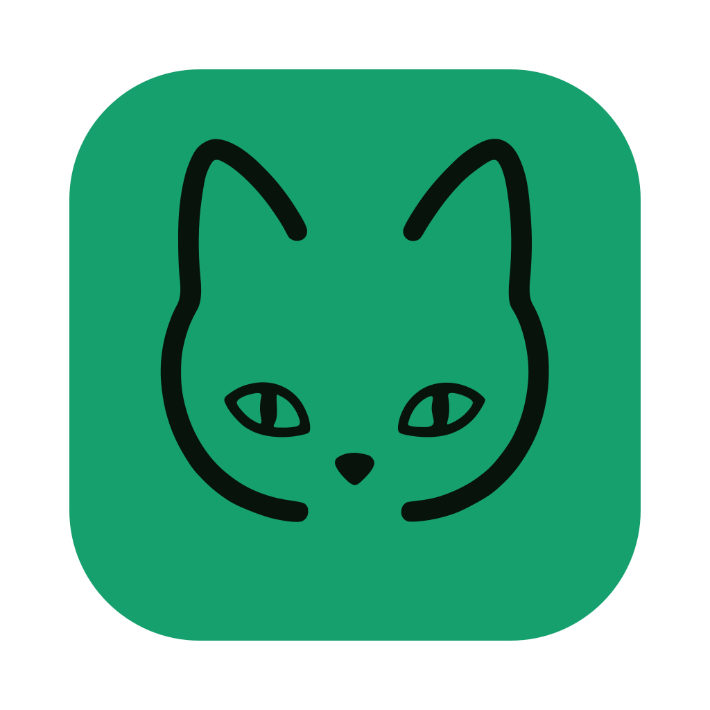

<div align="center">
  <h1>
     EdgeEver
  </h1>
  <p>
    <b>Base de conocimiento nativa de IA y alternativa a Evernote/Obsidian con sincronización instantánea y MCP nativo. Gratis en Cloudflare o autoalojado con Docker.</b>
  </p>
  <p>
    <a href="https://github.com/tianma-if/edgeever/stargazers"></a>
    <a href="https://github.com/tianma-if/edgeever/network/members"></a>
    <a href="https://github.com/tianma-if/edgeever"></a>
    <a href="https://github.com/tianma-if/edgeever/pkgs/container/edgeever"></a>
    <a href="https://www.producthunt.com/products/edgeever?utm_source=other&utm_medium=social"></a>
    <a href="https://hellogithub.com/repository/tianma-if/edgeever" target="_blank"></a>
    <a href="#patrocinio-y-soporte"></a>
  </p>
  <p>
    <a href="README.zh-CN.md">简体中文</a> | <a href="README.zh-TW.md">繁體中文</a> | <a href="README.md">English</a> | <b>Español</b> | <a href="README.de.md">Deutsch</a> | <a href="README.fr.md">Français</a> | <a href="README.ja.md">日本語</a> | <a href="README.pl-PL.md">Polski</a> | <a href="README.ru.md">Русский</a>
  </p>
  <p>
    <a href="https://t.me/+GvKYnL37feUwOTNl"> Grupo de Telegram</a> &nbsp;|&nbsp;
    <a href="https://demo.edgeever.org">🌐 Demostración en vivo</a> &nbsp;|&nbsp;
    <a href="#clientes-y-extensiones">📱 Clientes y extensiones</a> &nbsp;|&nbsp;
    <a href="#features">Matriz de funciones y capacidades</a> &nbsp;|&nbsp;
    <a href="docs/note-migration-guide.en-US.md">📥 Migración de notas</a>
  </p>
  <p align="center">
    
  </p>
</div>

EdgeEver es un espacio de trabajo moderno y de código abierto para notas y bases de conocimiento. Conserva el flujo de trabajo de productividad clásico y altamente eficiente de tres paneles (Vista de árbol · Lista de notas · Editor), al tiempo que ofrece una arquitectura de datos abierta e integración fluida con agentes de IA para un control total y una productividad inteligente.

> 💡 **Serverless y 100% gratuito para siempre**
> EdgeEver puede ejecutarse dentro de las cuotas gratuitas de Cloudflare sin necesidad de adquirir servidores ni mantener un VPS. Los usuarios que prefieran un VPS, NAS o servidor doméstico pueden desplegar la misma aplicación con Docker.

> ⭐ Si EdgeEver te resulta útil, considera darle una estrella (Star). Tu apoyo ayuda a que más personas descubran el proyecto.

## Por qué EdgeEver

Muchos usuarios de **aplicaciones de notas y bases de conocimiento personales** solo buscan una base de conocimiento **fiable, abierta y rápida**. Sin embargo, las soluciones convencionales actuales presentan inconvenientes:

* **Evernote**: Ofrece la experiencia de sincronización en la nube multidispositivo más fluida y transparente. Sin embargo, a medida que evolucionó hacia una suite comercial repleta de funciones, los anuncios y complementos se multiplicaron mientras aumentaba el consumo de recursos. Mientras tanto, las cuotas del plan gratuito se redujeron, las suscripciones premium de IA se encarecieron y sigue siendo difícil de integrar en flujos de trabajo de IA privados y autoalojados modernos.
* **Obsidian**: Archivos abiertos, núcleo de código cerrado. La sincronización oficial es de pago y la de terceros resulta tediosa; depender exclusivamente del escaneo de archivos locales planos provoca retrasos notables en el arranque en frío y en las búsquedas cuando las notas alcanzan miles o se cargan plugins pesados; almacenar imágenes y adjuntos junto con las notas infla rápidamente las bóvedas, ralentizando la sincronización móvil y dejando archivos huérfanos; además, es demasiado pesado para capturar notas rápidas en cualquier momento.
* **Joplin**: Una veterana aplicación de notas de código abierto con tres paneles, pero su diseño visual y su experiencia de edición parecen haberse quedado estancados hace más de una década, careciendo de fluidez y acabado moderno. La sincronización oficial rápida (Joplin Cloud) requiere suscripción de pago; la sincronización gratuita mediante WebDAV o discos en la nube se basa en sondeos archivo por archivo que se vuelven lentos en dispositivos móviles a medida que crecen las notas y los adjuntos, mientras que autoalojar Joplin Server requiere mantener tu propio servidor sin opción serverless de coste cero. También carece de un espacio de trabajo web completo en el navegador y de capacidades nativas para agentes de IA (MCP/ACP).
* **Memos y notas cronológicas (flomo)**: Limpias y sencillas, pero sus diseños de línea de tiempo difieren fundamentalmente de la productividad estructurada de un flujo de trabajo clásico de tres paneles.
* **SiYuan y herramientas PKM basadas en bloques**: Potentes y con soporte para autoalojamiento, pero su arquitectura granular a nivel de bloques impone una carga cognitiva notable para capturas diarias rápidas y redacción de texto continuo. Además, carecen de un nivel de despliegue serverless verdaderamente gratuito, y la sincronización multidispositivo depende de suscripciones oficiales de pago o de pagar extra para desbloquear las funciones de sincronización S3/WebDAV con tu propio almacenamiento.

**EdgeEver llena este vacío**: Todo el stack es de código abierto, ofreciendo una **sincronización instantánea en la nube multidispositivo, de baja latencia y sin fricciones**, con total libertad para autoalojarlo de forma gratuita. Mantiene el diseño de tres paneles que ya conoces, permanece ágil y ligero incluso con más de 10 000 notas, e integra agentes de IA nativos con despliegue a coste cero.

## Demostración en vivo

- Demo: [https://demo.edgeever.org](https://demo.edgeever.org)

La demostración pública se restablece todos los días a las 3:00 AM (hora estándar de China, UTC+8) y restaura las notas de ejemplo. No almacenes contenido privado en ella.

<a id="all-platform-clients--browser-extension"></a>
<a id="clientes-y-extensiones"></a>
## Clientes en todas las plataformas y extensión de navegador

### Descargas de clientes

<p>
  <a href="https://github.com/tianma-if/edgeever/releases/latest"></a>&nbsp;&nbsp;
  <a href="https://github.com/tianma-if/edgeever/releases/latest"></a>&nbsp;&nbsp;
  <a href="https://github.com/tianma-if/edgeever/releases/latest"></a>&nbsp;&nbsp;
  <a href="https://play.google.com/store/apps/details?id=org.edgeever.mobile&hl=es"></a>&nbsp;&nbsp;
  <a href="https://apps.apple.com/es/app/edgeever/id6792625631"></a>
</p>

> La aplicación para iOS requiere un Apple ID registrado fuera de China continental.

### Extensión de captura web para navegadores (Web Clipper)

<p>
  <a href="https://chromewebstore.google.com/detail/edgeever-web-clipper/gjadpfmanienmlofajibkfkkpfdkclgo"></a>&nbsp;&nbsp;
  <a href="https://chromewebstore.google.com/detail/edgeever-web-clipper/gjadpfmanienmlofajibkfkkpfdkclgo"></a>&nbsp;&nbsp;
  <a href="https://addons.mozilla.org/firefox/addon/edgeever-web-clipper/"></a>
</p>

- Extrae Markdown limpio de artículos web o captura texto e imágenes seleccionados directamente en tu instancia autoalojada.
- Captura estructurada profunda para más de 20 plataformas: redes sociales (X, Xiaohongshu, WeChat, Jike, Douban, Threads, Bluesky), comunidades técnicas y de lectura (Zhihu, Reddit, GitHub, V2EX, Hacker News, Medium, Substack) y medios/podcasts (Bilibili, YouTube, Xiaoyuzhou).

<a id="features"></a>
## Matriz de funciones y capacidades

Un espacio de trabajo integral que conecta la captura de inspiración, la creación profunda y la consolidación del conocimiento (👉 **[Explora 19 casos prácticos paso a paso con capturas de pantalla](docs/best-practices.md)**):

| Módulo | Funciones principales | Funciones avanzadas |
| :--- | :--- | :--- |
| **Escritura y edición** | • Diseño clásico de 3 paneles con ancho ajustable<br>• Alternancia fluida entre editor visual WYSIWYG y Markdown puro<br>• Resaltado de sintaxis, fórmulas matemáticas, listas de tareas y modo de concentración<br>• Guardado automático al segundo, sincronización instantánea multidispositivo e historial de versiones | • **Notas tipo póster nativas**: Diseños de tarjetas visuales estructuradas sobre lienzo, edición con doble clic<br>• **Formateador para cuentas oficiales de WeChat**: Copia con un clic con CSS inline para boletines y blogs<br>• **Exportación de imágenes tipo póster**: Temas seleccionados, avatares tipo monograma; exportación a MD, HTML o PDF |
| **Organización y búsqueda** | • Cuadernos con anidamiento infinito y navegación en árbol de carpetas<br>• Sistema de etiquetas, ordenación mediante arrastrar y soltar, combinación y movimiento por lotes<br>• Búsqueda de texto completo en milisegundos con filtros históricos | • **Publicación independiente de bases de conocimiento**: Publica cuadernos completos con un clic como sitios de documentación estáticos con navegación en árbol y protección por contraseña<br>• Espacios multiusuario y aislamiento físico de datos por inquilino |
| **Captura y multimedia** | • Carga universal de archivos adjuntos (PDF, Office, audio/vídeo, archivos comprimidos)<br>• Extensión de navegador para captura precisa de texto e imágenes web<br>• Hoja para compartir del sistema móvil para guardar fotos y artículos | • **Captura estructurada profunda multiplataforma**: Adaptada en profundidad para Xiaohongshu, X (Twitter), Zhihu, Reddit, GitHub, YouTube, Bilibili y más de 20 fuentes<br>• **Archivado de historial de chat de WeChat**: Importación completa de transcripciones en macOS con un clic, con marcas de tiempo, citas, emojis y multimedia<br>• **Compresión silenciosa de imágenes en el cliente**: Reducción automática de tamaño del 50% al 90%; transmisión por fragmentos que admite de forma segura archivos de hasta 1 GiB |
| **Datos y elementos visuales** | • Edición nativa de tablas y renderizado de tablas en Markdown<br>• Diagramas Mermaid nativos (diagramas de flujo, diagramas de secuencia, arquitectura) | • **Tablas multidimensionales con IA**: Creación de bases de datos mediante prompts con tipado automático de campos (etiquetas, fechas, selectores)<br>• **Formularios públicos de recopilación en línea**: Formularios compartibles con un clic sin necesidad de inicio de sesión, sincronizando respuestas en tablas en tiempo real<br>• **Generación de diagramas e infografías con IA**: Creación directa de líneas de tiempo, gráficos comparativos, matrices de cuadrantes y mapas mentales |
| **IA y ecosistema** | • Asistente de IA en la barra lateral para resúmenes, corrección de estilo y traducciones<br>• BYOK (Trae tu propia clave): compatible con OpenAI, Claude, Gemini y endpoints personalizados | • **Protocolos nativos para agentes (MCP y ACP)**: MCP integrado para lectura/escritura por agentes externos; ACP en la app de escritorio para controlar directamente agentes locales como Codex, Claude Code y CodeBuddy<br>• **Resumen diario RSS con IA**: Agregación automatizada de feeds, filtrado de ruido mediante IA y generación de resúmenes estructurados<br>• API extensible para el desarrollo de plugins |
| **Sincronización multidispositivo y base del sistema** | • Sincronización fluida y de baja latencia en escritorio, móvil y web sin límite de dispositivos<br>• Soporte de clientes oficiales en Web, macOS, Windows, Linux, iOS y Android<br>• Prioridad sin conexión (offline-first) con cola de sincronización automática: escribe sin conexión con total fluidez, reanuda y sincroniza automáticamente al reconectarte<br>• Base de datos SQLite estándar, copia de seguridad ZIP sin pérdidas y exportación/importación en Markdown | • **Cero coste de servidor de por vida**: 100% ejecutable en el plan gratuito de Cloudflare (~150 000 notas cortas y ~50 000 imágenes)<br>• **Autoalojamiento flexible con Docker**: Despliegue con un clic para VPS, NAS o servidor doméstico para millones de notas con sincronización instantánea<br>• Protección contra ataques de fuerza bruta en el servidor y seguridad para inquilinos |

## Despliegue

Cloudflare es la opción recomendada para un despliegue sin servidor. Docker está disponible para usuarios que prefieran un VPS, NAS o servidor doméstico.

Para Cloudflare, elige cualquiera de las siguientes opciones de despliegue en línea:

### Opción A: Despliegue con un agente de IA (Recomendado)

Copia el siguiente prompt directamente en un agente de IA (como Codex, Claude, Cursor, WorkBuddy, Antigravity, OpenClaw, Hermes Agent, etc.). Durante la ejecución, si se requiere acceso a GitHub o Cloudflare, revisa los permisos solicitados y sigue las indicaciones para autorizar el acceso.

```text
Despliega EdgeEver íntegramente a través de GitHub y Cloudflare:
1. Haz un Fork de https://github.com/tianma-if/edgeever.
2. Crea la base de datos D1 `edgeever` y el bucket R2 `edgeever-resources` en Cloudflare.
3. En Workers & Pages, selecciona "Start with Hello World!" y crea un Worker llamado `edgeever`.
4. Añade la contraseña elegida por el usuario como el secreto de ejecución `EDGE_EVER_AUTH_PASSWORD`
   en Settings → Variables and Secrets, y despliega el secreto (preferiblemente de al menos
   32 caracteres). El nombre de usuario predeterminado es `admin`.
5. Solo después de desplegar el secreto, abre en este Worker Settings → Builds → Connect
   y conecta la rama `main` del Fork.
6. En Settings → Builds → API token de este Worker, selecciona o crea el token de API de Cloudflare utilizado para el despliegue, con permisos de lectura/edición de D1 para la cuenta de destino.
7. En el repositorio de GitHub del Fork, abre Actions → Update deployed EdgeEver, activa el flujo de trabajo si se te solicita y selecciona Run workflow en `main`. Tras confirmar en Cloudflare que la compilación correspondiente se completó con éxito y el despliegue finalizó, verifica `/api/health` y `/api/openapi.json`, y luego inicia sesión con el nombre de usuario y la contraseña de administrador.
   Este flujo de trabajo sincronizará automáticamente futuras versiones estables y correcciones.
```

> Requisitos detallados: [Despliegue en Cloudflare con agente de IA](docs/agent-deploy-cloudflare.md).

### Opción B: Despliegue manual en línea

<details>
<summary>📖 Haz clic para desplegar: Guía de despliegue manual en la web en 7 pasos</summary>

Completa los siguientes 7 pasos en la web estrictamente en orden:

1. **Hacer Fork del repositorio**: Haz clic en **Fork** en la parte superior derecha de GitHub para bifurcar EdgeEver en tu cuenta personal.
2. **Crear recursos en Cloudflare**: Crea la base de datos D1 `edgeever` y el bucket R2 `edgeever-resources`.
3. **Crear el Worker**: En Cloudflare Workers & Pages, selecciona Create application → Start with Hello World!, asigna al Worker el nombre `edgeever` y despliégalo. Esto crea un marcador de posición; EdgeEver se desplegará en el paso 7.
4. **Configurar la contraseña de administrador**: En Settings → Variables and Secrets del Worker, añade `EDGE_EVER_AUTH_PASSWORD` con el tipo Secret y haz clic en Deploy. Su valor es la contraseña de inicio de sesión elegida, preferiblemente de al menos 32 caracteres. Completa esto antes de conectar el Fork.
5. **Conectar el Fork**: En Settings → Builds → Connect del Worker existente, selecciona el Fork y la rama de producción `main`.
6. **Configurar permisos de despliegue**: En Settings → Builds → API token de este Worker, selecciona o crea el token de API de Cloudflare utilizado para el despliegue, con permisos de lectura/edición de D1 para la cuenta de destino.
7. **Compilar y verificar**: En el repositorio de GitHub del Fork, abre Actions → Update deployed EdgeEver, activa el flujo de trabajo si se te solicita y selecciona Run workflow en `main`. Tras confirmar en Cloudflare que la compilación correspondiente tuvo éxito y el despliegue finalizó, comprueba que `/api/health` devuelva `200` y verifica el inicio de sesión. Este flujo de trabajo sincronizará automáticamente futuras versiones estables y correcciones.

> 📖 Para consultar las instrucciones completas paso a paso y los detalles de configuración, consulta la [Guía de despliegue en línea](docs/deploy-cloudflare-button.md).

</details>

<details>
<summary>📌 Ver notas sobre el despliegue en Cloudflare (dominio personalizado y cuota gratuita de R2)</summary>

> **Dominio personalizado y acceso**: Tras el despliegue, puedes utilizar directamente el dominio predeterminado `*.workers.dev` asignado por Cloudflare, o vincular tu propio dominio personalizado en la configuración del Worker en **Settings → Domains & Routes**.
>
> **Activación de Cloudflare R2**: Aunque Cloudflare R2 ofrece una generosa [cuota de almacenamiento gratuita](https://developers.cloudflare.com/r2/pricing/#free-tier) en la que las cargas de trabajo de toma de notas se mantienen por completo, primero debes activar una suscripción a R2 y añadir un método de pago. Cloudflare [admite oficialmente](https://developers.cloudflare.com/billing/get-started/update-billing-info/#supported-payment-methods) tarjetas UnionPay, Visa y Mastercard, así como PayPal, Apple Pay, Google Pay y otros métodos de pago.

</details>

### Opción C: Docker en un VPS o NAS

Docker ejecuta la misma interfaz, rutas de API, servicios, autenticación, implementación de MCP y migraciones que Cloudflare. El contenedor utiliza SQLite con archivos locales o almacenamiento de adjuntos compatible con S3, y es compatible con `amd64` y `arm64`. Consulta [Desplegar EdgeEver con Docker](docs/deploy-docker.md) y [Arquitectura de autoalojamiento y Docker](docs/self-hosting-architecture.md).

Utiliza el instalador alojado en GitHub y la imagen oficial de GHCR:

```sh
curl -fsSL https://edgeever.org/install.sh | bash
```

El comando descarga la imagen más reciente, genera una contraseña de administrador e inicia EdgeEver con Docker Compose.

Consulta la [guía de despliegue con Docker](docs/deploy-docker.md) para el despliegue manual y la configuración.

Tras la instalación, las actualizaciones se ejecutan automáticamente cada día de forma predeterminada. Para actualizar manualmente, ejecuta `~/edgeever/update.sh` en el servidor de despliegue.

---

## Configuración avanzada y administración

### Copia de seguridad, exportación y migración de datos

Ya sea para copias de seguridad rutinarias, migraciones fluidas entre instancias o para cambiar desde otras plataformas de notas, EdgeEver ofrece una movilidad de datos completa y fiable:

- **Copia de seguridad y restauración nativa de EdgeEver**: En la aplicación, ve a **Perfil** -> **Importar y exportar** para exportar o importar un archivo ZIP de EdgeEver en cualquier momento. El directorio descomprimido `notes/` conserva archivos Markdown de texto plano legibles y adjuntos para su archivado local o lectura directa, mientras que los metadatos estructurados internos permiten una restauración completa y sin pérdidas en diferentes instancias de EdgeEver. Al importar, se conservan los datos no relacionados existentes en la instancia de destino y se sobrescriben automáticamente los registros que coincidan en ID.
- **Migración fluida desde aplicaciones de terceros**: Ya sea importando mediante la interfaz gráfica nativa con un solo clic (compatible con notas completas, jerarquías y adjuntos de Evernote, Obsidian y Joplin) o migrando desde Notion, flomo, Memos y otras plataformas mediante AI Agent y MCP, EdgeEver garantiza una transferencia de datos fluida y verificada. Consulta la [Guía de migración de notas de terceros](docs/note-migration-guide.en-US.md).

### Integración con IA y el protocolo MCP

Crea un token de API en **Perfil** -> **API / MCP** y copia la configuración de Remote MCP con un solo clic para permitir que agentes de IA como Claude Code, Cursor, Antigravity y OpenClaw gestionen de forma segura tu base de conocimiento dentro de los permisos de tu cuenta. EdgeEver admite CRUD completo para notas de texto, notas de diagramas visuales (mapas mentales, diagramas de flujo y esquemas de arquitectura), notas de tablas estructuradas y notas tipo póster nativas. Los agentes también pueden gestionar la jerarquía de cuadernos, etiquetas, archivos adjuntos, historial de versiones, plantillas de notas e instrucciones de IA.

Para la configuración de clientes, los niveles de acceso de los tokens, la resolución de problemas y reglas sugeridas para agentes, consulta [Using EdgeEver with MCP clients](docs/mcp-guide.md) (en inglés).

> 💡 **Inspiración:**
> Convierte a la IA en tu verdadero orquestador de conocimiento y copiloto creativo: transforma conceptos al instante en mapas mentales interactivos, diagramas de flujo, diagramas de arquitectura y tablas estructuradas, mientras proporcionas contexto privado a tus agentes de IA. Combinado con la potente edición de texto enriquecido y la elegante tipografía de EdgeEver, el contenido asistido por IA se convierte en activos de conocimiento bellamente estructurados, refinados y listos para publicar.

### Inicio de sesión multicuenta y gestión del almacenamiento

Una vez desplegada, una sola instancia admite el inicio de sesión de múltiples cuentas.

El administrador de la instancia puede crear, deshabilitar o restablecer cuentas de miembros en **Perfil** -> **Cuentas de usuario**. Cada miembro obtiene un espacio de trabajo personal totalmente aislado, incluidos cuadernos, notas, adjuntos, Papelera, importación/exportación y tokens MCP. Un intuitivo panel de control de uso del almacenamiento proporciona visibilidad en tiempo real del espacio consumido por los archivos adjuntos en toda la instancia, así como por cada cuenta individual.

### Ampliación del almacenamiento y alojamiento de imágenes de terceros

- **Almacenamiento de objetos OSS**: El propietario de la instancia puede configurar almacenamiento de objetos compatible con S3 en **Ajustes → Avanzado → Almacenamiento de objetos OSS**. Cambiar el almacenamiento no migra ni afecta a los archivos adjuntos existentes.
- **Integración de PicGo en la app de escritorio**: La aplicación de escritorio puede transferir las imágenes insertadas a un servidor PicGo o PicList en este equipo o en otra máquina de confianza, como un NAS. Dicho servidor las sube a GitHub, SM.MS, Upyun, Qiniu o a un host de imágenes personalizado. La dirección solo necesita terminar en `/upload`, por lo que también funciona un PicList detrás de un proxy inverso.
- **CloudFlare ImgBed en la app de escritorio**: La aplicación de escritorio también puede subir imágenes insertadas directamente a tu instancia autoalojada de [CloudFlare ImgBed](https://github.com/MarSeventh/CloudFlare-ImgBed) mediante un token de API. La carpeta de subida admite marcadores de posición al estilo PicList, como `{Y}/{m}/{d}` y `{memoId}`.

### Plugins y temas

Las aplicaciones web y de escritorio admiten plugins funcionales y temas personalizados, instalables desde el marketplace oficial, GitHub o una URL de manifiesto, con sincronización transparente en todo tu espacio de trabajo. Los desarrolladores pueden ampliar las capacidades mediante `@edgeever/plugin-api`; consulta la [guía de desarrollo de plugins](docs/plugin-development.md) y la [política de publicación en el marketplace](docs/plugin-marketplace-policy.md).

---

## Guía para desarrolladores y contribuciones

### Inicio rápido

```sh
bun install
bun run dev
```

El entorno de desarrollo local inicia sesión automáticamente; las bases de datos nuevas utilizan `owner` / `edgeever-local-dev`. Cierra sesión para probar la pantalla de inicio de sesión.

### Arquitectura y stack tecnológico

#### Stack tecnológico

- Monorepositorio basado en Bun con Web, API, sitio oficial y paquete de tipos compartidos.
- Frontend: Vite, React, React Router, TanStack Query, Tailwind CSS, shadcn/ui y Radix UI.
- Editor: TipTap / ProseMirror con soporte para Markdown; la PWA utiliza vite-plugin-pwa, Workbox y Dexie.
- App de Android: Expo + React Native en `apps/mobile`, con almacenamiento local SQLite y sincronización incremental.
- App de iOS: SwiftUI nativo en `apps/ios` (iOS 17+), con un EditorBundle de TipTap empaquetado, réplica local/bandeja de salida en GRDB y diseño alineado con Android.
- App de escritorio nativa: Electron + sidecar en Rust que combina una experiencia multiplataforma coherente con servicios locales de datos de alto rendimiento; SQLite permite edición sin conexión, sincronización incremental al volver a conectarse y copias de seguridad locales.
- Web clipper: Manifest V3, Mozilla Readability y Turndown para Chrome, Microsoft Edge y Firefox.
- Backend: una aplicación de negocio unificada con Hono/Zod con API REST y Remote MCP; Cloudflare utiliza Workers/D1/R2, mientras que Docker utiliza Bun/SQLite/archivos locales o S3.
- Sitio oficial: Sitio estático con Astro en `apps/site`, desplegable en Cloudflare Pages.

#### Estructura del proyecto

<details>
<summary>📁 Desplegar para ver: Estructura del proyecto en monorepositorio</summary>

```text
apps/web          Frontend con Vite + React, PWA, borradores sin conexión y cola de sincronización
apps/extension    Web clipper Manifest V3 para Chrome/Edge/Firefox
apps/api          Cloudflare Worker + API Hono, endpoint de MCP
apps/mobile       App para Android con Expo + React Native
apps/ios          App nativa para iOS con SwiftUI (TipTap EditorBundle, GRDB)
apps/desktop      Shell de escritorio en Electron, puente de precarga y empaquetado nativo
apps/site         Sitio web oficial en Astro, desplegable de forma independiente
packages/client   Cliente de API compartido para aplicaciones web y móviles
packages/shared   Tipos compartidos, esquemas Zod, conversión TipTap / Markdown
crates/desktop-sidecar
                  Sidecar en Rust para SQLite local, datos sin conexión, copias de seguridad y recursos
scripts           Wrapper de Wrangler, hash de contraseñas, CLI, puente stdio de MCP, importación ENEX de Evernote
migrations        Migraciones de base de datos D1/SQLite compartidas (solo adición)
docs              Documentación de arquitectura, migración y despliegue
.github/workflows CI para web, móvil, iOS, empaquetado de escritorio, despliegue y lanzamientos
wrangler.toml     Configuración de Cloudflare Workers, Assets, D1 y R2
```

</details>

#### Modelo de almacenamiento de datos

EdgeEver conserva el contenido de las notas simultáneamente en tres formatos para equilibrar el rendimiento de edición, la portabilidad abierta y la velocidad de búsqueda de texto completo:

```text
content_json      Documento TipTap/ProseMirror, la fuente de verdad del editor
content_markdown  Interoperabilidad con API, agentes, exportación y ecosistema externo
content_text      Búsqueda de texto completo, generación de resúmenes e indexación
```

### Mecanismos clave y decisiones de diseño

- **Compresión silenciosa en el cliente**: Para evitar consumir cuota de cómputo en entornos serverless como Cloudflare Workers, la compresión de imágenes se realiza en el cliente web antes de la subida (convirtiendo PNG/JPEG/WebP/AVIF a WebP cuando resulte ventajoso, con un borde máximo de 2560 px; se conserva el original si la compresión no reduce el tamaño). Los endpoints de la API REST y MCP almacenan directamente los binarios proporcionados por el cliente sin transcodificación adicional en el servidor.
- **Prioridad sin conexión (Offline-First) y frecuencia de sincronización**: Los clientes Web, PWA y de escritorio suben automáticamente las modificaciones de notas tras 30 segundos de inactividad de escritura, y comprueban cambios remotos cada 5 minutos mientras la ventana permanece visible; al recuperar el foco o actualizar manualmente, la sincronización es inmediata. Estos parámetros son configurables a través de `DEFERRED_MEMO_SYNC_DELAY_MS` y `BACKGROUND_WORKSPACE_REFRESH_INTERVAL_MS` en [`apps/web/src/lib/workspace-refresh.ts`](apps/web/src/lib/workspace-refresh.ts).

### Contribuir con código

¡Las contribuciones de la comunidad son muy bienvenidas! Por favor, ten en cuenta las siguientes pautas:

- Consulta la [Guía de contribución](CONTRIBUTING.md) antes de enviar código.
- **Aislamiento del despliegue**: Si tu Fork de GitHub también se utiliza para desplegar EdgeEver, mantén su rama `main` limpia y dedicada exclusivamente al despliegue. Crea una rama independiente a partir de `upstream/main` oficial para funciones/correcciones y pull requests; no desarrolles ni ejecutes Sync fork directamente en la rama `main` de despliegue.

---

## Comunidad y comentarios

- **Problemas y sugerencias**: Para informar de errores, solicitar funciones y resolver dudas sobre el despliegue, envíalos a [GitHub Issues](https://github.com/tianma-if/edgeever/issues) para ayudar a la comunidad a crear soluciones indexables y consultables.

### Comunidad de Telegram

Te damos la bienvenida a la comunidad de EdgeEver, un punto de encuentro para desarrolladores y creadores que exploran el vibe coding y la IA. Únete a nosotros para debatir sobre productividad de vanguardia con IA y mejores prácticas para bases de conocimiento personales.

👉 [Unirse al grupo de Telegram de EdgeEver](https://t.me/+GvKYnL37feUwOTNl)

## Enlaces de interés

- [LINUX DO](https://linux.do/) — Una comunidad para compartir tecnología y proyectos de código abierto.

<a id="patrocinio-y-soporte"></a>
## Patrocinio y soporte

EdgeEver es un proyecto gratuito y de código abierto. Mantener el desarrollo de clientes multiplataforma, las pruebas continuas en dispositivos, la firma de código y el soporte para múltiples entornos de ejecución requiere dedicación y recursos constantes.

- [Apoyar a EdgeEver](docs/sponsor.md) — Donación voluntaria mediante WeChat Pay o Alipay
- [Patrocinadores y colaboradores](docs/partners.md) — Apoyo en infraestructura, herramientas de desarrollo, servicios o colaboración comunitaria

## Agradecimientos

- El diseño de producto para la toma de notas de EdgeEver también se inspiró en las experiencias de producto públicamente accesibles de herramientas maduras como [Evernote](https://evernote.com/) y [Notion](https://www.notion.com/). Las funciones correspondientes fueron diseñadas e implementadas de forma independiente por EdgeEver.
- El diseño de producto de las notas de mapas mentales y diagramas visuales se inspiró en las experiencias de producto públicamente accesibles de [XMind](https://xmind.com/) y [ProcessOn](https://www.processon.com/). Estas funciones fueron diseñadas e implementadas de forma independiente por EdgeEver.
- El espacio de diseño de pósteres de EdgeEver se inspira en [Qiaomu Design](https://github.com/joeseesun/qiaomu-cover-design) de 向阳乔木 (joeseesun), y adapta sus plantillas y motor tipográfico bajo la licencia MIT.
- Los temas visuales y la tipografía de las tarjetas para compartir notas como imágenes se inspiraron en [Firefly Card (流光卡片)](https://fireflycard.shushiai.com/). Gracias por la inspiración en el diseño.
- La publicación en WeChat con un solo clic y la tipografía de artículos destacados en EdgeEver se inspiran en [gzh-design-skill](https://github.com/isjiamu/gzh-design-skill) de isjiamu. Gracias por la inspiración en el diseño y la maquetación.

## Marcas comerciales y uso de la marca

El nombre EdgeEver, su logotipo y otros identificadores de marca distinguen al proyecto oficial. Los forks y las versiones modificadas pueden indicar que están basados en EdgeEver, pero no deben insinuar un estatus oficial ni inducir a error a los usuarios. La licencia de código abierto no otorga derechos sobre marcas comerciales; cualquier otro uso requiere autorización previa por escrito de los mantenedores del proyecto.

## Descargo de responsabilidad

EdgeEver es una aplicación de notas independiente y de código abierto desarrollada y mantenida por particulares y la comunidad. No está afiliada, autorizada, patrocinada ni respaldada por Evernote Corporation ni por sus filiales.

EdgeEver es software autoalojado. Salvo en las instancias de demostración oficiales, los mantenedores del proyecto no alojan, controlan ni revisan el contenido de los usuarios. El contenido almacenado o mostrado por una instancia es responsabilidad de sus usuarios u operadores y no representa la opinión de los mantenedores.

## Colaboradores

<!-- readme-contributors:start -->
<p align="left">
  <a href="https://github.com/tianma-if"></a>
  <a href="https://github.com/dkoryto"></a>
  <a href="https://github.com/sivdead"></a>
  <a href="https://github.com/yulei666"></a>
  <a href="https://github.com/thorufur"></a>
  <a href="https://github.com/arsaboo"></a>
  <a href="https://github.com/alyyasser"></a>
  <a href="https://github.com/MadlyFX"></a>
  <a href="https://github.com/claude"></a>
  <a href="https://github.com/Crowszzz"></a>
  <a href="https://github.com/CottonChou"></a>
  <a href="https://github.com/Z-DDV"></a>
  <a href="https://github.com/0xfelixli"></a>
  <a href="https://github.com/Sergmay911"></a>
  <a href="https://github.com/X77seven"></a>
  <a href="https://github.com/imgdown"></a>
  <a href="https://github.com/mookim-eth"></a>
  <a href="https://github.com/nzhdotme"></a>
  <a href="https://github.com/Shunamxiao"></a>
</p>
<!-- readme-contributors:end -->
