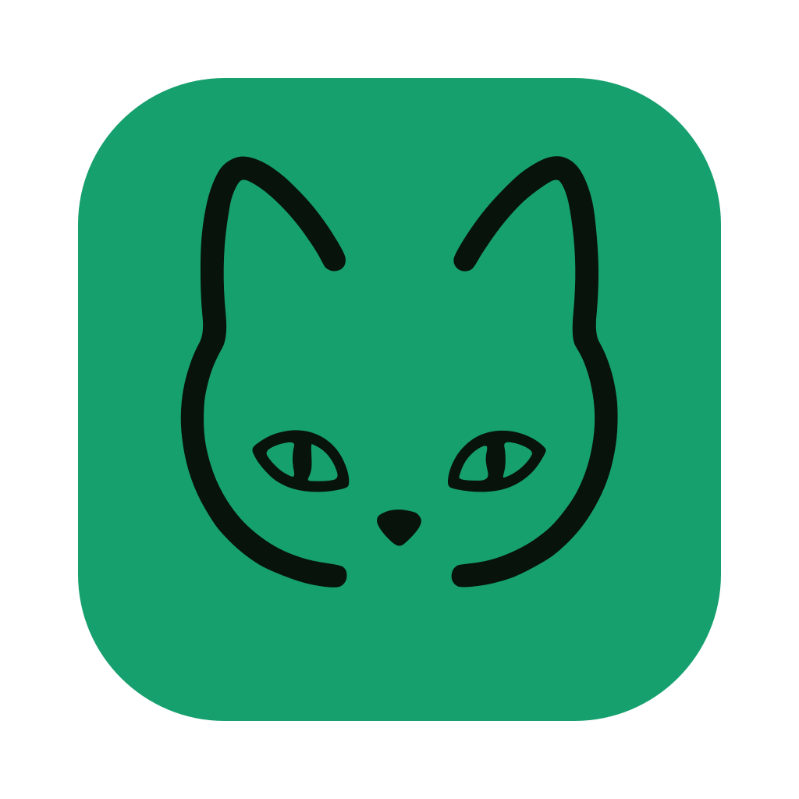
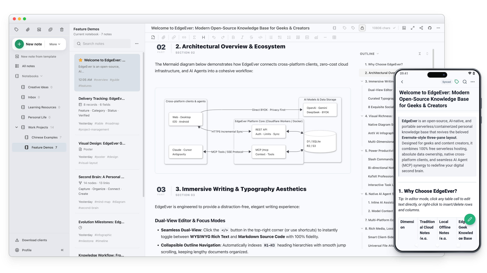

<div align="center">
  <h1>
     EdgeEver
  </h1>
  <p>
    <b>Base de connaissances native pour l'IA et alternative à Evernote/Obsidian. Synchronisation instantanée multiplateforme, notes riches (tableaux, cartes mentales, diagrammes, posters), web clipper et MCP. 100 % gratuit sur Cloudflare ou avec Docker.</b>
  </p>
  <p>
    <a href="https://github.com/tianma-if/edgeever/stargazers"></a>
    <a href="https://github.com/tianma-if/edgeever/network/members"></a>
    <a href="https://github.com/tianma-if/edgeever/releases"></a>
    <a href="https://github.com/tianma-if/edgeever/pkgs/container/edgeever"></a>
    <a href="https://www.producthunt.com/products/edgeever?utm_source=other&utm_medium=social"></a>
    <a href="https://hellogithub.com/repository/tianma-if/edgeever" target="_blank"></a>
    <a href="#sponsor--support"></a>
  </p>
  <p>
    <a href="README.zh-CN.md">简体中文</a> | <a href="README.zh-TW.md">繁體中文</a> | <a href="README.md">English</a> | <a href="README.es.md">Español</a> | <a href="README.de.md">Deutsch</a> | <b>Français</b> | <a href="README.ja.md">日本語</a> | <a href="README.pl-PL.md">Polski</a> | <a href="README.ru.md">Русский</a>
  </p>
  <p>
    <a href="https://t.me/+GvKYnL37feUwOTNl"> Groupe Telegram</a> &nbsp;|&nbsp;
    <a href="https://demo.edgeever.org">🌐 Démo en ligne</a> &nbsp;|&nbsp;
    <a href="https://github.com/users/tianma-if/projects/1">🗺️ Feuille de route</a> &nbsp;|&nbsp;
    <a href="#all-platform-clients--browser-extension">📱 Clients et extension</a> &nbsp;|&nbsp;
    <a href="#features">Matrice des fonctionnalités et capacités</a> &nbsp;|&nbsp;
    <a href="docs/note-migration-guide.en-US.md">📥 Migration de notes</a>
  </p>
  <p align="center">
    
  </p>
</div>

EdgeEver est un espace de travail moderne et open source pour vos notes et votre base de connaissances. Il préserve le flux de travail classique et ultra-efficace à trois volets (Arborescence · Liste des notes · Éditeur), tout en offrant une architecture de données ouverte et une intégration fluide d'agents IA pour un contrôle total de vos données et une productivité intelligente.

> 💡 **Serverless & 100 % gratuit pour toujours**
> EdgeEver fonctionne dans les limites des quotas gratuits de Cloudflare, sans achat de serveur ni maintenance de VPS. Les utilisateurs préférant un VPS, un NAS ou un serveur domestique peuvent déployer la même application avec Docker.

> ⭐ Si EdgeEver vous est utile, n'hésitez pas à lui attribuer une étoile (Star) sur GitHub. Votre soutien aide d'autres utilisateurs à découvrir le projet.

## Pourquoi EdgeEver

De nombreux utilisateurs d'**applications de prise de notes et de bases de connaissances personnelles** recherchent simplement un outil **fiable, ouvert et rapide**. Pourtant, les solutions existantes imposent toutes des compromis :

* **Evernote** : Propose l'expérience de synchronisation cloud multi-appareils la plus fluide et transparente. Cependant, son évolution vers une suite commerciale lourde s'est accompagnée d'une multiplication des publicités et des modules superflus, alourdissant le système. Dans le même temps, les quotas du forfait gratuit ont été drastiquement réduits, les abonnements IA premium sont devenus très onéreux, et l'intégration dans des flux de travail IA privés et auto-hébergés reste complexe.
* **Obsidian** : Fichiers ouverts, mais cœur propriétaire et fermé. La synchronisation officielle est payante et les solutions tierces sont fastidieuses. Le fonctionnement reposant entièrement sur l'analyse de fichiers locaux bruts engendre des ralentissements notables au démarrage à froid et lors de la recherche dès que les notes se comptent par milliers ou que des plugins lourds sont activés. Stocker les images et pièces jointes au sein des coffres fait rapidement gonfler leur taille, rendant la synchronisation mobile léthargique et laissant des fichiers orphelins. Enfin, l'application est bien trop lourde pour une prise de notes rapide et instantanée au quotidien.
* **Joplin** : Une application open source historique à trois volets, mais son interface utilisateur et son expérience d'édition semblent figées dix ans en arrière, manquant de fluidité et de modernité. La synchronisation officielle rapide (Joplin Cloud) exige un abonnement payant ; la synchronisation gratuite via WebDAV ou disques cloud repose sur une scrutation fichier par fichier qui devient lente sur mobile à mesure que les notes et pièces jointes s'accumulent. De plus, auto-héberger Joplin Server nécessite de gérer un serveur dédié sans option serverless gratuite. Enfin, il lui manque un espace de travail web complet dans le navigateur et des capacités natives pour les agents IA (MCP/ACP).
* **Memos et flux chronologiques (flomo)** : Épurés et simples, mais leur présentation sous forme de fil d'actualité façon réseau social diffère fondamentalement de la productivité structurée offerte par un flux de travail classique à trois volets.
* **SiYuan et outils PKM basés sur des blocs** : Puissants et compatibles avec l'auto-hébergement, mais leur architecture granulaire par « blocs » impose une charge cognitive non négligeable pour les captures rapides du quotidien et la rédaction suivie de longs textes. En outre, ils ne proposent aucune formule de déploiement serverless gratuite, et la synchronisation multi-appareils dépend d'abonnements officiels payants ou nécessite un paiement supplémentaire pour débloquer les fonctionnalités de synchronisation S3/WebDAV avec son propre stockage.

**EdgeEver comble ce vide** : L'ensemble de la pile est open source, offrant une **synchronisation cloud multi-appareils instantanée, fluide et à faible latence**, avec une liberté totale d'auto-hébergement. Il conserve la disposition à trois volets que vous connaissez bien, reste ultra-fluide et réactif même avec plus de 10 000 notes, et intègre des agents IA natifs, le tout avec un coût de déploiement nul.

## Démo en ligne

- Démo : [https://demo.edgeever.org](https://demo.edgeever.org)

La démo publique est réinitialisée automatiquement chaque jour à 3h00 (heure normale de Chine, UTC+8) et rétablit les notes d'exemple. N'y stockez aucun contenu confidentiel.

<a id="all-platform-clients--browser-extension"></a>
<a id="clients-et-extension"></a>
## Clients sur toutes les plateformes et extension de navigateur

### Téléchargement des clients

<p>
  <a href="https://github.com/tianma-if/edgeever/releases/latest"></a>&nbsp;&nbsp;
  <a href="https://github.com/tianma-if/edgeever/releases/latest"></a>&nbsp;&nbsp;
  <a href="https://github.com/tianma-if/edgeever/releases/latest"></a>&nbsp;&nbsp;
  <a href="https://play.google.com/store/apps/details?id=org.edgeever.mobile"></a>&nbsp;&nbsp;
  <a href="https://apps.apple.com/us/app/edgeever/id6792625631"></a>
</p>

> L'application iOS nécessite un identifiant Apple ID situé en dehors de la Chine continentale.

### Extension de capture web pour navigateur (Web Clipper)

<p>
  <a href="https://chromewebstore.google.com/detail/edgeever-web-clipper/gjadpfmanienmlofajibkfkkpfdkclgo"></a>&nbsp;&nbsp;
  <a href="https://chromewebstore.google.com/detail/edgeever-web-clipper/gjadpfmanienmlofajibkfkkpfdkclgo"></a>&nbsp;&nbsp;
  <a href="https://addons.mozilla.org/firefox/addon/edgeever-web-clipper/"></a>
</p>

- Extrayez du Markdown propre à partir d'articles web ou capturez directement du texte et des images sélectionnés vers votre instance auto-hébergée.
- Capture structurée approfondie pour plus de 20 plateformes : réseaux sociaux (X, Xiaohongshu, WeChat, Jike, Douban, Threads, Bluesky), communautés de lecture et tech (Zhihu, Reddit, GitHub, V2EX, Hacker News, Medium, Substack) et médias/podcasts (Bilibili, YouTube, Xiaoyuzhou).

<a id="features"></a>
## Matrice des fonctionnalités et capacités

Un espace de travail tout-en-un reliant la capture d'inspiration, la création approfondie et la capitalisation des connaissances (👉 **[Découvrez 19 cas pratiques détaillés avec captures d'écran](docs/best-practices.md)**) :

| Module | Fonctionnalités clés | Fonctionnalités avancées |
| :--- | :--- | :--- |
| **Écriture et édition** | • Disposition classique à 3 volets avec largeur de panneaux ajustable<br>• Bascule instantanée entre éditeur visuel WYSIWYG et Markdown brut<br>• Coloration syntaxique, formules mathématiques, listes de tâches et mode concentration<br>• Sauvegarde automatique à la seconde, synchronisation instantanée multi-appareils et historique des révisions | • **Notes poster natives** : Dispositions visuelles sur canevas sous forme de cartes structurées, éditables par double-clic<br>• **Mise en page pour compte officiel WeChat** : Copie en un clic avec CSS inline pour newsletters et blogs<br>• **Exportation d'images poster** : Thèmes soignés, avatars monogrammes ; export en MD, HTML ou PDF<br>• **Outils de productivité sur ordinateur** : Capture de zone d'écran par raccourci global vers une note, réenregistrement automatique des pièces jointes modifiées en externe et édition multi-fenêtres |
| **Organisation et recherche** | • Arborescence de carnets et dossiers à profondeur infinie<br>• Système d'étiquettes, réorganisation par glisser-déposer, fusion et déplacement de notes par lot<br>• Recherche plein texte à la milliseconde avec filtres temporels | • **Publication indépendante de bases de connaissances** : Publiez des carnets entiers en un clic sous forme de sites de documentation statiques avec navigation arborescente et protection par mot de passe<br>• **Migration en un clic depuis des apps tierces** : Importation graphique native depuis flomo, Evernote, Obsidian et Joplin avec notes complètes, arborescence et pièces jointes<br>• Espaces multi-utilisateurs et isolation physique des données par locataire |
| **Capture et médias** | • Import universel de pièces jointes (PDF, suite Office, audio/vidéo, archives)<br>• Capture précise de texte et d'images web via l'extension de navigateur<br>• Feuille de partage mobile pour enregistrer photos et articles | • **Capture structurée approfondie multiplateforme** : Adaptée en profondeur pour Xiaohongshu, X (Twitter), Zhihu, Reddit, GitHub, YouTube, Bilibili et plus de 20 sources<br>• **Archivage de conversations WeChat** : Import complet de transcriptions en un clic avec horodatages, citations, émojis et médias<br>• **Compression d'images silencieuse côté client** : Réduction automatique de 50 % à 90 % de la taille ; le streaming par fragments prend en charge des fichiers jusqu'à 1 Gio en toute sécurité<br>• **Stockage objet OSS et hébergement d'images sur ordinateur** : Stockage compatible S3 par instance ; envoi direct depuis le bureau via PicGo / PicList et CloudFlare ImgBed |
| **Données et visuels** | • Édition native de tableaux et rendu de tableaux en Markdown<br>• Diagrammes Mermaid natifs (diagrammes de flux, de séquence, architecture) | • **Bases de données multidimensionnelles par IA** : Création de bases de données à partir de prompts avec typage automatique des champs (étiquettes, dates, sélecteurs)<br>• **Formulaires publics de collecte en ligne** : Formulaires partageables en un clic sans inscription, synchronisant les réponses en temps réel dans les tableaux<br>• **Génération d'infographies et diagrammes par IA** : Création in situ de frises chronologiques, graphiques comparatifs, matrices de quadrants et cartes mentales |
| **IA et écosystème** | • Assistant IA en barre latérale pour résumer, corriger et traduire<br>• BYOK (Apportez votre propre clé API) : compatible avec OpenAI, Claude, Gemini et endpoints personnalisés | • **Protocoles d'agents natifs (MCP et ACP)** : MCP intégré pour la lecture/écriture par des agents externes ; ACP dans l'application de bureau pour piloter directement des agents locaux comme Codex, Claude Code et CodeBuddy<br>• **Transcription audio et vidéo par IA** : Extraction et découpage de la piste audio côté client, connexion directe aux modèles vocaux compatibles OpenAI pour transcrire et insérer le texte dans les notes<br>• **API de plugins ouverte et écosystème de thèmes** : Installation en un clic depuis le marché ou GitHub avec synchronisation multi-appareils ; permet de lire/écrire des notes et d'interagir avec l'éditeur, d'ajouter des panneaux et commandes personnalisés, d'appeler l'IA, de planifier des tâches sur ordinateur et de personnaliser les thèmes sans code |
| **Synchronisation multi-appareils et socle système** | • Synchronisation fluide et à faible latence sur bureau, mobile et web, sans limite d'appareils<br>• Clients officiels disponibles sur le Web, macOS, Windows, Linux, iOS et Android<br>• Priorité au mode hors ligne (offline-first) avec file de synchronisation automatique : écrivez confortablement sans connexion, reprise et synchronisation automatiques dès reconnexion<br>• Base de données SQLite standard, sauvegarde ZIP sans perte et export/import Markdown | • **Zéro coût d'infrastructure à vie** : Fonctionne à 100 % sur le forfait gratuit de Cloudflare (~150 000 notes courtes et ~50 000 images)<br>• **Auto-hébergement Docker flexible** : Déploiement en un clic pour VPS, NAS ou serveur domestique, capable de gérer des millions de notes avec synchronisation instantanée<br>• **Sauvegarde automatique sur ordinateur** : Sauvegardes locales planifiées avec rétention multi-instantanés, chiffrement optionnel par mot de passe et copie distante automatique via WebDAV<br>• Protection anti-brute force côté serveur, authentification à deux facteurs TOTP (2FA), gestion des sessions d'appareils et isolation des locataires |

## Déploiement

Cloudflare est l'option recommandée pour un déploiement serverless sans infrastructure à gérer. Docker est disponible pour les utilisateurs qui préfèrent un VPS, un NAS ou un serveur domestique.

Pour Cloudflare, choisissez l'une des options de déploiement en ligne suivantes :

### Option A : Déploiement avec un agent IA (Recommandé)

Copiez l'invite (prompt) ci-dessous directement dans un agent IA (tel que Codex, Claude, Cursor, WorkBuddy, Antigravity, OpenClaw, Hermes Agent, etc.). Durant l'exécution, si un accès à GitHub ou Cloudflare est requis, vérifiez les autorisations demandées et suivez les instructions pour valider l'accès.

```text
Déployer EdgeEver intégralement via GitHub et Cloudflare :
1. Forker https://github.com/tianma-if/edgeever.
2. Créer la base de données D1 `edgeever` et le bucket R2 `edgeever-resources` dans Cloudflare.
3. Dans Workers & Pages, sélectionner « Start with Hello World! » et créer un Worker nommé `edgeever`.
4. Ajouter le mot de passe choisi par l'utilisateur en tant que Secret d'exécution `EDGE_EVER_AUTH_PASSWORD`
   sous Settings → Variables and Secrets, et déployer le Secret (de préférence d'au moins
   32 caractères). Le nom d'utilisateur par défaut est `admin`.
5. Seulement après le déploiement du Secret, ouvrir Settings → Builds → Connect de ce Worker
   et connecter la branche `main` du Fork.
6. Dans Settings → Builds → API token de ce Worker, sélectionner ou créer le jeton d'API Cloudflare utilisé pour le déploiement, avec les autorisations de lecture/écriture D1 pour le compte cible.
7. Dans le dépôt GitHub du Fork, ouvrir Actions → Update deployed EdgeEver, activer le workflow si demandé, et sélectionner Run workflow sur `main`. Après avoir confirmé dans Cloudflare que la compilation a réussi et que le déploiement est terminé, vérifier `/api/health` et `/api/openapi.json`, puis se connecter avec le nom d'utilisateur et le mot de passe administrateur.
   Ce workflow synchronisera automatiquement les futures versions stables et correctifs.
```

> Instructions détaillées : [Déploiement Cloudflare avec un agent IA](docs/agent-deploy-cloudflare.md).

### Option B : Déploiement manuel en ligne

<details>
<summary>📖 Cliquez pour afficher : Guide de déploiement manuel en 7 étapes sur le Web</summary>

Suivez scrupuleusement ces 7 étapes dans l'ordre :

1. **Forker le dépôt** : Cliquez sur **Fork** en haut à droite sur GitHub pour copier EdgeEver sur votre compte personnel.
2. **Créer les ressources Cloudflare** : Créez la base de données D1 `edgeever` et le bucket R2 `edgeever-resources`.
3. **Créer le Worker** : Dans Cloudflare Workers & Pages, sélectionnez Create application → Start with Hello World!, nommez le Worker `edgeever` et déployez-le. Cela crée un placeholder ; EdgeEver sera déployé à l'étape 7.
4. **Définir le mot de passe administrateur** : Sous Settings → Variables and Secrets du Worker, ajoutez `EDGE_EVER_AUTH_PASSWORD` avec le type Secret et cliquez sur Deploy. Sa valeur correspond à votre mot de passe de connexion, idéalement de 32 caractères ou plus. Réalisez cette étape avant de connecter le Fork.
5. **Connecter le Fork** : Dans Settings → Builds → Connect du Worker existant, sélectionnez votre Fork et la branche de production `main`.
6. **Configurer les autorisations de déploiement** : Dans Settings → Builds → API token de ce Worker, sélectionnez ou créez le jeton d'API Cloudflare utilisé pour le déploiement, disposant des droits de lecture/écriture D1 sur le compte cible.
7. **Compiler et vérifier** : Dans le dépôt GitHub de votre Fork, ouvrez Actions → Update deployed EdgeEver, activez le workflow si demandé, puis sélectionnez Run workflow sur la branche `main`. Une fois la compilation et le déploiement validés dans Cloudflare, vérifiez que `/api/health` renvoie le statut `200` et testez la connexion. Ce workflow synchronisera automatiquement les prochaines versions stables et correctifs.

> 📖 Pour les instructions complètes pas à pas et le détail des configurations, consultez le [Guide de déploiement en ligne](docs/deploy-cloudflare-button.md).

</details>

<details>
<summary>📌 Remarques sur le déploiement Cloudflare (domaine personnalisé & quota gratuit R2)</summary>

> **Domaine personnalisé & accès** : Après le déploiement, vous pouvez utiliser directement le sous-domaine par défaut `*.workers.dev` attribué par Cloudflare, ou associer votre propre nom de domaine personnalisé dans les paramètres du Worker sous **Settings → Domains & Routes**.
>
> **Activation de Cloudflare R2** : Bien que Cloudflare R2 propose un [forfait de stockage gratuit](https://developers.cloudflare.com/r2/pricing/#free-tier) très généreux et largement suffisant pour une utilisation normale de prise de notes, vous devez d'abord activer l'abonnement R2 et renseigner un moyen de paiement. Cloudflare [prend officiellement en charge](https://developers.cloudflare.com/billing/get-started/update-billing-info/#supported-payment-methods) les cartes bancaires (Visa, Mastercard, UnionPay, etc.) ainsi que PayPal, Apple Pay, Google Pay et d'autres moyens de paiement.

</details>

### Option C : Docker sur VPS ou NAS

Docker exécute la même interface utilisateur, les mêmes routes d'API, services, authentification, implémentation MCP et migrations que la version Cloudflare. Le conteneur s'appuie sur SQLite avec stockage local de fichiers ou stockage d'objets compatible S3 pour les pièces jointes, et prend en charge les architectures `amd64` et `arm64`. Consultez [Déployer EdgeEver avec Docker](docs/deploy-docker.md) et [Architecture d'auto-hébergement et Docker](docs/self-hosting-architecture.md).

Utilisez le script d'installation hébergé sur GitHub et l'image officielle GHCR :

```sh
curl -fsSL https://edgeever.org/install.sh | bash
```

Cette commande télécharge la dernière image, génère un mot de passe administrateur et démarre EdgeEver via Docker Compose.

Consultez le [guide de déploiement Docker](docs/deploy-docker.md) pour les instructions de déploiement manuel et de configuration.

Après l'installation, les mises à jour s'exécutent automatiquement chaque jour par défaut. Pour mettre à jour manuellement, lancez `~/edgeever/update.sh` sur le serveur de déploiement.

---

## Configuration avancée et administration

### Sauvegarde, exportation et migration des données

Que ce soit pour des sauvegardes régulières, une migration sans heurts entre instances ou pour quitter une autre plateforme de notes, EdgeEver garantit une mobilité complète et fiable de vos données :

- **Sauvegarde et restauration natives d'EdgeEver** : Dans l'application, rendez-vous dans **Profil** -> **Importation et exportation** pour exporter ou importer une archive ZIP EdgeEver à tout moment. Le répertoire extrait `notes/` conserve des fichiers Markdown en texte brut lisibles ainsi que les pièces jointes pour un archivage local ou une consultation directe, tandis que les métadonnées internes structurées permettent une restauration intégrale sans perte sur une autre instance EdgeEver. L'importation préserve les données existantes non concernées sur l'instance cible et remplace automatiquement les entrées dont les identifiants correspondent.
- **Sauvegarde planifiée sur ordinateur et copie distante** : Dans les paramètres **Sauvegarde et importation** de l'application de bureau, vous pouvez activer les sauvegardes locales planifiées (hebdomadaires ou mensuelles) avec dossier personnalisé et nombre d'instantanés conservés, générant automatiquement des archives ZIP standard ou chiffrées `.edgeever.enc` dès qu'un contenu change, avec envoi automatique vers un NAS ou stockage WebDAV après chaque sauvegarde locale.
- **Migration fluide depuis des applications tierces** : Qu'il s'agisse d'un import en un clic via l'interface graphique native (prenant en charge les notes complètes, l'arborescence et les pièces jointes depuis Evernote, Obsidian et Joplin) ou d'une migration depuis Notion, flomo, Memos et d'autres plateformes via un agent IA et MCP, EdgeEver assure une transition de données fluide et éprouvée. Consultez le [Guide de migration depuis des applications tierces](docs/note-migration-guide.en-US.md).

### Intégration IA et protocole MCP

Générez un jeton d'API dans **Profil** -> **API / MCP** et copiez la configuration Remote MCP en un clic pour permettre à des agents IA comme Claude Code, Cursor, Antigravity et OpenClaw de gérer votre base de connaissances en toute sécurité selon les autorisations de votre compte. EdgeEver prend en charge le cycle complet CRUD pour les notes textuelles, les notes de diagrammes visuels (cartes mentales, organigrammes et schémas d'architecture), les notes de tableaux structurés et les notes poster natives. Les agents peuvent également organiser l'arborescence des carnets, les étiquettes, les pièces jointes, l'historique des versions, les modèles de notes et les instructions IA.

Pour la configuration des clients, les niveaux d'accès des jetons, le dépannage et des règles suggérées pour les agents, consultez [Using EdgeEver with MCP clients](docs/mcp-guide.md) (en anglais).

> 💡 **Inspiration :**
> Faites de l'IA votre véritable chef d'orchestre des connaissances et votre copilote créatif : transformez instantanément des concepts en cartes mentales interactives, organigrammes, diagrammes d'architecture et tableaux structurés, tout en fournissant un contexte privé à vos agents IA. Associé à l'éditeur de texte enrichi performant et à la typographie soignée d'EdgeEver, le contenu assisté par IA devient un ensemble de connaissances élégamment structuré, soigné et prêt pour la publication.

### Connexion multi-comptes et gestion du stockage

Une fois déployée, une seule instance prend en charge la connexion de plusieurs comptes utilisateurs.

L'administrateur de l'instance peut créer, désactiver ou réinitialiser les comptes membres dans **Profil** -> **Comptes utilisateurs**. Chaque membre bénéficie d'un espace de travail personnel totalement isolé, comprenant carnets, notes, pièces jointes, corbeille, import/export et jetons MCP. Un tableau de bord intuitif sur l'utilisation du stockage offre une visibilité en temps réel sur l'espace consommé par les pièces jointes sur l'ensemble de l'instance ainsi que par chaque compte individuel.

### Extension du stockage et hébergement d'images tiers

- **Stockage d'objets OSS** : Le propriétaire de l'instance peut configurer un stockage d'objets compatible S3 dans **Paramètres → Avancé → Stockage d'objets OSS**. Changer de stockage ne migre ni n'altère les pièces jointes existantes.
- **Intégration PicGo dans l'application de bureau** : L'application de bureau peut transmettre les images insérées à un serveur PicGo ou PicList local ou hébergé sur une autre machine de confiance (ex. un NAS). Ce serveur les téléverse ensuite vers GitHub, SM.MS, Upyun, Qiniu ou un hébergeur d'images personnalisé. L'adresse doit simplement se terminer par `/upload`, ce qui fonctionne également avec PicList derrière un reverse proxy.
- **CloudFlare ImgBed dans l'application de bureau** : L'application de bureau peut également téléverser les images insérées directement vers votre instance auto-hébergée de [CloudFlare ImgBed](https://github.com/MarSeventh/CloudFlare-ImgBed) via un jeton d'API. Le dossier de destination accepte les variables de chemin de type PicList, telles que `{Y}/{m}/{d}` et `{memoId}`.

### Plugins et thèmes

Les applications web et de bureau prennent en charge des plugins fonctionnels et des thèmes personnalisés, installables depuis la marketplace officielle, GitHub ou une URL de Manifeste, avec une synchronisation transparente sur l'ensemble de votre espace de travail. Les développeurs peuvent enrichir les fonctionnalités à l'aide de `@edgeever/plugin-api` ; consultez le [guide de développement de plugins](docs/plugin-development.md) et la [politique de publication sur la marketplace](docs/plugin-marketplace-policy.md).

---

## Guide du développeur et contributions

### Démarrage rapide

```sh
bun install
bun run dev
```

L'environnement de développement local se connecte automatiquement ; les nouvelles bases de données utilisent les identifiants `owner` / `edgeever-local-dev`. Déconnectez-vous pour tester l'écran de connexion.

### Architecture et pile technologique

#### Pile technologique

- Monorepo géré avec Bun workspace regroupant le Web, l'API, le site officiel et le paquet de types partagés.
- Frontend : Vite, React, React Router, TanStack Query, Tailwind CSS, shadcn/ui et Radix UI.
- Éditeur : TipTap / ProseMirror avec support du Markdown ; la PWA s'appuie sur vite-plugin-pwa, Workbox et Dexie.
- Application Android : Expo + React Native dans `apps/mobile`, avec stockage local SQLite et synchronisation incrémentielle.
- Application iOS : SwiftUI natif dans `apps/ios` (iOS 17+), avec TipTap EditorBundle intégré, miroir local/boîte d'envoi via GRDB et interface cohérente avec la version Android.
- Application de bureau native : Electron + sidecar Rust combinant une expérience multiplateforme homogène et des services de données locaux haute performance ; SQLite permet l'édition hors ligne, la synchronisation incrémentielle lors du retour en ligne et les sauvegardes locales.
- Web clipper : Manifest V3, Mozilla Readability et Turndown pour Chrome, Microsoft Edge et Firefox.
- Backend : une application métier unifiée Hono/Zod avec API REST et Remote MCP ; Cloudflare s'appuie sur Workers/D1/R2, tandis que Docker utilise Bun/SQLite/fichiers locaux ou S3.
- Site officiel : Site statique développé avec Astro dans `apps/site`, déployable sur Cloudflare Pages.

#### Structure du projet

<details>
<summary>📁 Déplier pour afficher : Structure du projet en monorepo</summary>

```text
apps/web          Frontend Vite + React, PWA, brouillons hors ligne et file de synchronisation
apps/extension    Web clipper Manifest V3 pour Chrome/Edge/Firefox
apps/api          Worker Cloudflare + API Hono, point d'entrée MCP
apps/mobile       Application Android Expo + React Native
apps/ios          Application iOS native en SwiftUI (TipTap EditorBundle, GRDB)
apps/desktop      Shell Electron de bureau, pont de préchargement et empaquetage natif
apps/site         Site web officiel Astro, déployable indépendamment
packages/client   Client d'API partagé pour les applications web et mobiles
packages/shared   Types partagés, schémas Zod, conversion TipTap / Markdown
crates/desktop-sidecar
                  Sidecar Rust pour SQLite local, données hors ligne, sauvegardes et ressources
scripts           Scripts utilitaires Wrangler, hachage de mot de passe, CLI, pont stdio MCP, import ENEX Evernote
migrations        Migrations de base de données partagées D1/SQLite (ajouts uniquement)
docs              Documentation d'architecture, de migration et de déploiement
.github/workflows CI pour web, mobile, iOS, packaging desktop, déploiement et releases
wrangler.toml     Configuration Cloudflare Workers, Assets, D1, R2
```

</details>

#### Modèle de stockage des données

EdgeEver conserve le contenu des notes simultanément sous trois formats afin d'équilibrer les performances d'édition, l'interopérabilité ouverte et la rapidité de la recherche plein texte :

```text
content_json      Document TipTap/ProseMirror, source de vérité de l'éditeur
content_markdown  Interopérabilité avec l'API, les agents, l'exportation et l'écosystème externe
content_text      Recherche plein texte, génération de résumés et indexation
```

### Mécanismes fondamentaux et choix de conception

- **Compression silencieuse côté client** : Pour éviter de consommer du quota de calcul sur des environnements serverless comme Cloudflare Workers, la compression des images est effectuée dans le client Web avant le téléversement (conversion des formats PNG/JPEG/WebP/AVIF en WebP lorsque c'est avantageux, dimension maximale de 2560 px ; le fichier original est conservé si la compression ne réduit pas la taille). Les points de terminaison d'API REST et MCP stockent directement les fichiers binaires transmis par le client sans transcodage supplémentaire côté serveur.
- **Priorité au mode hors ligne (Offline-First) & fréquence de synchronisation** : Les clients Web, PWA et de bureau téléversent automatiquement les modifications apportées aux notes après 30 secondes d'inactivité de frappe, et interrogent les modifications distantes toutes les 5 minutes lorsque l'application est visible ; le retour au premier plan de la fenêtre et l'actualisation manuelle restent instantanés. Ces paramètres sont configurables via `DEFERRED_MEMO_SYNC_DELAY_MS` et `BACKGROUND_WORKSPACE_REFRESH_INTERVAL_MS` dans [`apps/web/src/lib/workspace-refresh.ts`](apps/web/src/lib/workspace-refresh.ts).

### Contribuer au code

Les contributions de la communauté sont chaleureusement bienvenues ! Veuillez garder à l'esprit les consignes suivantes :

- Veuillez consulter le [Guide de contribution](CONTRIBUTING.md) avant de soumettre du code.
- **Isolation de l'environnement de déploiement** : Si votre Fork GitHub sert également à déployer EdgeEver, conservez sa branche `main` propre et exclusivement dédiée au déploiement. Créez une branche distincte à partir de la branche officielle `upstream/main` pour vos fonctionnalités, correctifs et pull requests ; ne développez pas et n'exécutez pas Sync fork directement sur la branche `main` de déploiement.

---

## Communauté et retours

- **Tickets & suggestions** : Pour signaler des bugs, proposer des fonctionnalités ou poser des questions sur le déploiement, veuillez ouvrir un ticket sur [GitHub Issues](https://github.com/tianma-if/edgeever/issues) afin d'enrichir la base de connaissances consultable par la communauté.

### Communauté Telegram

Bienvenue dans la communauté EdgeEver, réunissant développeurs et créateurs explorant le vibe coding et l'IA. Rejoignez-nous pour échanger sur la productivité de pointe propulsée par l'IA et les meilleures pratiques pour vos bases de connaissances personnelles.

👉 [Rejoindre le groupe Telegram d'EdgeEver](https://t.me/+GvKYnL37feUwOTNl)

## Liens partenaires

- [LINUX DO](https://linux.do/) — Une communauté d'échange sur les technologies et les projets open source.

<a id="sponsor--support"></a>
<a id="parrainage-et-soutien"></a>
## Parrainage et soutien

EdgeEver est un projet gratuit et open source. Poursuivre le développement des clients multiplateformes, les tests réguliers sur différents appareils, la signature de code et la maintenance de l'écosystème sur plusieurs environnements d'exécution requiert un investissement continu et des ressources.

- [Soutenir EdgeEver](docs/sponsor.md) — Don volontaire via WeChat Pay ou Alipay
- [Parrains et partenaires](docs/partners.md) — Soutien en infrastructure, outils de développement, services ou partenariats communautaires

## Remerciements

- La conception du produit de prise de notes d'EdgeEver s'est également inspirée de l'expérience utilisateur publiquement accessible d'outils de prise de notes reconnus tels qu'[Evernote](https://evernote.com/) et [Notion](https://www.notion.com/). Les fonctionnalités associées ont été conçues et développées de manière totalement indépendante par EdgeEver.
- La conception des notes de cartes mentales et de diagrammes visuels s'est inspirée de l'expérience utilisateur publiquement accessible d'[XMind](https://xmind.com/) et de [ProcessOn](https://www.processon.com/). Ces fonctionnalités ont été conçues et développées de manière indépendante par EdgeEver.
- L'espace de conception de posters d'EdgeEver s'inspire du projet [Qiaomu Design](https://github.com/joeseesun/qiaomu-cover-design) créé par 向阳乔木 (joeseesun), et adapte ses modèles ainsi que son moteur typographique sous licence MIT.
- Les thèmes visuels et la typographie des cartes de partage d'images d'EdgeEver ont été inspirés par [Firefly Card (流光卡片)](https://fireflycard.shushiai.com/). Merci pour cette inspiration graphique.
- La publication WeChat en un clic et la mise en page des articles d'EdgeEver s'inspirent de [gzh-design-skill](https://github.com/isjiamu/gzh-design-skill) créé par isjiamu. Merci pour l'inspiration apportée à la mise en page et au design.

## Marques et utilisation de la marque

Le nom EdgeEver, son logo et les autres éléments d'identité de marque identifient le projet officiel. Les forks et versions modifiées peuvent indiquer qu'ils sont basés sur EdgeEver, mais ne doivent en aucun cas suggérer une affiliation officielle ou induire les utilisateurs en erreur. La licence open source ne confère aucun droit d'utilisation de marque ; tout autre usage nécessite l'autorisation écrite préalable des mainteneurs du projet.

## Clause de non-responsabilité

EdgeEver est une application de prise de notes open source indépendante, développée et maintenue par des contributeurs individuels et la communauté. Elle n'est en aucun cas affiliée, autorisée, sponsorisée ou approuvée par Evernote Corporation ou ses filiales.

EdgeEver est un logiciel auto-hébergé. À l'exception des instances de démonstration officielles, les mainteneurs du projet n'hébergent, ne contrôlent ni n'examinent le contenu des utilisateurs. Les contenus stockés ou affichés par une instance relèvent de la seule responsabilité de ses utilisateurs ou administrateurs et ne reflètent pas les opinions des mainteneurs.

## Contributeurs

<!-- readme-contributors:start -->
<p align="left">
  <a href="https://github.com/tianma-if"></a>
  <a href="https://github.com/dkoryto"></a>
  <a href="https://github.com/sivdead"></a>
  <a href="https://github.com/yulei666"></a>
  <a href="https://github.com/thorufur"></a>
  <a href="https://github.com/arsaboo"></a>
  <a href="https://github.com/alyyasser"></a>
  <a href="https://github.com/MadlyFX"></a>
  <a href="https://github.com/claude"></a>
  <a href="https://github.com/Crowszzz"></a>
  <a href="https://github.com/CottonChou"></a>
  <a href="https://github.com/Z-DDV"></a>
  <a href="https://github.com/0xfelixli"></a>
  <a href="https://github.com/Sergmay911"></a>
  <a href="https://github.com/X77seven"></a>
  <a href="https://github.com/imgdown"></a>
  <a href="https://github.com/mookim-eth"></a>
  <a href="https://github.com/nzhdotme"></a>
  <a href="https://github.com/Shunamxiao"></a>
</p>
<!-- readme-contributors:end -->
