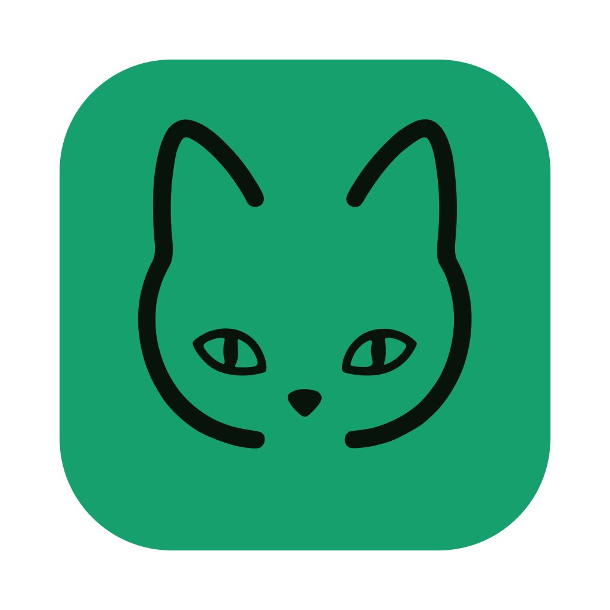

<div align="center">
  <h1>
     EdgeEver
  </h1>
  <p>
    <b>AI ネイティブ知識ベース、瞬時マルチデバイス同期＆ネイティブ MCP を備えた Evernote / Obsidian 代替ツール。Cloudflare 無料運用または Docker 自前運用</b>
  </p>
  <p>
    <a href="https://github.com/tianma-if/edgeever/stargazers"></a>
    <a href="https://github.com/tianma-if/edgeever/network/members"></a>
    <a href="https://github.com/tianma-if/edgeever"></a>
    <a href="https://github.com/tianma-if/edgeever/pkgs/container/edgeever"></a>
    <a href="https://www.producthunt.com/products/edgeever?utm_source=other&utm_medium=social"></a>
    <a href="https://hellogithub.com/repository/tianma-if/edgeever" target="_blank"></a>
    <a href="#スポンサーと支援"></a>
  </p>
  <p>
    <a href="README.zh-CN.md">简体中文</a> | <a href="README.zh-TW.md">繁體中文</a> | <a href="README.md">English</a> | <b>日本語</b> | <a href="README.pl-PL.md">Polski</a>
  </p>
  <p>
    <a href="https://t.me/+wwUx1BYLrIdiZjY1"> Telegram グループ</a> &nbsp;|&nbsp;
    <a href="https://demo.edgeever.org">🌐 オンラインデモ</a> &nbsp;|&nbsp;
    <a href="#全プラットフォームクライアントと拡張機能">📱 クライアントと拡張機能</a> &nbsp;|&nbsp;
    <a href="#features">機能とワークフローマトリクス</a>
  </p>
  <p align="center">
    
  </p>
</div>

EdgeEver は、オープンソースのノートと知識ベースの作業領域です。クラシックで高効率な三ペインの作業体験（ツリー階層・ノート一覧・エディタ）を継承しつつ、データを自分で持ち、AI Agent と連携できます。

> 💡 **サーバーレス、ずっと無料**
> EdgeEver は Cloudflare の無料枠内で動かせ、サーバーを借りたり保守したりする必要はありません。VPS、NAS、自宅サーバーを使いたい場合は、同じアプリを Docker で導入できます。

> ⭐ EdgeEver が役に立ったら、Star をお願いします。発見のきっかけになります。

## なぜ EdgeEver か

多くの**ノートアプリや個人知識ベース**のユーザーが求めているのは、**信頼でき、開かれていて、速い**個人知識ベースです。よくある代替には、それぞれ代償があります。

* **Evernote**：最もストレスがなく、滑らかなマルチデバイス即時クラウド同期を備えています。しかし多機能な商業向けスイートへと進化するにつれ、広告や追加機能が増えてシステム負荷が高まりました。さらに無料枠の制限が厳格化され、高度な AI サブスクリプションも高額で、現代のセルフホストやプライベートな AI ワークフローとの柔軟な連携も難しくなっています。
* **Obsidian**：ファイルは開いていますが、コアはクローズドです。公式同期は有料、第三者同期は手間がかかります。フラットなローカルファイル走査に依存するため、ノートが数千・数万件に増えたりプラグインを重ねると起動や検索がもたつきます。画像と添付をノートと一緒に置くと保管庫が膨らみ、モバイル同期が遅く、削除後に添付が残りやすいです。気軽な取り込みには重いことがあります。
* **Joplin**：定番のオープンソース三ペイン型ノートですが、UI の見た目や編集の操作感は十数年前のソフトウェアのまま止まっているような印象があり、現代的な洗練さや滑らかさに欠けます。公式の高速同期（Joplin Cloud）は有料サブスクリプションが必要で、WebDAV やクラウドストレージを使った無料同期はファイル単位のポーリングに依存するため、ノートや添付が増えると（特にモバイルで）同期が遅くなります。また Joplin Server のセルフホストには自前サーバーの保守が必要で、費用ゼロの Serverless 構成がありません。さらにブラウザですぐ使える完全な Web ワークスペースがなく、ネイティブな AI Agent 連携（MCP/ACP）やマルチモーダルな知識表現も備えていません。
* **Memos などのタイムライン型**：簡潔ですが、三ペインの整理作業とはレイアウトが違います。
* **思源ノート（SiYuan）などのブロック型知識ベース**：高機能でオープンソースのセルフホストに対応していますが、徹底した「ブロック（Block）」構造により日常的な気軽なメモや流れるような文章作成には心理的負荷がやや高くなります。また、サーバー費用ゼロの Serverless 運用形態がなく、マルチデバイス同期は公式の有料サブスクリプション、または S3/WebDAV 同期機能を有料でアンロックして自前ストレージを用意する必要があります。

**EdgeEver はその隙間を埋めます。** スタック全体がオープンソースで、**ストレスフリーかつ低遅延なマルチデバイス即時クラウド同期**を提供し、すべてのサービスを完全に無料でセルフホストできます。使い慣れた三ペインを残し、1万件のノートを抱えて常駐しても軽快でなめらか、ネイティブな AI Agent と手軽な導入も備えています。

## オンラインデモ

- Demo: [https://demo.edgeever.org](https://demo.edgeever.org)

公開デモは毎日 3:00（中国標準時）にリセットされ、サンプルノートが戻ります。非公開の内容は置かないでください。

## 全プラットフォームクライアントと拡張機能

### クライアントのダウンロード

<p>
  <a href="https://github.com/tianma-if/edgeever/releases/latest"></a>&nbsp;&nbsp;
  <a href="https://github.com/tianma-if/edgeever/releases/latest"></a>&nbsp;&nbsp;
  <a href="https://github.com/tianma-if/edgeever/releases/latest"></a>&nbsp;&nbsp;
  <a href="https://play.google.com/store/apps/details?id=org.edgeever.mobile&hl=ja"></a>&nbsp;&nbsp;
  <a href="https://apps.apple.com/jp/app/edgeever/id6792625631"></a>
</p>

> iOS アプリは、中国本土以外の Apple ID が必要です。

### ブラウザ Web Clipper

<p>
  <a href="https://chromewebstore.google.com/detail/edgeever-web-clipper/gjadpfmanienmlofajibkfkkpfdkclgo"></a>&nbsp;&nbsp;
  <a href="https://chromewebstore.google.com/detail/edgeever-web-clipper/gjadpfmanienmlofajibkfkkpfdkclgo"></a>&nbsp;&nbsp;
  <a href="https://addons.mozilla.org/ja/firefox/addon/edgeever-web-clipper/"></a>
</p>

- Web ページの本文をクリーンな Markdown として抽出、または選択したテキストや画像を直接セルフホストインスタンスに保存。
- 20 以上の主要プラットフォームの構造化クリップに深層対応：SNS（X、小紅書、WeChat、即刻、豆瓣、Threads、Bluesky）、技術・コミュニティ（知乎、Reddit、GitHub、V2EX、Hacker News、Medium、Substack）、動画・ポッドキャスト（Bilibili、YouTube、小宇宙）など。

<a id="features"></a>
## 機能とワークフローマトリクス

「インスピレーションの収集 · 深い創作 · 知識の蓄積」をシームレスにつなぐオールインワンワークスペース（👉 **[全 19 の実機スクリーンショットと活用ガイドを見る](docs/best-practices.md)**）：

| モジュール | 基本機能 | 高度な機能 |
| :--- | :--- | :--- |
| **執筆と編集** | • 画面幅を自由に調節できる伝統的な 3 ペイン構成<br>• リッチテキスト（WYSIWYG）と Markdown ソース表示の切り替え<br>• コードハイライト、数式、タスクリスト、集中モード<br>• 秒単位の自動保存・マルチ端末瞬時同期・履歴リビジョン管理 | • **ネイティブポスターノート**：キャンバスベースの洗練されたビジュアルカード、ダブルクリックで即編集<br>• **微信公式アカウント整形**：インライン CSS 付与で直接貼り付け可能<br>• **高画質ポスター画像共有**：テーマ選択、モノグラムアバター対応、MD/HTML/PDF 書き出し |
| **整理と検索** | • 無制限階層のノートブックとフォルダツリー<br>• タグシステム、ドラッグ＆ドロップ並べ替え、一括結合・移動<br>• ミリ秒単位のインクリメンタル全文検索とフィルタ | • **独立した知識ベースサイト公開**：ノートブック全体をツリーナビゲーション付きの静的 Web サイトとしてワンクリック公開（パスワード保護対応）<br>• マルチアカウント・複数ワークスペースの物理分離 |
| **収集とメディア** | • デスクトップ・モバイルでの各種添付ファイル（PDF、Office、音声・動画など）保存<br>• ブラウザ拡張によるテキスト・画像の選択クリップ<br>• スマホの共有メニューから画像や Web 記事を即時保存 | • **高度な構造化クリッピング**：小紅書、X (Twitter)、知乎、Reddit、GitHub、YouTube、Bilibili など 20 以上の主要サービスに対応<br>• **微信チャット履歴の取り込み**：タイムライン、発言者、引用、スタンプ、メディアを完全保持<br>• **クライアント側自動圧縮**：画像アップロード時に 50%〜90% 自動軽量化；最大 1 GiB の分割ストリーミングアップロード対応 |
| **データと可視化** | • ネイティブ表編集と Markdown テーブル描画<br>• Mermaid 記法によるフローチャート・シーケンス図・構成図の直接描画 | • **AI 多次元テーブル**：プロンプトからタグや日付などの列型を備えた業務テーブルを自動生成<br>• **一般公開集計フォーム**：ログイン不要の Web フォームを発行し、回答をリアルタイムでテーブルへ集約<br>• **AI インフォグラフィック生成**：タイムライン、比較図、マトリクス、マインドマップを自動生成 |
| **AI とエコシステム** | • サイドバーの伴走型 AI アシスタント（要約、校正、翻訳、推敲）<br>• BYOK（独自 API キー）：OpenAI、Anthropic、Gemini 互換プロトコル対応 | • **ネイティブ Agent プロトコル連携**：外部 Agent が読み書きできる MCP、ローカル Agent を直接呼び出す ACP を標準搭載<br>• **AI RSS 購読日報**：フィードを自動収集し、AI がノイズを排除して構造化日報を作成<br>• 自由な拡張を可能にするプラグイン開発 API |
| **マルチ端末同期と基盤** | • PC・スマホ・タブレット間で低遅延・シームレスに同期、接続端末数無制限<br>• Web、macOS、Windows、Linux、iOS、Android の全プラットフォーム公式対応<br>• オフラインファーストと自動同期キュー：オフラインでも軽快に執筆、再接続時に自動増分同期<br>• 標準 SQLite、可逆 ZIP アーカイブ・Markdown の入出力に対応 | • **生涯サーバー代ゼロ**：Cloudflare の無料枠で 100% 稼働（短文約 15 万件＋画像約 5 万枚）<br>• **自由な Docker セルフホスト**：自宅サーバー・VPS・NAS にワンクリック配置、数百万件規模の高速同期に対応<br>• サーバー側ブルートフォース保護とセキュリティ隔離 |

## 導入

Cloudflare が、サーバーを持たない導入の推奨です。VPS、NAS、自宅サーバーなら Docker も使えます。

Cloudflare のオンライン導入は、次のいずれかです。

### 方法 A: AI Agent に任せて導入（推奨）

次のプロンプトを AI Agent（Codex、Claude、Cursor、WorkBuddy、Antigravity、OpenClaw、Hermes Agent など）へそのまま送ってください。実行中に GitHub や Cloudflare へのアクセスが求められたら、権限を確認して認可してください。

```text
GitHub と Cloudflare のオンライン操作だけで EdgeEver を導入してください:
1. Fork https://github.com/tianma-if/edgeever。
2. Cloudflare で D1 `edgeever` と R2 `edgeever-resources` を作成します。
3. Workers & Pages で Fork の `main` ブランチから `edgeever` という名前の Worker を作成します。
   リポジトリのルートを使い、Cloudflare Workers Builds の既定のデプロイコマンドを維持します。
   その API トークンに D1 の読み取り・編集権限があることを確認して Save and Deploy を選択します。
4. Worker の作成後、ユーザーが指定したパスワードを実行時 Secret
   `EDGE_EVER_AUTH_PASSWORD` に設定します
   （32 文字以上を推奨）。管理者ユーザー名の既定値は `admin` です。別の名前を指定された場合は、
   次のビルド前に Workers Builds 変数 `EDGE_EVER_AUTH_USERNAME` を設定します。
5. 再度ビルドし、`/api/health` と `/api/openapi.json` を確認してから、
   その管理者ユーザー名とパスワードでログインできることを確認します。
6. GitHub Actions の `Update deployed EdgeEver` を有効にし、一度手動実行して、
   Fork が今後の安定版と修正を自動で受け取れるようにします。
```

> 詳細な要件: [AI Agent Cloudflare Deployment](docs/agent-deploy-cloudflare.md)。

### 方法 B: 手動のオンライン導入

<details>
<summary>📖 クリックして展開：Web で行う 6 ステップの手動導入手順</summary>

ウェブ上の 6 手順で完了します。

1. **リポジトリを Fork**：GitHub 右上の **Fork** で、EdgeEver を自分のアカウントへ Fork します。
2. **Cloudflare リソースを作成**：D1 `edgeever` と R2 `edgeever-resources` を作ります。
3. **プロジェクトを取り込み、設定**：Cloudflare **Workers & Pages** で Fork の `main` ブランチから `edgeever` という名前の Worker を作成します。リポジトリのルートと、Cloudflare 上で実行される Workers Builds の既定のデプロイコマンドを使い、API トークンの D1 読み取り・編集権限を確認します。binding はデプロイコマンドが作るため、Fork 内のファイルは編集しないでください。
4. **管理者パスワードを準備**：管理者ログイン用パスワードを用意します。32 文字以上を推奨します。Worker 作成後、実行時 Secret `EDGE_EVER_AUTH_PASSWORD` に保存します。
5. **ビルドと確認**：Save and Deploy で Worker が作成され、ビルドが始まります。初回のビルドは Worker インスタンスを初期化するためのものであり、管理者 Secret 未設定によるエラーは想定内の動作です。手順 4 の実行時 Secret `EDGE_EVER_AUTH_PASSWORD` を追加した後に再試行ボタンを押せばビルドが通過します。管理者ユーザー名の既定値は `admin` です。別の名前を使う場合は、再試行前に Workers Builds 変数 `EDGE_EVER_AUTH_USERNAME` を設定します。導入後に `/api/health` が `200` を返すことを確認し、設定した管理者ユーザー名とパスワードでログインします。
6. **自動更新を有効化**：Fork の **Actions** タブで **I understand my workflows, go ahead and enable them** を押し、**Update deployed EdgeEver** を一度手動実行して、今後の安定版と修正を自動で受け取れるようにします。

> 📖 手順と設定の詳細は [Online Deployment Guide](docs/deploy-cloudflare-button.md) を見てください。

</details>

<details>
<summary>📌 Cloudflare 導入の注意事項を確認（独自ドメイン紐付けと R2 無料枠）</summary>

> **ドメインとアクセス**：デプロイ完了後は、Cloudflare から自動で割り当てられる `*.workers.dev` ドメインでそのまま利用できるほか、Worker の **Settings → Domains & Routes** で独自のカスタムドメインを紐付けることもできます。
>
> **Cloudflare R2 の有効化**：Cloudflare R2 にはノート用途で足りる [無料保存枠](https://developers.cloudflare.com/r2/pricing/#free-tier) がありますが、先に R2 のサブスクリプションを有効にし、支払い方法を登録する必要があります。Cloudflare は [公式に](https://developers.cloudflare.com/billing/get-started/update-billing-info/#supported-payment-methods) UnionPay、Visa、Mastercard などのカードと、PayPal、Apple Pay、Google Pay などを受け付けます。

</details>

### 方法 C: VPS または NAS で Docker

Docker は Cloudflare と同じフロントエンド、API、サービス、認証、MCP、migration です。コンテナは SQLite と、ローカルファイルまたは S3 互換の添付保存を使い、`amd64` と `arm64` に対応します。 [Deploy EdgeEver with Docker](docs/deploy-docker.md) と [Self-hosting and Docker architecture](docs/self-hosting-architecture.md) を見てください。

GitHub ホストのインストーラと公式 GHCR イメージを使います。

```sh
curl -fsSL https://edgeever.org/install.sh | bash
```

このコマンドは最新イメージを引き、管理者パスワードを生成し、Docker Compose で EdgeEver を起動します。

手動導入と設定は [Docker deployment guide](docs/deploy-docker.md) を見てください。

インストール後は既定で毎日自動更新されます。手動で更新する場合は、導入先のサーバーで `~/edgeever/update.sh` を実行してください。

---

## 高度な設定と管理

### データのバックアップ、書き出しと移行

日常のバックアップ、インスタンス間のスムーズな移行、既存のノートアプリからの乗り換えなど、EdgeEver は信頼性の高い完全なデータ流通を提供します：

- **EdgeEver ネイティブのバックアップと復元**：アプリ内の **プロフィール** -> **インポートとエクスポート** から、いつでも EdgeEver ZIP アーカイブを書き出し、または取り込めます。解凍後の `notes/` ディレクトリには Markdown ファイルと添付がそのまま保持され、ローカル保管や直接閲覧に利用できます。内部の構造化メタデータにより、異なる EdgeEver インスタンス間でも無劣化で完全復元が可能です。取り込み時は無関係な既存データを残し、同一 ID のノートを自動で上書き更新します。
- **サードパーティ製ノートからのスムーズな移行**：
  - **Evernote からの移行**: [docs/evernote-migration-guide.md](docs/evernote-migration-guide.md)
  - **flomo からの移行**: [docs/flomo-migration-guide.md](docs/flomo-migration-guide.md)
  - **Memos からの移行**: [docs/memos-migration-guide.md](docs/memos-migration-guide.md)
  - **Notion からの移行**: [docs/notion-migration-guide.md](docs/notion-migration-guide.md)

### AI と MCP プロトコル連携

**プロフィール** -> **API / MCP** で API トークンを作成し、ワンクリックで Remote MCP 設定をコピーすることで、Claude Code、Cursor、Antigravity、OpenClaw などの AI Agent がアカウント権限の範囲内で知識ベースを安全に管理できます。テキストノート、図のノート（マインドマップ、フローチャート、アーキテクチャ図）、多次元テーブルノート、ネイティブポスターノートの完全な CRUD に対応し、Agent はノートブック階層、タグ、添付ファイル、履歴バージョン、ノートテンプレート、AI 指示の管理も行えます。

> 💡 **着想：**
> AI を知識の整理役と創作の相棒にしてください。構想をインタラクティブなマインドマップ、フローチャート、アーキテクチャ図、多次元テーブルへ瞬時に落とし込み、Agent に私有の文脈を渡せます。EdgeEver のリッチテキストと美しい体裁と組み合わせることで、AI が手伝った内容は、整った、いつでも配布できる高品質な知識資産になります。

### 複数アカウントとストレージ管理

導入後、1 インスタンスで複数アカウントのログインができます。

インスタンス管理者は **プロフィール** -> **ユーザーアカウント** でメンバーの作成、無効化、パスワードリセットができます。メンバーごとにノートブック、ノート、添付、ゴミ箱、インポート / エクスポート、MCP トークンが分離されます。また、直感的なストレージ使用量ダッシュボードにより、インスタンス全体および各アカウントの添付ファイル容量をリアルタイムで把握できます。

### ストレージ拡張とサードパーティ画像ホスティング

- **OSS オブジェクトストレージ**：インスタンスのオーナーは **設定 → 詳細 → OSS オブジェクトストレージ** で S3 互換ストレージを設定できます。切り替えは既存添付を移さず、影響しません。
- **デスクトップ版 PicGo 連携**：デスクトップ版は、このパソコンまたは信頼できる別のマシン（NAS など）の PicGo / PicList に挿入画像を渡し、GitHub、SM.MS、又拍雲、七牛雲や自前ホストへアップロードできます。アドレスは `/upload` で終われば良いので、リバースプロキシ配下の PicList も使えます。
- **デスクトップ版 CloudFlare ImgBed 連携**：デスクトップ版は、API トークンを使って挿入画像を自前の [CloudFlare ImgBed](https://github.com/MarSeventh/CloudFlare-ImgBed) に直接アップロードすることもできます。アップロード先フォルダーには `{Y}/{m}/{d}` や `{memoId}` など PicList 形式のプレースホルダーを使えます。

### プラグインとカスタムテーマ

Web とデスクトップは機能プラグインとカスタムテーマに対応し、公式マーケット、GitHub、Manifest URL から手軽に導入でき、作業領域を通じて同期されます。開発者は `@edgeever/plugin-api` で拡張できます。詳細は [plugin development guide](docs/plugin-development.md) と [marketplace submission policy](docs/plugin-marketplace-policy.md) を参照してください。

---

## 開発者ガイドと貢献

### クイックスタート

```sh
bun install
bun run dev
```

ローカル開発は自動ログインします。新しいデータベースの初期アカウントは `owner` / `edgeever-local-dev` です。ログイン画面を試すときはログアウトしてください。

### アーキテクチャ設計と技術スタック

#### 技術スタック選定

- Bun workspace の monorepo。Web、API、公式サイト、共有型パッケージ。
- フロントエンド: Vite、React、React Router、TanStack Query、Tailwind CSS、shadcn/ui、Radix UI。
- エディタ: TipTap / ProseMirror と Markdown。PWA は vite-plugin-pwa、Workbox、Dexie。
- Android アプリ: `apps/mobile` の Expo + React Native。SQLite のローカル保存と差分同期。
- iOS アプリ: `apps/ios` のネイティブ SwiftUI（iOS 17+）。同梱の TipTap EditorBundle、GRDB のローカルミラー / outbox、Android に揃えたシェル。
- ネイティブデスクトップ: Electron + Rust sidecar。横断プラットフォームの操作感と、速いローカルデータ。SQLite でオフライン編集、復帰後の差分同期、ローカルバックアップ。
- Web Clipper: Manifest V3、Mozilla Readability、Turndown。Chrome、Microsoft Edge、Firefox。
- バックエンド: Hono / Zod の業務アプリ 1 式。REST API と Remote MCP。Cloudflare は Workers / D1 / R2、Docker は Bun / SQLite / ローカルファイルまたは S3。
- 公式サイト: `apps/site` の Astro 静的サイト。Cloudflare Pages に出せます。

#### リポジトリ構成

<details>
<summary>📁 展開して確認：Monorepo リポジトリ構成</summary>

```text
apps/web          Vite + React フロントエンド、PWA、オフライン下書き、同期キュー
apps/extension    Chrome/Edge/Firefox Manifest V3 Web Clipper
apps/api          Cloudflare Worker + Hono API、MCP
apps/mobile       Expo + React Native の Android アプリ
apps/ios          ネイティブ SwiftUI の iOS アプリ（TipTap EditorBundle、GRDB）
apps/desktop      Electron のデスクトップシェル、preload、ネイティブ梱包
apps/site         Astro の公式サイト。独立して導入できます
packages/client   Web とモバイルで共有する API クライアント
packages/shared   共有型、Zod、TipTap / Markdown 変換
crates/desktop-sidecar
                   ローカル SQLite、オフラインデータ、バックアップ、リソースの Rust sidecar
scripts           Wrangler ラッパ、パスワード hash、CLI、MCP stdio、Evernote ENEX 取り込み
migrations        D1/SQLite 共用の、追加のみの migration
docs              アーキテクチャ、移行、導入の文書
.github/workflows Web、モバイル、iOS、デスクトップ梱包、導入、Release の CI
wrangler.toml     Cloudflare Workers、Assets、D1、R2 の設定
```

</details>

#### データストレージモデル

EdgeEver はエディタの描画性能、データポータビリティ、および全文検索の高速性を両立するため、ノート本文をデータベース内で同時に 3 つの形で保持します：

```text
content_json      TipTap/ProseMirror 文書、エディタの正本
content_markdown  API、Agent、書き出し、外部エコシステム連携用
content_text      全文検索、要約生成、索引
```

### コアメカニズムと設計上の決定

- **クライアント側での静默圧縮**：Cloudflare Workers などの Serverless ランタイムで画像トランスコードを行い計算枠を消費するのを防ぐため、画像圧縮は Web クライアント側のアップロード前に完結させます（PNG/JPEG/WebP/AVIF を WebP に変換、長辺 2560px 制限；サイズが小さくならなければ原画像を維持）。サーバー側の REST API や MCP アップロードはクライアントから受け取った内容をそのまま格納します。
- **オフライン優先と同期のタイミング**：Web、PWA、デスクトップは、ユーザーの編集が 30 秒間止まった段階で増分を自動アップロードし、フォアグラウンド表示中は 5 分ごとにクラウドの変更を確認します。ウィンドウへのフォーカス復帰や手動更新時は即座に同期されます。開発者は [`apps/web/src/lib/workspace-refresh.ts`](apps/web/src/lib/workspace-refresh.ts) 内の定数（`DEFERRED_MEMO_SYNC_DELAY_MS` および `BACKGROUND_WORKSPACE_REFRESH_INTERVAL_MS`）で調整できます。

### コードへの貢献

コミュニティからの貢献を歓迎します！貢献の際は以下の約束にご協力ください：

- コードを提出する前に [Contribution Guide](CONTRIBUTING.md) をご一読ください。
- **本番導入とブランチの分離**：自身の GitHub Fork を EdgeEver のオンライン導入用にも使用している場合、その `main` ブランチはデプロイ専用のクリーンな状態に維持してください。機能開発やプルリクエスト作成は必ず公式の `upstream/main` から作成した別ブランチで行い、デプロイ用 `main` での直接作業や Sync fork は避けてください。

---

## コミュニティとフィードバック

- **不具合報告と機能要望**：不具合や機能要望、導入に関する疑問は [GitHub Issues](https://github.com/tianma-if/edgeever/issues) へ投稿してください。

### Telegram コミュニティ

EdgeEver コミュニティへようこそ。Vibe Coding や AI を探求する仲間が集まり、最先端の AI 生産性と個人ナレッジベースのベストプラクティスを共有しています。

👉 [EdgeEver の Telegram グループに参加](https://t.me/+wwUx1BYLrIdiZjY1)

## 関連リンク

- [LINUX DO](https://linux.do/) — 技術交流とオープンソースプロジェクトの共有コミュニティ。

## スポンサーと支援

EdgeEver は無料のオープンソースプロジェクトです。クロスプラットフォームクライアント（macOS、Windows、Linux、iOS、Android）の継続的な開発、実機テスト、コード署名、複数ランタイムのエコシステム維持には、継続的な時間とリソースの投入が必要です。

- [EdgeEver を支援する](docs/sponsor.md) — WeChat Pay または Alipay による自发的な寄付
- [スポンサーとパートナー](docs/partners.md) — インフラ、開発ツール、サービス、コミュニティ連携の支援

## 謝辞

- ノート製品の設計は、[Evernote](https://evernote.com/) や [Notion](https://www.notion.com/) など成熟したノートツールの公開されている製品体験も参考にしています。関連機能は EdgeEver が独自に設計し、実装しています。
- マインドマップと視覚的な図のノートは、[XMind](https://xmind.com/) と [ProcessOn](https://www.processon.com/) の公開されている製品体験を参考にしています。関連機能は EdgeEver が独自に設計し、実装しています。
- EdgeEver のポスターデザイン機能は、向阳乔木（joeseesun）の [Qiaomu Design](https://github.com/joeseesun/qiaomu-cover-design) を参考にし、MIT ライセンスに基づいてテンプレートと文字組みエンジンを改変して利用しています。
- EdgeEver の画像共有カードのテーマデザインと文字組みは、[流光卡片（Firefly Card）](https://fireflycard.shushiai.com/) を参考にしています。デザインから得た着想に感謝します。

## 商標とブランド

EdgeEver の名称、ロゴ、その他のブランド表示は公式プロジェクトを区別します。Fork や改変版は EdgeEver に基づくと述べられますが、公式であるように装ったり、利用者を誤認させたりしてはなりません。オープンソースライセンスは商標権を与えません。ほかの利用は、メンテナの事前の書面による許可が必要です。

## 免責

EdgeEver は、個人とコミュニティが開発・維持する独立したオープンソースのノートアプリです。Evernote Corporation およびその関係会社と提携、認可、後援、推奨の関係はありません。

EdgeEver はセルフホスト型ソフトウェアです。公式デモを除き、メンテナはユーザー内容をホスト、管理、審査しません。インスタンスに保存または表示される内容は、その利用者または運用者の責任であり、メンテナの見解ではありません。

## コントリビューター

<!-- readme-contributors:start -->
<p align="left">
  <a href="https://github.com/tianma-if"></a>
  <a href="https://github.com/dkoryto"></a>
  <a href="https://github.com/sivdead"></a>
  <a href="https://github.com/thorufur"></a>
  <a href="https://github.com/yulei666"></a>
  <a href="https://github.com/arsaboo"></a>
  <a href="https://github.com/alyyasser"></a>
  <a href="https://github.com/MadlyFX"></a>
  <a href="https://github.com/claude"></a>
  <a href="https://github.com/Crowszzz"></a>
  <a href="https://github.com/CottonChou"></a>
  <a href="https://github.com/Z-DDV"></a>
  <a href="https://github.com/0xfelixli"></a>
  <a href="https://github.com/Sergmay911"></a>
  <a href="https://github.com/X77seven"></a>
  <a href="https://github.com/imgdown"></a>
  <a href="https://github.com/mookim-eth"></a>
  <a href="https://github.com/nzhdotme"></a>
  <a href="https://github.com/Shunamxiao"></a>
</p>
<!-- readme-contributors:end -->
