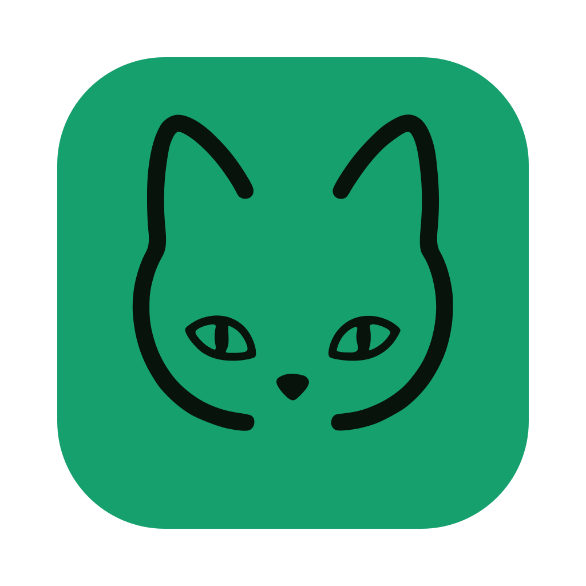
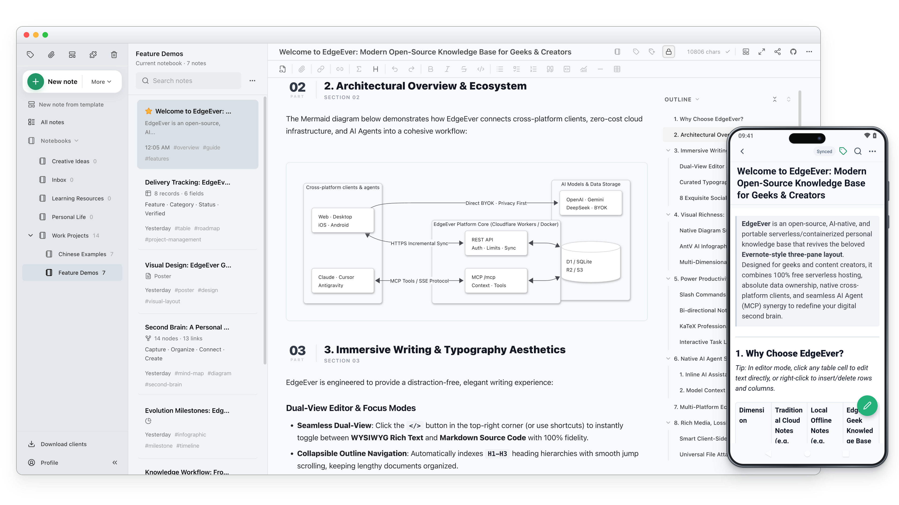

<div align="center">
  <h1>
     EdgeEver
  </h1>
  <p>
    <b>Natywna dla AI baza wiedzy oraz alternatywa dla Evernote/Obsidian. Błyskawiczna synchronizacja na wszystkich platformach, bogate notatki (tabele, mapy myśli, diagramy, plakaty), web clipper i MCP. W 100% bezpłatnie na Cloudflare lub przez Docker.</b>
  </p>
  <p>
    <a href="https://github.com/tianma-if/edgeever/stargazers"></a>
    <a href="https://github.com/tianma-if/edgeever/network/members"></a>
    <a href="https://github.com/tianma-if/edgeever/releases"></a>
    <a href="https://github.com/tianma-if/edgeever/pkgs/container/edgeever"></a>
    <a href="https://www.producthunt.com/products/edgeever?utm_source=other&utm_medium=social"></a>
    <a href="https://hellogithub.com/repository/tianma-if/edgeever" target="_blank"></a>
    <a href="#wsparcie-projektu"></a>
  </p>
  <p>
    <a href="README.zh-CN.md">简体中文</a> | <a href="README.zh-TW.md">繁體中文</a> | <a href="README.md">English</a> | <a href="README.es.md">Español</a> | <a href="README.de.md">Deutsch</a> | <a href="README.fr.md">Français</a> | <a href="README.ja.md">日本語</a> | <b>Polski</b> | <a href="README.ru.md">Русский</a>
  </p>
  <p>
    <a href="https://t.me/+GvKYnL37feUwOTNl"> Grupa na Telegramie</a> &nbsp;|&nbsp;
    <a href="https://demo.edgeever.org">🌐 Demo na żywo</a> &nbsp;|&nbsp;
    <a href="https://github.com/users/tianma-if/projects/1">🗺️ Plan rozwoju</a> &nbsp;|&nbsp;
    <a href="#aplikacje-i-rozszerzenia">📱 Aplikacje i rozszerzenia</a> &nbsp;|&nbsp;
    <a href="#features">Macierz funkcji i zastosowań</a> &nbsp;|&nbsp;
    <a href="docs/note-migration-guide.en-US.md">📥 Migracja notatek</a>
  </p>
  <p align="center">
    
  </p>
</div>

EdgeEver to nowoczesna, otwartoźródłowa przestrzeń do notatek i zarządzania wiedzą. Zachowuje wygodę klasycznego, wysoce efektywnego układu trzech paneli (drzewo katalogów · lista notatek · edytor), a jednocześnie daje kontrolę nad danymi i bezpośrednią współpracę z agentami AI.

> 💡 **Bez serwera i bez opłat w ramach darmowego planu**
> EdgeEver może działać w darmowym planie Cloudflare, bez kupowania i utrzymywania serwera. Jeśli wolisz VPS, NAS lub serwer domowy, tę samą aplikację możesz wdrożyć przez Dockera.

> ⭐ Jeśli EdgeEver Ci się przydaje, zostaw gwiazdkę na GitHubie. Dzięki temu więcej osób znajdzie projekt.

## Dlaczego EdgeEver?

Wielu użytkowników **aplikacji do notatek i osobistych baz wiedzy** szuka po prostu **niezawodnej, otwartej i szybkiej** osobistej bazy wiedzy. Popularne rozwiązania mają jednak swoje ograniczenia:

* **Evernote**: Oferuje najpłynniejszą i najbardziej bezproblemową synchronizację w chmurze między wieloma urządzeniami. Z czasem stało się jednak rozbudowanym komercyjnym pakietem: przybyło reklam i dodatków, wzrosło zużycie zasobów, ograniczono darmowy plan, a zaawansowane funkcje AI są kosztowne. Trudno też połączyć je z samodzielnie hostowanymi usługami i prywatnymi procesami AI.
* **Obsidian**: Pliki są otwarte, ale sam program ma zamknięty kod. Oficjalna synchronizacja jest płatna, a konfiguracja innych metod wymaga pracy. Przy tysiącach notatek lub wielu wtyczkach skanowanie lokalnych plików spowalnia uruchamianie i wyszukiwanie. Obrazy i załączniki powiększają magazyn, utrudniają synchronizację mobilną i mogą pozostawać po usunięciu notatek.
* **Joplin**: Zasłużona, otwartoźródłowa aplikacja z układem trzech paneli, jednak jej interfejs i wygoda edycji sprawiają wrażenie zatrzymanych kilkanaście lat temu, bez nowoczesnej lekkości i dopracowania. Szybka oficjalna synchronizacja (Joplin Cloud) wymaga płatnej subskrypcji; darmowa synchronizacja przez WebDAV lub dyski chmurowe odpytuje pliki pojedynczo i zwalnia na urządzeniach mobilnych wraz ze wzrostem liczby notatek i załączników, natomiast własny Joplin Server wymaga utrzymywania serwera bez darmowej opcji serverless. Brakuje też pełnej przestrzeni roboczej w przeglądarce oraz natywnej obsługi agentów AI (MCP/ACP).
* **Memos i notatki strumieniowe**: Są proste, ale interfejs przypominający oś czasu różni się od uporządkowanej pracy w trzech panelach.
* **SiYuan i systemy oparte na blokach**: Oferują wiele funkcji i własny hosting, lecz szczegółowa struktura bloków utrudnia szybkie zapisywanie myśli i pisanie dłuższego tekstu. Brakuje im również bezpłatnego wdrożenia bezserwerowego, a synchronizacja między urządzeniami wymaga płatnej subskrypcji lub dodatkowo płatnego dostępu do S3/WebDAV.

**EdgeEver wypełnia tę lukę**: cały stos ma otwarty kod, zapewniając w pełni **płynną, błyskawiczną synchronizację w chmurze o niskim opóźnieniu między wieloma urządzeniami** oraz pełną swobodę bezpłatnego hostingu. Zachowuje znany układ trzech paneli, działa sprawnie nawet przy ponad 10 000 notatek i oferuje natywną współpracę z agentami AI oraz możliwość bezpłatnego wdrożenia.

## Demo online

- Demo: [https://demo.edgeever.org](https://demo.edgeever.org)

Publiczne demo resetuje się codziennie o 3:00 czasu chińskiego (UTC+8) i przywraca przykładowe notatki. Nie zapisuj w nim prywatnych danych.

## Aplikacje i rozszerzenia

### Pobierz aplikacje

<p>
  <a href="https://github.com/tianma-if/edgeever/releases/latest"></a>&nbsp;&nbsp;
  <a href="https://github.com/tianma-if/edgeever/releases/latest"></a>&nbsp;&nbsp;
  <a href="https://github.com/tianma-if/edgeever/releases/latest"></a>&nbsp;&nbsp;
  <a href="https://play.google.com/store/apps/details?id=org.edgeever.mobile&hl=pl"></a>&nbsp;&nbsp;
  <a href="https://apps.apple.com/pl/app/edgeever/id6792625631"></a>
</p>

> Aplikacja na iOS wymaga Apple ID spoza Chin kontynentalnych.

### Rozszerzenie Web Clipper

<p>
  <a href="https://chromewebstore.google.com/detail/edgeever-web-clipper/gjadpfmanienmlofajibkfkkpfdkclgo"></a>&nbsp;&nbsp;
  <a href="https://chromewebstore.google.com/detail/edgeever-web-clipper/gjadpfmanienmlofajibkfkkpfdkclgo"></a>&nbsp;&nbsp;
  <a href="https://addons.mozilla.org/firefox/addon/edgeever-web-clipper/"></a>
</p>

- Przekształca artykuły w przejrzysty Markdown lub zapisuje zaznaczony tekst i obrazy bezpośrednio w Twojej instancji.
- Głębokie, ustrukturyzowane zapisywanie treści z ponad 20 platform: społecznościowych (X, Xiaohongshu, WeChat, Jike, Douban, Threads, Bluesky), serwisów czytelniczych i technicznych (Zhihu, Reddit, GitHub, V2EX, Hacker News, Medium, Substack) oraz wideo i podcastów (Bilibili, YouTube, Xiaoyuzhou).

<a id="features"></a>
## Macierz funkcji i zastosowań

Wszechstronny obszar roboczy łączący zbieranie inspiracji, głębokie tworzenie i gromadzenie wiedzy (👉 **[Zobacz wszystkie 19 scenariuszy ze zrzutami ekranu](docs/best-practices.md)**):

| Moduł | Funkcje podstawowe | Funkcje zaawansowane |
| :--- | :--- | :--- |
| **Pisanie i edycja** | • Klasyczny układ z 3 panelami i regulowaną szerokością<br>• Płynne przełączanie między edytorem wizualnym (WYSIWYG) a kodem Markdown<br>• Podświetlanie składni, wzory matematyczne, listy zadań i tryb skupienia<br>• Błyskawiczny automatyczny zapis, natychmiastowa synchronizacja na wielu urządzeniach i historia zmian | • **Natywne notatki plakatowe**: Układy kart graficznych na płótnie, szybka edycja dwuklikiem<br>• **Formatowanie dla WeChat Official Account**: Kopiowanie ze stylami inline bezpośrednio do newsletterów/blogów<br>• **Eksport grafik i dokumentów**: Estetyczne szablony, awatary monogramowe; eksport do MD, HTML i PDF<br>• **Narzędzia produktywności na desktopie**: Zrzuty wybranego obszaru ekranu skrótem globalnym wprost do notatki, automatyczny zapis zmian w załącznikach edytowanych zewnętrznie oraz edycja w wielu oknach |
| **Organizacja i wyszukiwanie** | • Nieograniczone zagnieżdżanie notatników i drzewo folderów<br>• System tagów, sortowanie przeciąganiem, łączenie i przenoszenie notatek<br>• Błyskawiczne wyszukiwanie pełnotekstowe z filtrami | • **Samodzielna publikacja bazy wiedzy**: Publikuj całe notatniki jako statyczne strony dokumentacji z nawigacją i ochroną hasłem<br>• **Migracja jednym kliknięciem z innych aplikacji**: Natywny import przez GUI z flomo, Evernote, Obsidian i Joplin z zachowaniem notatek, struktury i załączników<br>• Wiele odizolowanych przestrzeni użytkowników |
| **Zapisywanie i załączniki** | • Obsługa załączników dowolnego formatu (PDF, Office, wideo, archiwa)<br>• Precyzyjne wycinanie tekstu i obrazów ze stron w rozszerzeniu przeglądarki<br>• Udostępnianie systemowe w telefonie do zapisu zdjęć i artykułów | • **Ustrukturyzowane zapisywanie z wielu platform**: Dostosowane do Xiaohongshu, X (Twittera), Zhihu, Reddita, GitHuba, YouTube i 20+ serwisów<br>• **Archiwizacja rozmów WeChat**: Import całych rozmów ze znacznikami czasu, cytatami, emotikonami i załącznikami<br>• **Cicha kompresja obrazów**: Zmniejszenie rozmiaru o 50–90%; strumieniowe przesyłanie plików do 1 GiB<br>• **Magazyn obiektowy OSS i hosting obrazów na desktopie**: Obsługa magazynów zgodnych z S3 na instancję; bezpośrednie wysyłanie obrazów z desktopu przez PicGo / PicList oraz CloudFlare ImgBed |
| **Dane i wizualizacje** | • Natywna edycja tabel i renderowanie tabel Markdown<br>• Natywne diagramy Mermaid (schematy blokowe, sekwencje, architektura) | • **Wielowymiarowe tabele AI**: Tworzenie tabel biznesowych z promptu (z tagami, datami i polami wyboru)<br>• **Publiczne formularze zbierania danych**: Udostępnianie formularzy bez logowania i zapis odpowiedzi w czasie rzeczywistym<br>• **Generowanie infografik i map myśli przez AI**: Osi czasu, porównania, macierze i mapy myśli |
| **AI i ekosystem** | • Asystent AI w panelu bocznym do streszczeń, korekty, tłumaczeń i redakcji<br>• Własne klucze API (BYOK): zgodność z OpenAI, Claude, Gemini i serwerami proxy | • **Protokoły MCP i ACP**: Wbudowany MCP do odczytu/zapisu przez agentów zewnętrznych; ACP w aplikacji desktopowej do współpracy z lokalnymi agentami, takimi jak Codex, Claude Code i CodeBuddy<br>• **Transkrypcja audio i wideo AI**: Wyodrębnianie i podział ścieżki dźwiękowej po stronie klienta oraz bezpośrednie połączenie z modelami zgodnymi z OpenAI do transkrypcji i wstawiania tekstu do notatek<br>• **Otwarte API wtyczek i ekosystem motywów**: Instalacja jednym kliknięciem ze sklepu lub GitHub z synchronizacją między urządzeniami; API obsługuje odczyt/zapis notatek i interakcję z edytorem, własne panele i polecenia, wywołania AI, zadania cykliczne na desktopie oraz motywy bez kodowania |
| **Synchronizacja i fundament** | • Natychmiastowa synchronizacja bez opóźnień na komputerach, telefonach i w sieci bez limitu urządzeń<br>• Oficjalne aplikacje na Web, macOS, Windows, Linux, iOS i Android<br>• Architektura offline-first i kolejka synchronizacji: płynne pisanie bez sieci, automatyczna synchronizacja po połączeniu<br>• Standardowa baza SQLite, bezstratny eksport/import archiwów ZIP i Markdown | • **Zero kosztów serwera na zawsze**: 100% działania w darmowym planie Cloudflare (~150 tys. notatek i ~50 tys. obrazów)<br>• **Elastyczny hosting Docker**: Wdrożenie na VPS, NAS lub domowym serwerze dla milionów notatek z natychmiastową synchronizacją<br>• **Automatyczne kopie na desktopie**: Zaplanowane lokalne kopie zapasowe z wielopokoleniową retencją, opcjonalnym szyfrowaniem hasłem i automatyczną replikacją do WebDAV<br>• Ochrona przed atakami brute-force, uwierzytelnianie dwuskładnikowe TOTP (2FA), zarządzanie aktywnymi sesjami urządzeń i izolacja danych |

## Wdrożenie

Cloudflare to zalecana opcja bez własnego serwera. Docker jest dostępny dla osób korzystających z VPS, NAS lub serwera domowego. Szczegółowe przewodniki wdrożenia są obecnie dostępne po angielsku.

W przypadku Cloudflare wybierz jedną z poniższych metod wdrożenia online:

### Opcja A: Wdrożenie z agentem AI (zalecane)

Skopiuj poniższe polecenie do agenta AI, na przykład Codex, Claude, Cursor, WorkBuddy, Antigravity, OpenClaw lub Hermes Agent. Gdy agent poprosi o dostęp do GitHuba lub Cloudflare, sprawdź żądane uprawnienia i postępuj zgodnie z instrukcjami autoryzacji.

```text
Wdróż EdgeEver przez GitHub i Cloudflare:
1. Utwórz Fork repozytorium https://github.com/tianma-if/edgeever.
2. Utwórz bazę D1 `edgeever` i zasobnik R2 `edgeever-resources` w Cloudflare.
3. W Workers & Pages wybierz „Start with Hello World!” i utwórz Worker o nazwie `edgeever`.
4. W Settings → Variables and Secrets dodaj wybrane hasło jako sekret środowiska
   uruchomieniowego `EDGE_EVER_AUTH_PASSWORD` i kliknij Deploy (zalecane co najmniej
   32 znaki). Domyślna nazwa użytkownika to `admin`.
5. Po wdrożeniu sekretu otwórz Settings → Builds → Connect tego Workera i podłącz
   gałąź `main` Forka.
6. W Settings → Builds → API token tego Workera wybierz lub utwórz token API Cloudflare do wdrażania, z uprawnieniami do odczytu i edycji D1 na koncie docelowym.
7. W repozytorium Forka na GitHubie otwórz Actions → Update deployed EdgeEver, włącz workflow, jeśli pojawi się monit,
   i wybierz Run workflow dla gałęzi `main`. Po potwierdzeniu w Cloudflare, że odpowiedni build zakończył się sukcesem, a wdrożenie zostało ukończone, sprawdź `/api/health` i `/api/openapi.json`, a następnie
   zweryfikuj logowanie nazwą administratora i hasłem.
   Ten workflow będzie automatycznie synchronizować kolejne stabilne wersje i poprawki.
```

> Szczegółowe wymagania: [wdrożenie Cloudflare z agentem AI](docs/agent-deploy-cloudflare.md).

### Opcja B: Ręczne wdrożenie online

<details>
<summary>📖 Rozwiń: 7 kroków konfiguracji ręcznej w przeglądarce</summary>

Wykonaj poniższe siedem kroków w przeglądarce ściśle w podanej kolejności:

1. **Utwórz Fork repozytorium**: Kliknij **Fork** w prawym górnym rogu strony GitHub, aby utworzyć kopię EdgeEver na swoim koncie.
2. **Utwórz zasoby Cloudflare**: Utwórz bazę D1 `edgeever` i zasobnik R2 `edgeever-resources`.
3. **Utwórz Workera**: W Cloudflare Workers & Pages wybierz Create application → Start with Hello World!, nazwij Workera `edgeever` i wdróż go. To usługa tymczasowa; EdgeEver zostanie wdrożony w kroku 7.
4. **Ustaw hasło administratora**: W Settings → Variables and Secrets Workera dodaj `EDGE_EVER_AUTH_PASSWORD` jako typ Secret i kliknij Deploy. Wartością jest wybrane hasło logowania, najlepiej co najmniej 32 znaki. Zrób to przed podłączeniem Forka.
5. **Podłącz Fork**: W Settings → Builds → Connect istniejącego Workera wybierz Fork i gałąź produkcyjną `main`.
6. **Skonfiguruj uprawnienia wdrożenia**: W Settings → Builds → API token tego Workera wybierz lub utwórz token API Cloudflare do wdrażania, z uprawnieniami do odczytu i edycji D1 na koncie docelowym.
7. **Zbuduj i sprawdź**: W repozytorium Forka na GitHubie otwórz Actions → Update deployed EdgeEver, włącz workflow, jeśli pojawi się monit, i wybierz Run workflow dla gałęzi `main`. Po potwierdzeniu w Cloudflare, że odpowiedni build zakończył się sukcesem, a wdrożenie zostało ukończone, sprawdź, czy `/api/health` zwraca `200`, i zweryfikuj logowanie. Ten workflow będzie automatycznie synchronizować kolejne stabilne wersje i poprawki.

> Pełne instrukcje i konfigurację znajdziesz w [przewodniku wdrożenia online](docs/deploy-cloudflare-button.md).

</details>

<details>
<summary>📌 Uwagi dotyczące wdrożenia na Cloudflare (własna domena i darmowy limit R2)</summary>

> **Domena i dostęp**: Możesz użyć domyślnej domeny `*.workers.dev` lub podłączyć własną w ustawieniach Workera: **Settings → Domains & Routes**.
>
> **Aktywacja Cloudflare R2**: Choć [darmowy limit przestrzeni R2](https://developers.cloudflare.com/r2/pricing/#free-tier) wystarcza na typowe notatki, najpierw trzeba aktywować subskrypcję R2 i dodać metodę płatności. Cloudflare [obsługuje](https://developers.cloudflare.com/billing/get-started/update-billing-info/#supported-payment-methods) karty UnionPay, Visa i Mastercard oraz PayPal, Apple Pay i Google Pay.

</details>

### Opcja C: Docker na VPS lub NAS

Wariant Docker używa tego samego interfejsu, tras API, usług, uwierzytelniania, implementacji MCP i migracji co Cloudflare. Kontener korzysta z SQLite oraz plików lokalnych lub magazynu zgodnego z S3 i obsługuje architektury `amd64` oraz `arm64`. Zobacz [wdrożenie EdgeEver przez Dockera](docs/deploy-docker.md) oraz [architekturę własnego hostingu](docs/self-hosting-architecture.md).

Użyj instalatora hostowanego w GitHubie i oficjalnego obrazu GHCR:

```sh
curl -fsSL https://edgeever.org/install.sh | bash
```

Polecenie pobiera najnowszy obraz, generuje hasło administratora i uruchamia EdgeEver przez Docker Compose.

Ręczne wdrożenie i konfigurację opisuje [przewodnik po Dockerze](docs/deploy-docker.md).

Po instalacji aktualizacje domyślnie uruchamiają się codziennie. Aby zaktualizować aplikację ręcznie, uruchom `~/edgeever/update.sh` na serwerze.

---

## Zaawansowana konfiguracja i zarządzanie

### Kopia zapasowa, eksport i migracja danych

Zarówno przy codziennych kopiach zapasowych, bezproblemowej migracji między instancjami, jak i przenoszeniu notatek z innych platform, EdgeEver zapewnia niezawodny i pełny transfer danych:

- **Natywne kopie zapasowe i przywracanie EdgeEver**: W aplikacji w **Profil → Import i eksport** można w każdej chwili wyeksportować lub zaimportować archiwum ZIP EdgeEver. Rozpakowany katalog `notes/` zawiera bezpośrednio czytelne pliki Markdown oraz załączniki do lokalnego archiwizowania, a wewnętrzne dane strukturalne pozwalają na bezstratne i pełne odtworzenie bazy na innej instancji EdgeEver. Podczas importu zachowywane są istniejące, niezwiązane dane na instancji docelowej, a rekordy o tych samych identyfikatorach są automatycznie aktualizowane.
- **Automatyczne harmonogramowane kopie i replikacja WebDAV na desktopie**: W ustawieniach **Kopia zapasowa i import** aplikacji desktopowej możesz włączyć cykliczne lokalne kopie zapasowe (co tydzień lub co miesiąc) z własnym katalogiem i liczbą przechowywanych migawek — przy zmianie treści tworzone jest archiwum ZIP lub szyfrowane `.edgeever.enc`, które po zakończeniu lokalnej kopii może być automatycznie wysyłane przez WebDAV na serwer NAS lub kompatybilną przestrzeń.
- **Płynna migracja z innych platform**: Niezależnie od tego, czy importujesz jednym kliknięciem przez natywny interfejs graficzny w przeglądarce i aplikacji desktopowej (obsługujący pełne notatki, hierarchie i załączniki z Evernote, Obsidian i Joplin), czy migrujesz z Notion, flomo, Memos i innych baz wiedzy za pomocą AI Agent & MCP, EdgeEver zapewnia bezproblemowy i weryfikowalny transfer danych. Zobacz [Przewodnik migracji notatek z innych platform](docs/note-migration-guide.en-US.md).

### Integracja z AI i protokołem MCP

Utwórz token API w **Profil → API / MCP** i skopiuj konfigurację Remote MCP jednym kliknięciem. Agenci AI, tacy jak Claude Code, Cursor, Antigravity i OpenClaw, będą mogli bezpiecznie zarządzać Twoją bazą wiedzy w zakresie uprawnień konta. EdgeEver obsługuje pełne tworzenie, odczyt, edycję i usuwanie notatek tekstowych, diagramów (map myśli, schematów blokowych i diagramów architektury), tabel strukturalnych oraz natywnych notatek plakatowych. Agenci mogą też zarządzać strukturą notatników, tagami, załącznikami, historią wersji, szablonami i instrukcjami AI.

Konfigurację klientów, poziomy dostępu tokenów, rozwiązywanie problemów i przykładowe reguły dla agentów opisuje [Using EdgeEver with MCP clients](docs/mcp-guide.md) (po angielsku).

> 💡 **Inspiracja:**
> Użyj AI jako pomocnika w porządkowaniu wiedzy: zamieniaj pomysły w interaktywne mapy myśli, diagramy i tabele, dostarczając agentom własny kontekst. Edytor tekstu sformatowanego i typografia EdgeEver pomagają dopracować wynik do postaci gotowej do publikacji.

### Logowanie wielu użytkowników i zarządzanie miejscem

Jedna instancja obsługuje wiele kont.

Administrator może tworzyć i wyłączać konta oraz resetować ich hasła w **Profil → Członkowie**. Każdy użytkownik otrzymuje odizolowaną przestrzeń z notatnikami, notatkami, załącznikami, Koszem, importem i eksportem oraz tokenami MCP. Przejrzysty panel zużycia miejsca pozwala na bieżąco monitorować przestrzeń zajmowaną przez załączniki w całej instancji i na poszczególnych kontach.

### Rozszerzenia pamięci masowej i zewnętrzny hosting obrazów

- **Magazyn obiektów OSS**: Właściciel instancji może skonfigurować magazyn zgodny z S3 w **Profil → Zaawansowane → Magazyn obiektów OSS**. Zmiana magazynu nie przenosi istniejących załączników ani ich nie modyfikuje.
- **Integracja z PicGo na komputerze**: Aplikacja desktopowa może przekazać wstawiane obrazy do PicGo lub PicList na tym komputerze albo na innej zaufanej maszynie, na przykład NAS. Serwer wysyła je do GitHuba, SM.MS, Upyun, Qiniu lub własnego hostingu. Adres musi tylko kończyć się na `/upload`, więc działa też PicList za odwrotnym proxy.
- **CloudFlare ImgBed na komputerze**: Aplikacja desktopowa może też przesyłać wstawiane obrazy bezpośrednio do własnego [CloudFlare ImgBed](https://github.com/MarSeventh/CloudFlare-ImgBed) przy użyciu tokenu API. Folder docelowy obsługuje symbole zastępcze w stylu PicList, np. `{Y}/{m}/{d}` i `{memoId}`.

### Wtyczki i motywy

Aplikacje Web i desktopowa obsługują wtyczki oraz własne motywy, instalowane z oficjalnego marketplace, GitHuba lub adresu manifestu i synchronizowane między urządzeniami. Programiści mogą rozszerzać aplikację przez `@edgeever/plugin-api`; zobacz [przewodnik tworzenia wtyczek](docs/plugin-development.md) i [zasady publikowania w marketplace](docs/plugin-marketplace-policy.md).

---

## Przewodnik dla deweloperów i współtworzenie

### Szybki start

```sh
bun install
bun run dev
```

W lokalnym środowisku deweloperskim logowanie następuje automatycznie. Nowa baza używa danych `owner` / `edgeever-local-dev`. Wyloguj się, aby sprawdzić ekran logowania.

### Architektura i stos technologiczny

#### Stos technologiczny

- Monorepo oparte na Bun z aplikacją Web, API, oficjalną stroną i pakietem współdzielonych typów.
- Interfejs: Vite, React, React Router, TanStack Query, Tailwind CSS, shadcn/ui i Radix UI.
- Edytor: TipTap / ProseMirror z obsługą Markdown; PWA korzysta z vite-plugin-pwa, Workbox i Dexie.
- Android: Expo + React Native w `apps/mobile`, lokalny SQLite i synchronizacja przyrostowa.
- iOS: natywny SwiftUI w `apps/ios` (iOS 17+), dołączony EditorBundle TipTap, lokalna kopia i kolejka zmian GRDB.
- Desktop: Electron + proces pomocniczy Rust, SQLite do edycji offline, synchronizacji przyrostowej i lokalnych kopii zapasowych.
- Web Clipper: Manifest V3, Mozilla Readability i Turndown dla Chrome, Edge i Firefox.
- Backend: jedna aplikacja biznesowa Hono/Zod z REST API i Remote MCP. Cloudflare używa Workers/D1/R2, a Docker używa Bun/SQLite oraz plików lokalnych lub S3.
- Oficjalna strona: statyczna witryna Astro w `apps/site`, wdrażana niezależnie na Cloudflare Pages.

#### Struktura projektu

<details>
<summary>📁 Rozwiń, aby zobaczyć: Struktura projektu monorepo</summary>

```text
apps/web          Interfejs Vite + React, PWA, wersje robocze offline i kolejka synchronizacji
apps/extension    Rozszerzenie Web Clipper Manifest V3 dla Chrome/Edge/Firefox
apps/api          Cloudflare Worker + Hono API, punkt końcowy MCP
apps/mobile       Aplikacja Android Expo + React Native
apps/ios          Natywna aplikacja iOS SwiftUI (EditorBundle TipTap, GRDB)
apps/desktop      Powłoka Electron, most preload i pakowanie aplikacji
apps/site         Oficjalna strona Astro, wdrażana niezależnie
packages/client   Współdzielony klient API dla aplikacji Web i mobilnej
packages/shared   Współdzielone typy, schematy Zod, konwersja TipTap / Markdown
crates/desktop-sidecar
                  Proces pomocniczy Rust dla lokalnego SQLite, pracy offline, kopii i plików
scripts           Wrapper Wrangler, haszowanie haseł, CLI, most MCP stdio, import Evernote ENEX
migrations        Wspólne migracje D1/SQLite dopisywane bez zmiany wcześniejszych plików
docs              Dokumentacja architektury, migracji i wdrażania
.github/workflows CI dla Web, mobile, iOS, pakietów desktopowych, wdrożeń i wydań
wrangler.toml     Konfiguracja Cloudflare Workers, Assets, D1 i R2
```

</details>

#### Model przechowywania danych

EdgeEver przechowuje treść notatki jednocześnie w trzech formatach, aby pogodzić wydajność edycji, otwartość danych i szybkość wyszukiwania pełnotekstowego:

```text
content_json      Dokument TipTap/ProseMirror, autorytatywny format dla edytora
content_markdown  Format API, agentów, eksportu i integracji z zewnętrznym ekosystemem
content_text      Format do wyszukiwania pełnotekstowego, podsumowań i indeksowania
```

### Kluczowe mechanizmy i decyzje projektowe

- **Cicha kompresja po stronie klienta**: Aby uniknąć zużywania limitów obliczeniowych na środowiskach Serverless (np. Cloudflare Workers), kompresja obrazów odbywa się w całości w kliencie Web przed wysłaniem (konwersja PNG/JPEG/WebP/AVIF na WebP, ograniczenie dłuższego boku do 2560px; brak powiększenia rozmiaru zachowuje oryginał). Punkty końcowe REST API i MCP zapisują bezpośrednio oryginalną treść otrzymaną od klienta.
- **Offline-first i harmonogram synchronizacji**: Aplikacje Web, PWA i desktopowe przesyłają zmiany automatycznie po 30 sekundach braku aktywności w pisaniu, a przy widocznym oknie sprawdzają zmiany w chmurze co 5 minut. Ponowne przejście do aplikacji lub ręczne odświeżenie natychmiast synchronizuje dane. Wartości te można konfigurować przez `DEFERRED_MEMO_SYNC_DELAY_MS` i `BACKGROUND_WORKSPACE_REFRESH_INTERVAL_MS` w [`apps/web/src/lib/workspace-refresh.ts`](apps/web/src/lib/workspace-refresh.ts).

### Współtworzenie kodu

Serdecznie zapraszamy społeczność do współtworzenia projektu! Przed przesłaniem kodu pamiętaj o poniższych zasadach:

- Przed wniesieniem zmian przeczytaj [poradnik współtworzenia](CONTRIBUTING.md).
- **Izolacja wdrożenia i gałęzi**: Jeśli Twój GitHub Fork służy również do wdrożenia EdgeEver online, pozostaw jego gałąź `main` wyłącznie do wdrożeń. Do prac rozwojowych i pull requestów utwórz osobną gałąź od oficjalnego `upstream/main`; nie twórz zmian bezpośrednio na gałęzi `main` ani nie wykonuj na niej opcji Sync fork.

---

## Społeczność i opinie

- **Zgłaszanie uwag i propozycji**: Błędy, propozycje funkcji i pytania dotyczące wdrożenia zgłaszaj przez [GitHub Issues](https://github.com/tianma-if/edgeever/issues).

### Społeczność na Telegramie

Zapraszamy do społeczności EdgeEver, skupiającej twórców i pasjonatów vibe codingu oraz AI. Rozmawiajmy o nowoczesnej produktywności opartej na AI i sprawdzonych praktykach budowania osobistej bazy wiedzy.

👉 [Dołącz do grupy na Telegramie](https://t.me/+GvKYnL37feUwOTNl)

## Przyjazne linki

- [LINUX DO](https://linux.do/) — Społeczność wymiany wiedzy technicznej i projektów open source.

## Wsparcie projektu

EdgeEver jest darmowym projektem o otwartym kodzie. Rozwijanie aplikacji na różne platformy, testy na urządzeniach, podpisywanie kodu i utrzymywanie kilku środowisk uruchomieniowych wymagają czasu i środków.

- [Wesprzyj EdgeEver](docs/sponsor.md) — dobrowolne wpłaty przez WeChat Pay lub Alipay.
- [Sponsorzy i partnerzy](docs/partners.md) — wsparcie infrastruktury, narzędzi, usług i współpracy ze społecznością.

## Podziękowania

- Przy projektowaniu EdgeEver wzorowano się na publicznie dostępnych rozwiązaniach dojrzałych aplikacji do notatek, takich jak [Evernote](https://evernote.com/) i [Notion](https://www.notion.com/). Powiązane funkcje zostały zaprojektowane i zaimplementowane niezależnie przez EdgeEver.
- Inspiracją dla notatek z mapami myśli i diagramami były publicznie dostępne funkcje [XMind](https://xmind.com/) i [ProcessOn](https://www.processon.com/). Funkcje te zostały zaprojektowane i zaimplementowane niezależnie przez EdgeEver.
- Narzędzie do projektowania plakatów w EdgeEver czerpie inspirację z [Qiaomu Design](https://github.com/joeseesun/qiaomu-cover-design) autorstwa 向阳乔木 (joeseesun) i wykorzystuje dostosowane szablony oraz silnik typograficzny udostępnione na licencji MIT.
- Motywy wizualne i typografia kart do udostępniania notatek jako obrazów w EdgeEver były inspirowane [Firefly Card (流光卡片)](https://fireflycard.shushiai.com/). Dziękujemy za inspirację projektową.
- Funkcja publikowania jednym kliknięciem dla WeChat oraz typografia wyróżnionych artykułów w EdgeEver czerpią inspirację z projektu [gzh-design-skill](https://github.com/isjiamu/gzh-design-skill) autorstwa isjiamu. Dziękujemy za inspirację w zakresie układu i estetyki artykułów.

## Znak towarowy i użycie marki

Nazwa EdgeEver, logo i inne elementy identyfikacji wyróżniają oficjalny projekt. Forki i zmodyfikowane wersje mogą informować, że bazują na EdgeEver, ale nie mogą sugerować oficjalnego statusu ani wprowadzać użytkowników w błąd. Licencja otwartego oprogramowania nie przyznaje praw do znaków towarowych; ich inne użycie wymaga uprzedniej pisemnej zgody opiekunów projektu.

## Zastrzeżenie

EdgeEver to niezależna, otwartoźródłowa aplikacja do notatek rozwijana przez osoby prywatne i społeczność. Projekt nie jest powiązany z Evernote Corporation ani jej podmiotami zależnymi, nie jest przez nie autoryzowany, sponsorowany ani popierany.

EdgeEver jest oprogramowaniem do samodzielnego hostingu. Poza oficjalnymi instancjami demonstracyjnymi opiekunowie projektu nie hostują, nie kontrolują ani nie przeglądają treści użytkowników. Za treść przechowywaną lub wyświetlaną przez instancję odpowiadają jej użytkownicy lub operatorzy; nie reprezentuje ona poglądów opiekunów projektu.

## Współtwórcy

<!-- readme-contributors:start -->
<p align="left">
  <a href="https://github.com/tianma-if"></a>
  <a href="https://github.com/dkoryto"></a>
  <a href="https://github.com/sivdead"></a>
  <a href="https://github.com/yulei666"></a>
  <a href="https://github.com/thorufur"></a>
  <a href="https://github.com/arsaboo"></a>
  <a href="https://github.com/alyyasser"></a>
  <a href="https://github.com/MadlyFX"></a>
  <a href="https://github.com/claude"></a>
  <a href="https://github.com/Crowszzz"></a>
  <a href="https://github.com/CottonChou"></a>
  <a href="https://github.com/Z-DDV"></a>
  <a href="https://github.com/0xfelixli"></a>
  <a href="https://github.com/Sergmay911"></a>
  <a href="https://github.com/X77seven"></a>
  <a href="https://github.com/imgdown"></a>
  <a href="https://github.com/mookim-eth"></a>
  <a href="https://github.com/nzhdotme"></a>
  <a href="https://github.com/Shunamxiao"></a>
</p>
<!-- readme-contributors:end -->
