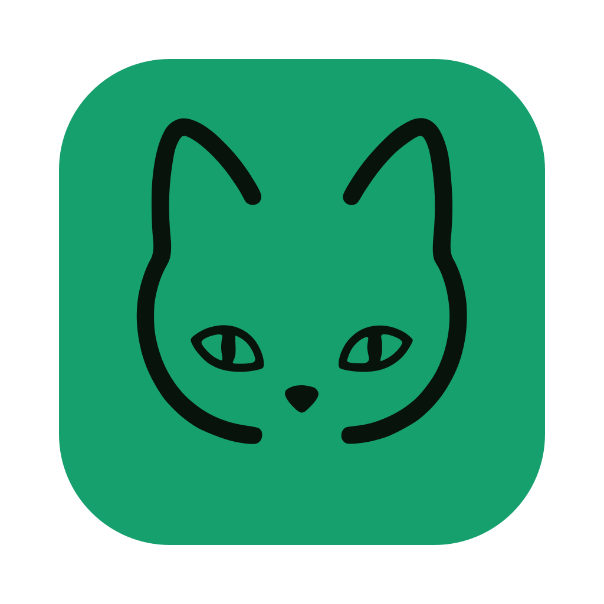
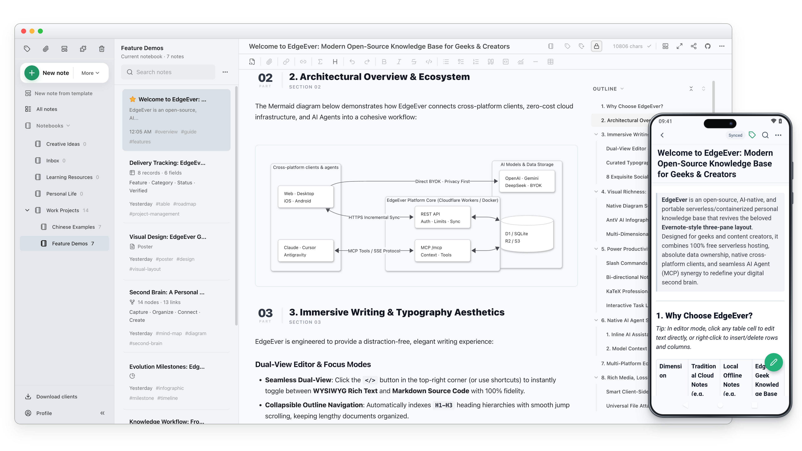

<div align="center">
  <h1>
     EdgeEver
  </h1>
  <p>
    <b>AI-native база знаний и альтернатива Evernote/Obsidian. Мгновенная синхронизация на всех платформах, мультиформатные заметки (таблицы, ментальные карты, диаграммы, постеры), веб-клиппер и MCP. 100% бесплатно на Cloudflare или через Docker.</b>
  </p>
  <p>
    <a href="https://github.com/tianma-if/edgeever/stargazers"></a>
    <a href="https://github.com/tianma-if/edgeever/network/members"></a>
    <a href="https://github.com/tianma-if/edgeever/releases"></a>
    <a href="https://github.com/tianma-if/edgeever/pkgs/container/edgeever"></a>
    <a href="https://www.producthunt.com/products/edgeever?utm_source=other&utm_medium=social"></a>
    <a href="https://hellogithub.com/repository/tianma-if/edgeever" target="_blank"></a>
    <a href="#sponsor--support"></a>
  </p>
  <p>
    <a href="README.zh-CN.md">简体中文</a> | <a href="README.zh-TW.md">繁體中文</a> | <a href="README.md">English</a> | <a href="README.es.md">Español</a> | <a href="README.de.md">Deutsch</a> | <a href="README.fr.md">Français</a> | <a href="README.ja.md">日本語</a> | <a href="README.pl-PL.md">Polski</a> | <b>Русский</b>
  </p>
  <p>
    <a href="https://t.me/+GvKYnL37feUwOTNl"> Группа в Telegram</a> &nbsp;|&nbsp;
    <a href="https://demo.edgeever.org">🌐 Онлайн-демо</a> &nbsp;|&nbsp;
    <a href="https://github.com/users/tianma-if/projects/1">🗺️ План развития</a> &nbsp;|&nbsp;
    <a href="#all-platform-clients--browser-extension">📱 Клиенты и расширение</a> &nbsp;|&nbsp;
    <a href="#features">Матрица возможностей</a> &nbsp;|&nbsp;
    <a href="docs/note-migration-guide.en-US.md">📥 Миграция заметок</a>
  </p>
  <p align="center">
    
  </p>
</div>

EdgeEver — это современное рабочее пространство с открытым исходным кодом для ведения заметок и управления базой знаний. Оно сохраняет классический высокоэффективный трехпанельный интерфейс (дерево навигации · список заметок · редактор), предлагая при этом открытую архитектуру данных и бесшовную интеграцию с AI-агентами для полного контроля над данными и интеллектуальной продуктивности.

> 💡 **Serverless и 100% бесплатно навсегда**
> EdgeEver может работать в рамках бесплатных лимитов Cloudflare без необходимости покупки сервера или обслуживания VPS. Пользователи, предпочитающие VPS, NAS или домашний сервер, могут развернуть то же самое приложение с помощью Docker.

> ⭐ Если EdgeEver вам полезен, поставьте звёздочку (Star) на GitHub. Ваша поддержка помогает другим узнать об этом проекте.

## Почему EdgeEver?

Многим пользователям **приложений для заметок и персональных баз знаний** нужна просто **надежная, открытая и быстрая** персональная база знаний. Однако все существующие популярные решения имеют компромиссы:

* **Evernote**: Обеспечивает максимально плавную и бесшовную облачную синхронизацию между множеством устройств. Но по мере превращения в громоздкий коммерческий пакет он оброс рекламой и надстройками, а системные требования выросли. Тем временем бесплатные лимиты сократились, премиум-подписки на функции ИИ подорожали, а интеграция в современные self-hosted и приватные рабочие процессы с ИИ остается сложной.
* **Obsidian**: Открытые файлы, закрытый исходный код ядра. Официальная синхронизация платная, а настройка сторонней синхронизации требует усилий. Полная ставка на сканирование плоских локальных файлов приводит к заметным задержкам холодного запуска и поиска при тысячах заметок или установке тяжелых плагинов. Хранение изображений и вложений рядом с заметками быстро раздувает хранилище, замедляет мобильную синхронизацию и оставляет файлы-сироты после удаления заметок. Кроме того, приложение избыточно тяжело для легковесного сценария «быстро записать мысль на ходу».
* **Joplin**: Проверенное временем опенсорсное трехпанельное приложение, но его интерфейс и опыт редактирования словно застряли на десятилетие назад, лишенные современной эстетики и плавности. Быстрая официальная синхронизация (Joplin Cloud) требует платной подписки; бесплатная синхронизация через WebDAV или облачные диски опрашивает файлы по одному и замедляется на мобильных устройствах по мере роста числа заметок и вложений; а для собственного Joplin Server требуется аренда и поддержка сервера без возможности бесплатного бессерверного развертывания (serverless). Также в нем нет полноценного веб-пространства в браузере и нативной поддержки AI-агентов (MCP/ACP).
* **Memos и потоковые заметки**: Простые и лаконичные, но их структура в виде ленты социальных сетей принципиально отличается от структурированной продуктивной работы в классическом трехпанельном интерфейсе.
* **SiYuan и блочные системы управления знаниями (PKM)**: Мощные инструменты с поддержкой самостоятельного хостинга, однако их детальная блочная архитектура создает ощутимую когнитивную нагрузку при быстрой повседневной фиксации мыслей и непрерывном написании связного текста. Кроме того, у них отсутствует полностью бесплатный уровень serverless-развертывания, а синхронизация между устройствами опирается на платную официальную подписку либо требует платной разблокировки функций синхронизации через S3/WebDAV на собственном хранилище.

**EdgeEver закрывает этот пробел**: весь стек полностью открыт, обеспечивая **по-настоящему бесшовную, мгновенную мультидевайс-синхронизацию с низкой задержкой через облако** и полную свободу самостоятельного хостинга. Приложение сохраняет привычный трехпанельный интерфейс, работает плавно и быстро даже при 10 000+ заметок и предлагает нативных AI-агентов с нулевыми затратами на развертывание.

## Онлайн-демо

- Демо: [https://demo.edgeever.org](https://demo.edgeever.org)

Публичная демо-версия сбрасывается каждый день в 3:00 ночи по пекинскому времени (CST / UTC+8) с восстановлением демонстрационных заметок. Не сохраняйте туда конфиденциальные данные.

<a id="all-platform-clients--browser-extension"></a>
## Клиенты для всех платформ и расширение для браузера

### Загрузка клиентов

<p>
  <a href="https://github.com/tianma-if/edgeever/releases/latest"></a>&nbsp;&nbsp;
  <a href="https://github.com/tianma-if/edgeever/releases/latest"></a>&nbsp;&nbsp;
  <a href="https://github.com/tianma-if/edgeever/releases/latest"></a>&nbsp;&nbsp;
  <a href="https://play.google.com/store/apps/details?id=org.edgeever.mobile"></a>&nbsp;&nbsp;
  <a href="https://apps.apple.com/us/app/edgeever/id6792625631"></a>
</p>

> Для приложения iOS требуется Apple ID региона за пределами материкового Китая.

### Расширение Web Clipper для браузера

<p>
  <a href="https://chromewebstore.google.com/detail/edgeever-web-clipper/gjadpfmanienmlofajibkfkkpfdkclgo"></a>&nbsp;&nbsp;
  <a href="https://chromewebstore.google.com/detail/edgeever-web-clipper/gjadpfmanienmlofajibkfkkpfdkclgo"></a>&nbsp;&nbsp;
  <a href="https://addons.mozilla.org/firefox/addon/edgeever-web-clipper/"></a>
</p>

- Извлечение чистого Markdown из веб-статей или сохранение выделенного текста и изображений напрямую в ваш собственный инстанс.
- Глубокий структурированный клиппинг для 20+ платформ: соцсети (X, Xiaohongshu, WeChat, Jike, Douban, Threads, Bluesky), сообщества разработчиков и читателей (Zhihu, Reddit, GitHub, V2EX, Hacker News, Medium, Substack), а также медиа и подкасты (Bilibili, YouTube, Xiaoyuzhou).

<a id="features"></a>
## Матрица возможностей и функций

Универсальное рабочее пространство, объединяющее фиксацию идей, глубокую работу с текстом и накопление знаний (👉 **[Изучите 19 пошаговых сценариев со скриншотами](docs/best-practices.md)**):

| Модуль | Основные возможности | Продвинутые возможности |
| :--- | :--- | :--- |
| **Создание и редактирование** | • Классический трехпанельный интерфейс с регулируемой шириной панелей<br>• Бесшовное переключение между визуальным редактором (WYSIWYG) и исходным кодом Markdown<br>• Подсветка синтаксиса, математические формулы, списки задач и режим фокуса<br>• Ежесекундное автосохранение, мгновенная синхронизация на нескольких устройствах и история версий | • **Нативные плакатные заметки**: Визуальные макеты карточек на холсте, редактирование по двойному клику<br>• **Форматирование для WeChat Official Account**: Копирование в один клик со встроенными CSS-стилями для рассылок и блогов<br>• **Экспорт постеров и документов**: Дизайнерские темы, монограммные аватары; экспорт в MD, HTML или PDF<br>• **Десктопные инструменты продуктивности**: Быстрый скриншот области экрана в заметку по глобальной горячей клавише, автосохранение изменений во внешне открытых вложениях и многооконное редактирование |
| **Организация и поиск** | • Блокноты с бесконечной вложенностью и древовидная навигация по папкам<br>• Система тегов, сортировка перетаскиванием (drag-and-drop), пакетное объединение и перемещение заметок<br>• Миллисекундный полнотекстовый поиск с фильтрацией по истории | • **Автономная публикация базы знаний**: Публикация целых блокнотов в один клик в виде статических сайтов документации с древовидной навигацией и защитой паролем<br>• **Миграция из сторонних сервисов в один клик**: Нативный импорт через графический интерфейс из flomo, Evernote, Obsidian и Joplin с сохранением заметок, иерархии и вложений<br>• Многопользовательские пространства и физическая изоляция данных тенантов |
| **Сбор данных и медиа** | • Универсальная загрузка вложений (PDF, Office, аудио, видео, архивы)<br>• Точный клиппинг текста и изображений с веб-страниц через расширение для браузера<br>• Системное меню «Поделиться» на смартфонах для сохранения фото и статей | • **Глубокий структурированный клиппинг с множества платформ**: Адаптирован для Xiaohongshu, X (Twitter), Zhihu, Reddit, GitHub, YouTube, Bilibili и 20+ других источников<br>• **Архивация истории чатов WeChat**: Полный импорт переписки в один клик с таймштампами, цитатами, эмодзи и медиа<br>• **Фоновое сжатие изображений на стороне клиента**: Автоматическое сжатие на 50%–90% без потери качества; потоковая загрузка фрагментами безопасно поддерживает файлы размером до 1 ГиБ<br>• **Объектное хранилище OSS и десктопный хостинг изображений**: S3-совместимое хранилище для инстанса; прямая загрузка с десктопа через PicGo / PicList и CloudFlare ImgBed |
| **Данные и визуализация** | • Нативное редактирование таблиц и рендеринг таблиц Markdown<br>• Нативные диаграммы Mermaid (блок-схемы, диаграммы последовательностей, схемы архитектуры) | • **Многомерные таблицы на базе ИИ**: Создание структуры базы данных по текстовому запросу с автоопределением типов полей (теги, даты, выбор из списка)<br>• **Публичные онлайн-формы сбора данных**: Формы для совместного использования без необходимости входа, синхронизирующие ответы в таблицы в реальном времени<br>• **Генерация инфографики и диаграмм с помощью ИИ**: Создание таймлайнов, сравнительных таблиц, матриц решений и интеллект-карт (mind maps) прямо в заметке |
| **ИИ и экосистема** | • AI-ассистент в боковой панели для создания саммари, вычитки и переводов<br>• Концепция BYOK (Bring Your Own Key): поддержка OpenAI, Claude, Gemini и пользовательских эндпоинтов | • **Нативные протоколы для агентов (MCP и ACP)**: Встроенный MCP для чтения/записи внешними агентами; протокол ACP в десктопном приложении для прямого взаимодействия с локальными агентами, такими как Codex, Claude Code и CodeBuddy<br>• **AI-транскрибация аудио и видео**: Извлечение и сегментация аудиодорожки на клиенте с прямым обращением к OpenAI-совместимым речевым моделям для расшифровки и вставки текста в заметку<br>• **Открытый API плагинов и экосистема тем**: Установка в один клик из маркетплейса или GitHub с синхронизацией между устройствами; API поддерживает чтение/запись заметок и работу с редактором, собственные панели и команды, вызовы ИИ, расписания на десктопе и темы без кода |
| **Синхронизация и фундамент** | • Бесшовная синхронизация с минимальной задержкой между десктопом, мобильными устройствами и вебом без ограничений по количеству устройств<br>• Официальные клиенты для Web, macOS, Windows, Linux, iOS и Android<br>• Архитектура offline-first с очередью автосинхронизации: комфортная работа без сети, автоматическое возобновление и синхронизация при подключении<br>• Стандартная база данных SQLite, резервное копирование в ZIP без потерь, экспорт и импорт Markdown | • **Нулевые затраты на сервер навсегда**: 100% работоспособность на бесплатном тарифе Cloudflare Free (~150 тыс. коротких заметок и ~50 тыс. изображений)<br>• **Гибкий самостоятельный хостинг в Docker**: Развертывание в один клик на VPS, NAS или домашнем сервере для миллионов заметок с мгновенной синхронизацией<br>• **Автоматическое резервное копирование на десктопе**: Локальные копии по расписанию с хранением нескольких снимков, опциональным шифрованием паролем и автоматической отправкой копий по WebDAV<br>• Защита от подбора паролей (brute-force), двухфакторная аутентификация TOTP (2FA), управление активными сессиями устройств и изоляция данных |

## Развертывание

Cloudflare — это рекомендуемый вариант бессерверного развертывания с нулевыми затратами. Docker доступен пользователям, предпочитающим VPS, NAS или домашний сервер.

Для Cloudflare выберите один из следующих вариантов онлайн-развертывания:

### Вариант A: Развертывание с помощью AI-агента (рекомендуется)

Скопируйте приведенный ниже промпт прямо в интерфейс AI-агента (например, Codex, Claude, Cursor, WorkBuddy, Antigravity, OpenClaw, Hermes Agent и др.). Если в процессе выполнения потребуется доступ к GitHub или Cloudflare, проверьте запрашиваемые права и следуйте инструкциям для авторизации.

```text
Разверни EdgeEver полностью через GitHub и Cloudflare:
1. Создай форк https://github.com/tianma-if/edgeever.
2. Создай базу данных D1 `edgeever` и хранилище R2 `edgeever-resources` в Cloudflare.
3. В Workers & Pages выбери «Start with Hello World!» и создай Worker с именем `edgeever`.
4. Добавь выбранный пользователем пароль в виде секрета среды выполнения `EDGE_EVER_AUTH_PASSWORD`
   в разделе Settings → Variables and Secrets и выполни Deploy для секрета (рекомендуется
   не менее 32 символов). Имя пользователя по умолчанию — `admin`.
5. Только после применения секрета открой Settings → Builds → Connect этого Worker
   и подключи ветку `main` созданного форка.
6. В разделе Settings → Builds → API token этого Worker выбери или создай API-токен Cloudflare, используемый для развертывания, с правами чтения/редактирования D1 для целевого аккаунта.
7. В GitHub-репозитории форка перейди в Actions → Update deployed EdgeEver, включи рабочий процесс (workflow), если появится запрос, и выбери Run workflow на ветке `main`. Убедившись в Cloudflare, что соответствующая сборка прошла успешно и развертывание завершено, проверь эндпоинты `/api/health` и `/api/openapi.json`, затем выполни вход под именем администратора
   и заданным паролем.
   Этот рабочий процесс будет автоматически синхронизировать будущие стабильные релизы и исправления.
```

> Подробные требования: [Развертывание на Cloudflare с помощью AI-агента](docs/agent-deploy-cloudflare.md).

### Вариант B: Ручное онлайн-развертывание

<details>
<summary>📖 Нажмите, чтобы развернуть: 7 шагов ручного развертывания через веб-интерфейс</summary>

Выполните следующие 7 шагов в веб-интерфейсе строго по порядку:

1. **Создайте форк репозитория**: Нажмите **Fork** в правом верхнем углу страницы репозитория на GitHub, чтобы создать копию EdgeEver в своем аккаунте.
2. **Создайте ресурсы в Cloudflare**: Создайте базу данных D1 `edgeever` и бакет R2 `edgeever-resources`.
3. **Создайте Worker**: В разделе Cloudflare Workers & Pages выберите Create application → Start with Hello World!, назовите Worker `edgeever` и разверните его. Это создаст заглушку; сам EdgeEver будет развернут на шаге 7.
4. **Установите пароль администратора**: В настройках Worker в разделе Settings → Variables and Secrets добавьте переменную `EDGE_EVER_AUTH_PASSWORD` с типом Secret и нажмите Deploy. Ее значение — ваш пароль для входа, желательно длиной не менее 32 символов. Выполните это действие до подключения форка.
5. **Подключите форк**: В настройках существующего Worker в разделе Settings → Builds → Connect выберите ваш форк и рабочую ветку `main`.
6. **Настройте права развертывания**: В разделе Settings → Builds → API token этого Worker выберите или создайте API-токен Cloudflare для развертывания с правами чтения и редактирования D1 для целевой учетной записи.
7. **Сборка и проверка**: В репозитории форка на GitHub откройте вкладку Actions → Update deployed EdgeEver, включите рабочий процесс при необходимости и выберите Run workflow для ветки `main`. Убедившись в Cloudflare, что сборка завершилась успешно и проект развернут, проверьте, что `/api/health` возвращает `200`, и войдите в систему. Этот workflow будет автоматически синхронизировать будущие стабильные версии и исправления.

> 📖 Полные пошаговые инструкции и детали конфигурации смотрите в [Руководстве по онлайн-развертыванию](docs/deploy-cloudflare-button.md).

</details>

<details>
<summary>📌 Примечания по развертыванию на Cloudflare (собственный домен и бесплатный лимит R2)</summary>

> **Собственный домен и доступ**: После развертывания вы можете использовать стандартный домен `*.workers.dev`, назначенный Cloudflare, либо подключить собственный домен в настройках Worker: **Settings → Domains & Routes**.
>
> **Активация Cloudflare R2**: Хотя Cloudflare R2 предоставляет щедрый [бесплатный лимит хранилища](https://developers.cloudflare.com/r2/pricing/#free-tier), объема которого полностью хватает для задач ведения заметок, вам потребуется предварительно активировать подписку R2 и привязать способ оплаты. Cloudflare [официально поддерживает](https://developers.cloudflare.com/billing/get-started/update-billing-info/#supported-payment-methods) карты UnionPay, Visa, Mastercard и другие, а также PayPal, Apple Pay, Google Pay и прочие платежные методы.

</details>

### Вариант C: Docker на VPS или NAS

Docker использует ту же кодовую базу интерфейса, маршрутов API, сервисов, аутентификации, реализации MCP и миграций, что и версия для Cloudflare. Контейнер работает с базой данных SQLite с локальным хранением файлов или S3-совместимым хранилищем вложений и поддерживает архитектуры `amd64` и `arm64`. См. [Развертывание EdgeEver с помощью Docker](docs/deploy-docker.md) и [Архитектура самостоятельного хостинга и Docker](docs/self-hosting-architecture.md).

Используйте скрипт установки, размещенный на GitHub, и официальный образ GHCR:

```sh
curl -fsSL https://edgeever.org/install.sh | bash
```

Эта команда загрузит актуальный образ, сгенерирует пароль администратора и запустит EdgeEver с помощью Docker Compose.

Инструкции по ручной установке и настройке приведены в [Руководстве по развертыванию в Docker](docs/deploy-docker.md).

После установки обновления по умолчанию запускаются автоматически раз в день. Чтобы обновить систему вручную, выполните команду `~/edgeever/update.sh` на сервере развертывания.

---

## Расширенная настройка и управление

### Резервное копирование, экспорт и миграция данных

Будь то регулярное резервное копирование данных, беспрепятственный перенос между инстансами или переход с других платформ заметок, EdgeEver гарантирует надежную и полную мобильность ваших данных:

- **Нативное резервное копирование и восстановление EdgeEver**: В приложении перейдите в **Профиль** → **Импорт и экспорт**, чтобы в любой момент выгрузить или загрузить ZIP-архив EdgeEver. Распакованный каталог `notes/` содержит чистые текстовые Markdown-файлы и вложения для локального архива или прямого чтения, а внутренние структурированные метаданные позволяют выполнить полное восстановление без потерь на другом инстансе EdgeEver. При импорте сохраняются существующие не связанные с ним данные на целевом инстансе, а записи с совпадающими идентификаторами автоматически перезаписываются.
- **Автоматическое резервное копирование и удалённые копии на десктопе**: В настройках **Резервное копирование и импорт** десктопного приложения можно включить локальное копирование по расписанию (раз в неделю или месяц) с выбором папки и количества хранимых снимков — при изменении данных автоматически создаётся стандартный ZIP или зашифрованный архив `.edgeever.enc`, а также поддерживается автоматическая загрузка копий по WebDAV на NAS или совместимое хранилище.
- **Плавная миграция из сторонних приложений**: Будь то импорт в один клик через встроенный графический интерфейс (поддерживающий полный перенос заметок, иерархии блокнотов и вложений из Evernote, Obsidian и Joplin) или миграция из Notion, flomo, Memos и других платформ с помощью AI-агентов и MCP, EdgeEver гарантирует удобный и проверенный перенос данных. См. [Руководство по миграции заметок из сторонних сервисов](docs/note-migration-guide.en-US.md).

### Интеграция с ИИ и протоколом MCP

Создайте токен API в разделе **Профиль** → **API / MCP** и скопируйте конфигурацию Remote MCP в один клик, чтобы AI-агенты, такие как Claude Code, Cursor, Antigravity и OpenClaw, могли безопасно управлять вашей базой знаний в рамках прав учетной записи. EdgeEver поддерживает полный цикл операций (CRUD) для текстовых заметок, визуальных диаграмм (интеллект-карт, блок-схем и архитектурных диаграмм), структурированных таблиц и нативных плакатных заметок. Агенты также могут управлять структурой блокнотов, тегами, вложениями, историей изменений, шаблонами заметок и системными инструкциями для ИИ.

Настройка клиентов, уровни доступа токенов, устранение неполадок и рекомендуемые правила для агентов описаны в руководстве [Using EdgeEver with MCP clients](docs/mcp-guide.md) (на английском).

> 💡 **Идея для вдохновения:**
> Сделайте ИИ настоящим дирижером знаний и творческим помощником — мгновенно превращайте концепции в интерактивные интеллект-карты, блок-схемы, схемы архитектуры и структурированные таблицы, одновременно передавая приватный контекст вашим AI-агентам. В сочетании с мощным визуальным редактором и элегантной типографикой EdgeEver материалы, созданные с помощью ИИ, превращаются в красиво структурированные, отточенные и готовые к публикации информационные активы.

### Многопользовательский вход и управление хранилищем

Один развернутый инстанс поддерживает работу нескольких пользователей.

Администратор инстанса может создавать, блокировать или сбрасывать учетные записи пользователей в разделе **Профиль** → **Учетные записи**. Каждый участник получает полностью изолированное личное рабочее пространство, включая блокноты, заметки, вложения, Корзину, импорт/экспорт и токены MCP. Наглядная панель использования дискового пространства позволяет в реальном времени отслеживать объем хранилища вложений как для всего инстанса, так и для каждого аккаунта отдельно.

### Расширение хранилища и сторонний хостинг изображений

- **Объектное хранилище OSS**: Владелец инстанса может настроить S3-совместимое объектное хранилище в разделе **Настройки → Дополнительно → Объектное хранилище OSS**. Смена хранилища не перемещает и не затрагивает уже загруженные вложения.
- **Интеграция с PicGo в десктопном клиенте**: Десктопное приложение может передавать вставляемые изображения на сервер PicGo или PicList на этом компьютере или на другом доверенном устройстве (например, NAS). Этот сервер загружает их на GitHub, SM.MS, Upyun, Qiniu или на пользовательский хостинг изображений. Адресу достаточно заканчиваться на `/upload`, поэтому PicList за обратным прокси (reverse proxy) также поддерживается.
- **CloudFlare ImgBed в десктопном клиенте**: Десктопное приложение также может загружать вставляемые изображения напрямую в ваш собственный сервис [CloudFlare ImgBed](https://github.com/MarSeventh/CloudFlare-ImgBed) с использованием API-токена. Путь к папке загрузки поддерживает плейсхолдеры в стиле PicList, такие как `{Y}/{m}/{d}` и `{memoId}`.

### Плагины и темы

Веб- и десктопное приложения поддерживают функциональные плагины и пользовательские темы, которые можно установить из официального каталога (marketplace), с GitHub или по URL-адресу манифеста, с бесшовной синхронизацией по всему рабочему пространству. Разработчики могут расширять функциональность с помощью `@edgeever/plugin-api`; см. [руководство по разработке плагинов](docs/plugin-development.md) и [правила публикации в каталоге](docs/plugin-marketplace-policy.md).

---

## Руководство для разработчиков и участие в проекте

### Быстрый старт

```sh
bun install
bun run dev
```

При локальной разработке вход выполняется автоматически; в новой базе данных используются учетные данные `owner` / `edgeever-local-dev`. Выйдите из системы, чтобы протестировать экран авторизации.

### Архитектура и стек технологий

#### Стек технологий

- Монорепозиторий на базе Bun с веб-клиентом, API, официальным сайтом и общим пакетом типов.
- Фронтенд: Vite, React, React Router, TanStack Query, Tailwind CSS, shadcn/ui и Radix UI.
- Редактор: TipTap / ProseMirror с поддержкой Markdown; для PWA используются vite-plugin-pwa, Workbox и Dexie.
- Приложение для Android: Expo + React Native в каталоге `apps/mobile`, локальное хранилище SQLite и инкрементальная синхронизация.
- Приложение для iOS: нативный интерфейс SwiftUI в `apps/ios` (iOS 17+), встроенный TipTap EditorBundle, локальное зеркало данных и очередь исходящих изменений GRDB, а также стилистическое единообразие с Android.
- Нативное десктопное приложение: Electron + вспомогательный процесс (sidecar) на Rust, сочетающий единообразный кроссплатформенный интерфейс с высокопроизводительными локальными сервисами данных; SQLite обеспечивает редактирование в офлайн-режиме, инкрементальную синхронизацию при появлении сети и локальные резервные копии.
- Веб-клиппер: Manifest V3, Mozilla Readability и Turndown для Chrome, Microsoft Edge и Firefox.
- Бэкенд: единое бизнес-приложение на базе Hono/Zod с REST API и Remote MCP; в среде Cloudflare используются Workers/D1/R2, а в Docker — Bun/SQLite/локальные файлы или S3.
- Официальный сайт: статический сайт на Astro в каталоге `apps/site`, развертываемый на Cloudflare Pages.

#### Структура проекта

<details>
<summary>📁 Нажмите, чтобы развернуть: Структура монорепозитория</summary>

```text
apps/web          Фронтенд на Vite + React, PWA, офлайн-черновики и очередь синхронизации
apps/extension    Веб-клиппер Manifest V3 для Chrome, Edge и Firefox
apps/api          API на Cloudflare Worker + Hono, эндпоинт MCP
apps/mobile       Android-приложение на Expo + React Native
apps/ios          Нативное iOS-приложение на SwiftUI (TipTap EditorBundle, GRDB)
apps/desktop      Десктопная оболочка на Electron, мост preload и сборка нативных пакетов
apps/site         Официальный сайт на Astro, развертываемый отдельно
packages/client   Общий API-клиент для веб- и мобильных приложений
packages/shared   Общие типы, схемы Zod, конвертация TipTap / Markdown
crates/desktop-sidecar
                  Процесс-сайдкар на Rust для локальной базы SQLite, работы офлайн, бэкапов и файлов
scripts           Обертка Wrangler, хэширование паролей, CLI, мост MCP stdio, импорт Evernote ENEX
migrations        Общие последовательные миграции базы данных D1/SQLite
docs              Документация по архитектуре, миграции и развертыванию
.github/workflows CI для веб- и мобильных платформ, iOS, десктопных сборок, развертывания и релизов
wrangler.toml     Конфигурация Cloudflare Workers, Assets, D1, R2
```

</details>

#### Модель хранения данных

EdgeEver сохраняет содержимое заметок одновременно в трех форматах, обеспечивая идеальный баланс производительности редактирования, переносимости данных и скорости полнотекстового поиска:

```text
content_json      Документ TipTap/ProseMirror, главный источник истины (source of truth) для редактора
content_markdown  Формат для взаимодействия с API, агентами, экспорта и интеграции со сторонними сервисами
content_text      Текстовый формат для полнотекстового поиска, генерации саммари и индексации
```

### Ключевые механизмы и архитектурные решения

- **Незаметное сжатие на стороне клиента**: Чтобы не расходовать вычислительные лимиты на бессерверных платформах вроде Cloudflare Workers, сжатие изображений полностью выполняется в веб-клиенте перед отправкой (преобразование PNG/JPEG/WebP/AVIF в формат WebP при целесообразности, максимальная сторона 2560px; если сжатие не уменьшает размер, сохраняется оригинал). Эндпоинты REST API и MCP сохраняют полученные от клиента бинарные файлы напрямую без дополнительного серверного перекодирования.
- **Принцип Offline-First и тайминги синхронизации**: Веб-клиент, PWA и десктопное приложение автоматически отправляют изменения заметок после 30 секунд отсутствия активности при вводе текста, а также опрашивают сервер на наличие удаленных изменений каждые 5 минут при активном окне; при возврате фокуса в окно или ручном обновлении синхронизация происходит мгновенно. Параметры настраиваются через переменные `DEFERRED_MEMO_SYNC_DELAY_MS` и `BACKGROUND_WORKSPACE_REFRESH_INTERVAL_MS` в файле [`apps/web/src/lib/workspace-refresh.ts`](apps/web/src/lib/workspace-refresh.ts).

### Участие в разработке

Мы искренне приветствуем вклад сообщества в проект! Пожалуйста, обратите внимание на следующие рекомендации:

- Ознакомьтесь с [Руководством по участию в проекте](CONTRIBUTING.md) перед отправкой кода.
- **Изоляция развертывания**: Если ваш GitHub Fork также используется для развертывания рабочего инстанса EdgeEver, сохраняйте его ветку `main` чистой и предназначенной исключительно для деплоя. Создавайте отдельную ветку от официального `upstream/main` для разработки новых возможностей, исправления ошибок и создания pull request; не ведите разработку и не запускайте Sync fork напрямую в рабочей ветке `main`.

---

## Сообщество и обратная связь

- **Вопросы и предложения**: Об ошибках, пожеланиях к функционалу и вопросах по развертыванию сообщайте в [GitHub Issues](https://github.com/tianma-if/edgeever/issues), чтобы помочь сообществу формировать базу решений с удобным поиском.

### Сообщество в Telegram

Добро пожаловать в сообщество EdgeEver, объединяющее разработчиков и авторов, исследующих vibe-кодинг и современные возможности ИИ. Присоединяйтесь к обсуждению передовых методов повышения продуктивности с помощью ИИ и лучших практик построения персональных баз знаний.

👉 [Вступить в группу EdgeEver в Telegram](https://t.me/+GvKYnL37feUwOTNl)

## Дружественные ресурсы

- [LINUX DO](https://linux.do/) — сообщество обмена техническим опытом и проектами с открытым исходным кодом.

<a id="sponsor--support"></a>
## Поддержка проекта

EdgeEver — бесплатный проект с открытым исходным кодом. Разработка кроссплатформенных клиентов, регулярное тестирование на реальных устройствах, подписание кода и поддержка экосистемы для нескольких сред выполнения требуют постоянного времени и ресурсов.

- [Поддержать EdgeEver](docs/sponsor.md) — добровольное пожертвование через WeChat Pay или Alipay
- [Спонсоры и партнеры](docs/partners.md) — поддержка инфраструктурой, инструментами разработки, сервисами или сотрудничеством с сообществом

## Благодарности

- Дизайн интерфейса заметок в EdgeEver создавался с учетом общедоступного опыта зрелых приложений для ведения заметок, таких как [Evernote](https://evernote.com/) и [Notion](https://www.notion.com/). Соответствующая функциональность была независимо спроектирована и реализована командой EdgeEver.
- Концепция заметок с интеллект-картами и визуальными схемами опиралась на общедоступный опыт сервисов [XMind](https://xmind.com/) и [ProcessOn](https://www.processon.com/). Эти возможности были независимо спроектированы и реализованы командой EdgeEver.
- Рабочее пространство для создания постеров в EdgeEver создано под вдохновением от проекта [Qiaomu Design](https://github.com/joeseesun/qiaomu-cover-design) автора 向阳乔木 (joeseesun) и адаптирует его шаблоны и типографический движок под лицензией MIT.
- Визуальные темы и оформление карточек для публикации заметок в виде изображений вдохновлены проектом [Firefly Card (流光卡片)](https://fireflycard.shushiai.com/). Благодарим авторов за вдохновение в дизайне.
- Публикация в один клик для WeChat и оформление статей созданы под влиянием проекта [gzh-design-skill](https://github.com/isjiamu/gzh-design-skill) автора isjiamu. Спасибо за идеи по композиции и визуальному стилю.

## Товарный знак и использование бренда

Название EdgeEver, логотип и другие элементы фирменного стиля служат для идентификации официального проекта. Форки и модифицированные версии могут указывать, что они созданы на базе EdgeEver, но не должны заявлять об официальном статусе или вводить пользователей в заблуждение. Лицензия на открытый исходный код не предоставляет прав на товарный знак; любое иное использование требует предварительного письменного согласия мейнтейнеров проекта.

## Отказ от ответственности

EdgeEver — независимое приложение для заметок с открытым исходным кодом, разрабатываемое и поддерживаемое отдельными авторами и сообществом. Проект не связан с Evernote Corporation или ее дочерними компаниями, не авторизован, не спонсируется и не поддерживается ими.

EdgeEver является программным обеспечением для самостоятельного хостинга (self-hosted). За исключением официальных демонстрационных инстансов, мейнтейнеры проекта не размещают, не контролируют и не проверяют пользовательский контент. Ответственность за любые материалы, хранящиеся или отображаемые в инстансе, несут исключительно его пользователи или администраторы; эти материалы не отражают позицию разработчиков проекта.

## Авторы проекта

<!-- readme-contributors:start -->
<p align="left">
  <a href="https://github.com/tianma-if"></a>
  <a href="https://github.com/dkoryto"></a>
  <a href="https://github.com/sivdead"></a>
  <a href="https://github.com/yulei666"></a>
  <a href="https://github.com/thorufur"></a>
  <a href="https://github.com/arsaboo"></a>
  <a href="https://github.com/alyyasser"></a>
  <a href="https://github.com/MadlyFX"></a>
  <a href="https://github.com/claude"></a>
  <a href="https://github.com/Crowszzz"></a>
  <a href="https://github.com/CottonChou"></a>
  <a href="https://github.com/Z-DDV"></a>
  <a href="https://github.com/0xfelixli"></a>
  <a href="https://github.com/Sergmay911"></a>
  <a href="https://github.com/X77seven"></a>
  <a href="https://github.com/imgdown"></a>
  <a href="https://github.com/mookim-eth"></a>
  <a href="https://github.com/nzhdotme"></a>
  <a href="https://github.com/Shunamxiao"></a>
</p>
<!-- readme-contributors:end -->
