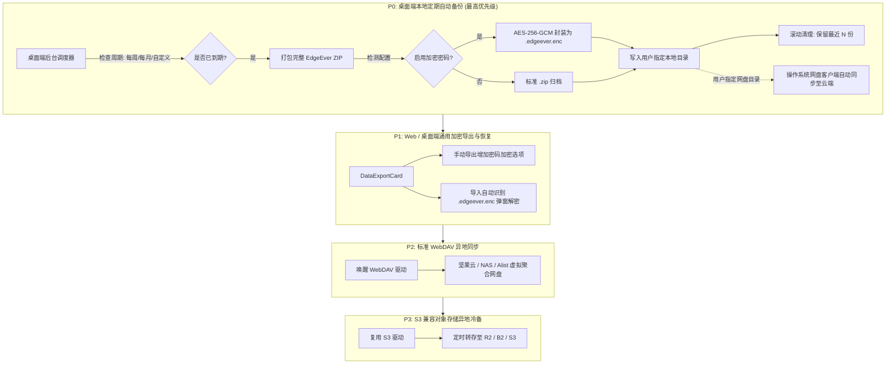

# EdgeEver 备份与异地容灾技术方案 (Backup & Disaster Recovery Plan)

> 本文档针对 GitHub Issue [#61](https://github.com/tianma-if/edgeever/issues/61) 提出的“加密备份与转存网盘/对象存储”需求，系统性梳理 EdgeEver 的备份策略、技术约束、优先级路线及详细实现方案。

---

## 1. 背景与核心诉求

### 1.1 问题背景
EdgeEver 主要运行在 Cloudflare Serverless（D1 数据库 + R2 对象存储 / KV）或自托管 Docker 容器中。
尽管云服务商具有较高的 SLA，但对知识库与个人笔记用户而言，存在两类核心痛点：
1. **云端单点故障与实例销毁风险（Extreme Disaster Recovery）**：
   - Cloudflare 账号风控/误封、扣费失败、D1 误操作重置、或 VPS 宿主机硬盘物理损坏。
   - 用户需要一种**完全脱离当前云端运行环境的独立冷备副本**。
2. **隐私泄露与数据主权担忧（Encryption at Rest）**：
   - 异地备份往往需要存放在第三方云存储（如网盘、公有对象存储）；
   - 用户笔记包含私人日记、敏感备忘等内容，明文归档上传存在第三方审查或存储桶越权泄露的风险，强依赖**客户端端到端强加密**。

---

## 2. 策略定调与行业解法

### 2.1 行业成熟解法（Obsidian / Joplin / 思源笔记）

| 路径 | 实现机制 | 优势 | 适用场景 |
| :--- | :--- | :--- | :--- |
| **方案 A：本地目录协同（系统网盘接管）** | 桌面端只负责按期落盘，用户将目录设在本地网盘同步盘（iCloud / OneDrive / 坚果云） | **零网络代码、100% 稳定性**，由操作系统与微软/苹果成熟同步守护进程负责断点续传与差量重试 | 覆盖 90% 桌面用户的免配置网盘备份 |
| **方案 B：标准 WebDAV 协议** | HTTP 标品协议，支持账号+应用专用密码（无 OAuth 烦恼） | 直连坚果云、NAS（群晖/Nextcloud），并通过 **Alist** 间接挂载百度/阿里/夸克网盘 | 进阶自建与 NAS 用户 |
| **方案 C：S3 兼容对象存储** | 标准 AWS SigV4 认证，AK/SK 静态凭证 | 极低成本异地冷备（Cloudflare R2 / Backblaze B2 / AWS S3 / 阿里云 OSS） | 技术极客与低成本云备 |

### 2.2 核心结论：优先级最高的备份策略
**“桌面端定期自动导出备份到本地目录（支持用户自定义路径 + 可选加密）”为 P0 优先级。**
- **终极兜底**：即使云端实例瞬间蒸发，用户物理机上永远留存一份完整的、独立的最新归档。
- **免维护网盘异地化**：用户只需把路径选在自己的网盘同步文件夹，直接无痛实现网盘多端冷备。
- **突破环境限制**：避开了 Cloudflare Worker 免费版 50ms CPU 时间和大文件内存限制。

---

## 3. 分阶段实施演进路线



---

## 4. 详细技术方案：P0 桌面端定期自动备份

### 4.1 归档格式规范：标准 EdgeEver ZIP
区别于简单的 SQLite 裸快照，自动导出的备份采用**标准自包含归档**：
- `manifest.json`：实例版本、打包时间、笔记总数、资源摘要校验码；
- `memos/`：每条笔记的独立 JSON（保留结构化文档树）与纯文本 Markdown；
- `notebooks.json`：层级笔记本拓扑；
- `prompts.json`：AI 提示词配置；
- `resources/`：包含图片、音视频、PDF 等所有二进制原始附件。

> **价值**：一旦远端实例彻底销毁，用户在任何新部署的 EdgeEver 上直接点击“从备份导入”即可瞬间重建整个知识库；用户也可以直接解压 ZIP 提取所有 Markdown 与图片，不被任何专有数据库格式绑定。

### 4.2 调度策略与生命周期
1. **触发机制**：
   - 桌面端启动时、或后台运行时每隔 1 小时检查一次调度状态。
   - 计算逻辑：`now - lastBackupAt >= intervalDays * 86400000`。
   - 提供周期选项：`关闭`、`每天`、`每周（默认）`、`每两周`、`每月`。
2. **执行流程（静默运行）**：
   - 后端异步获取全量数据流，避免阻塞用户主界面编辑。
   - 文件命名规则：`edgeever-backup-YYYY-MM-DD-HHmmss.zip`（若加密则为 `.edgeever.enc`）。
3. **滚动淘汰机制（Retention Policy）**：
   - 默认保留最新 **5** 份备份（用户可在设置中配置为 3~20 份）。
   - 每次生成新备份后，按修改时间排序清理旧备份，杜绝撑满硬盘。
4. **轻量通知与状态反馈**：
   - 备份完成后发送系统级轻量通知（“已完成本周自动备份”），失败时在设置面板保留错误日志。

### 4.3 加密规范（解决 Issue #61 核心安全诉求）
- **加密容器标准**：
  - 采用 **AES-256-GCM** 对整个 ZIP 流进行认证加密；
  - 密钥派生：采用 **PBKDF2**（HMAC-SHA256，100,000 次迭代）或 **Argon2id**，基于用户设定的备份独立密码派生出 256 位加密密钥；
  - 文件头结构：
    ```
    [4 Bytes: 魔数 EDGB] + [2 Bytes: 版本号 0x0001] + [16 Bytes: Salt] + [12 Bytes: GCM IV] + [密文 Payload] + [16 Bytes: GCM Auth Tag]
    ```
- **解密与还原**：
  - 用户导入文件时，根据文件头识别为加密包，提示用户输入密码并在内存/流式解密后执行还原。

---

## 5. 变更风险评估（依 AGENTS.md 规范）

| 评估维度 | 说明 |
| :--- | :--- |
| **功能价值** | **极高**。为用户资产构建最后一道不可摧毁的防线；用极低开发成本让用户零门槛借力电脑本地网盘实现异地云同步。 |
| **影响范围** | 桌面端主进程/Sidecar、Web 设置面板中的“数据与导出”模块。**不触碰现有核心笔记实时读写与协同同步链路**。 |
| **最坏后果** | 1. 用户设置了加密密码但在灾难发生时遗忘，导致备份无法恢复；<br>2. 磁盘空间极度不足时导出中断。 |
| **回滚与兜底方案** | 1. 自动备份为纯增量只读提取，执行失败绝不影响原数据完整性；<br>2. 密码加密为可选配置；开启时必须给用户弹出强提示“请妥善保管密码，EdgeEver 不保留任何备份私钥”。 |
| **未验证项** | 1. 包含数万张高分辨率图片（超 10GB）的超大知识库在桌面端的内存流式压控；<br>2. Windows / macOS 文件权限保护下的目录写入提示。 |

---

## 6. 用户界面（UI / UX）交互设计

在桌面端 `设置 -> 数据与备份`（`SettingsPane -> DataExportCard` 下方）新增 **“自动备份（本地与网盘同步）”** 卡片：

- **自动备份开关**：[ 开启 / 关闭 ]
- **备份频率**：下拉选择 [ 每天 / 每周（推荐）/ 每两周 / 每月 ]
- **备份保存目录**：
  - 默认路径：`~/Documents/EdgeEver Backups`
  - 操作按钮：`[ 更改目录... ]`（支持一键选择用户的 iCloud、OneDrive、坚果云同步文件夹）
- **保留历史份数**：下拉选择 [ 3 份 / 5 份（推荐）/ 10 份 / 20 份 ]
- **备份加密**：
  - 复选框：`[x] 使用密码加密备份文件（防网盘或第三方泄露）`
  - 密码输入框：`输入备份密码` 与 `确认密码`
- **操作区**：
  - `[ 立即备份一次 ]`
  - `[ 打开备份所在文件夹 ]`
- **历史记录列表**：
  - 展示当前目录下的现有备份列表（文件名、时间、大小、加密状态）。
