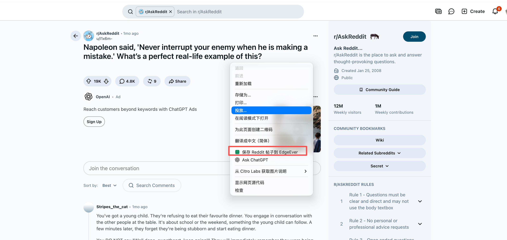
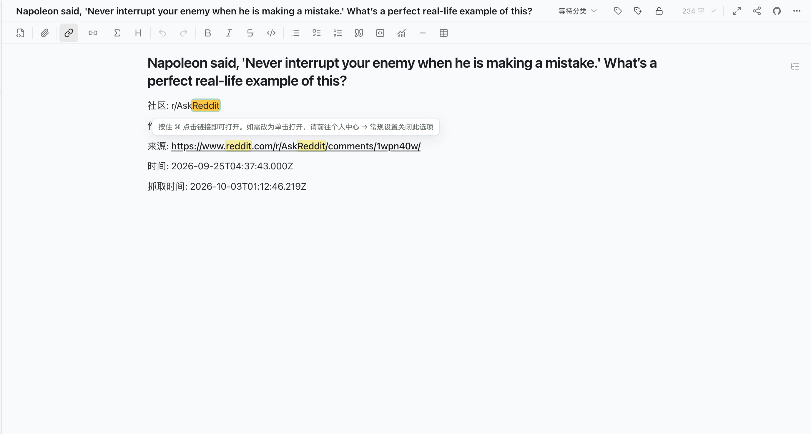
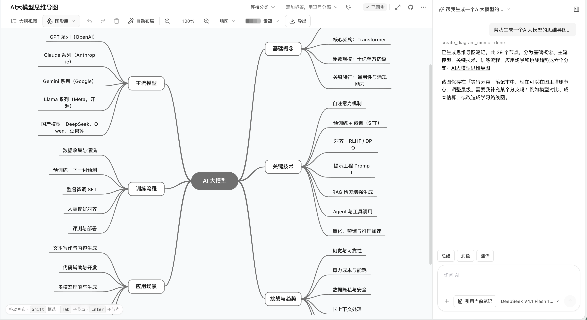
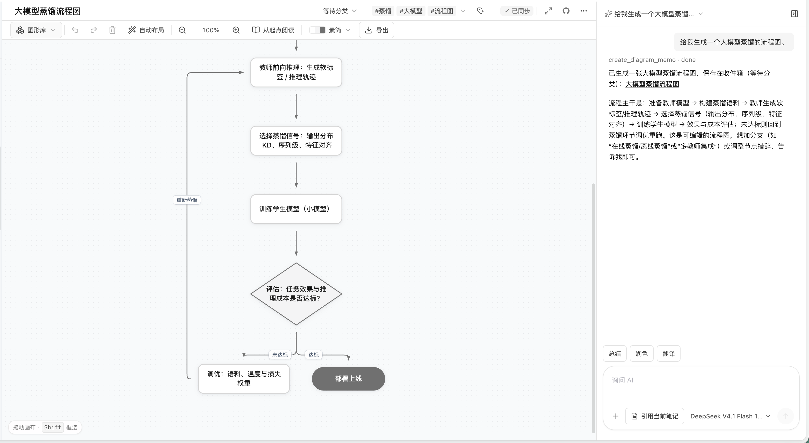
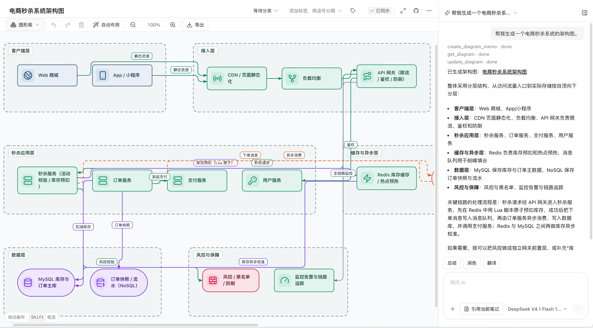
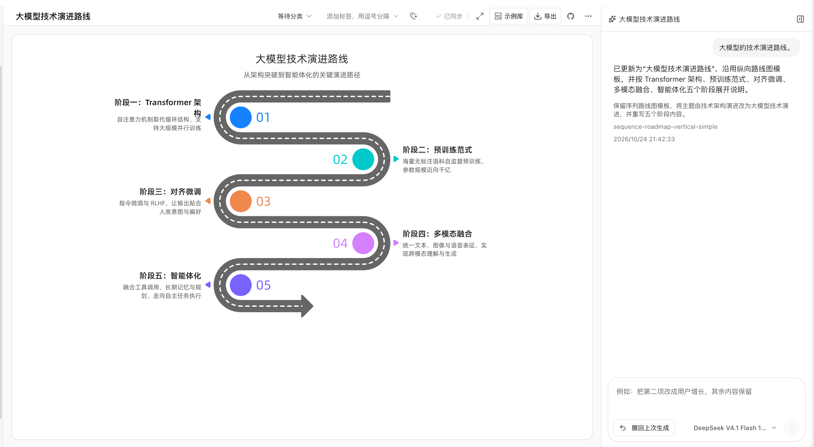
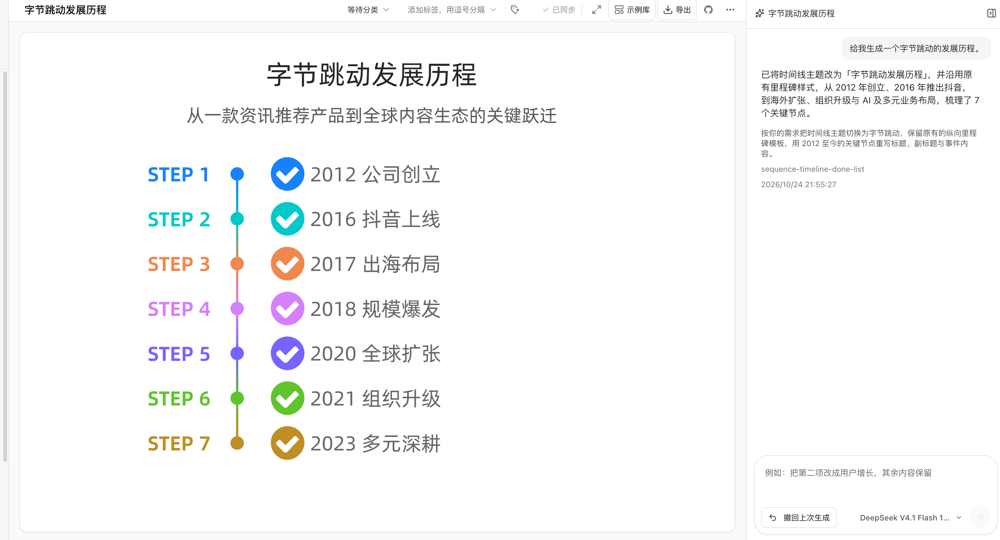
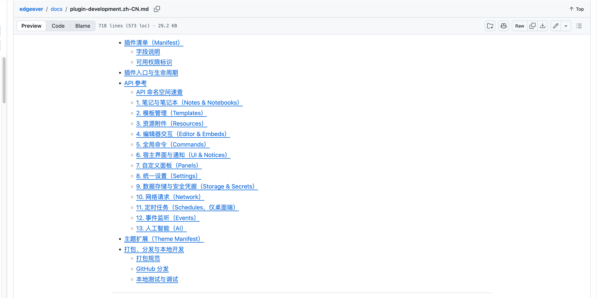

# EdgeEver Showcase & Workflows

A practical guide to core workflows, key features, and real-world usage scenarios with EdgeEver.

## Table of Contents

### Core Workspace & Focused Writing
- [1. Classic Three-Pane Workspace & Distraction-Free Editing](#1-classic-three-pane-workspace--distraction-free-editing)

### Omnichannel Capture & Ingestion
- [2. WeChat Chat History Archiving](#2-wechat-chat-history-archiving)
- [3. WeChat Article Clipping on Mobile](#3-wechat-article-clipping-on-mobile)
- [4. Mobile Image Sharing to Notes](#4-mobile-image-sharing-to-notes)
- [5. Xiaohongshu (RED) Note Clipping](#5-xiaohongshu-red-note-clipping)
- [6. X (Twitter) Post & Quote Clipping](#6-x-twitter-post--quote-clipping)
- [7. Zhihu Answer & Column Article Clipping](#7-zhihu-answer--column-article-clipping)
- [8. Reddit Discussion Post Clipping](#8-reddit-discussion-post-clipping)

### AI-Powered Structuring & Multi-Dimensional Data
- [9. AI Conversational Generation of Mind Maps, Flowcharts & Architecture Diagrams](#9-ai-conversational-generation-of-mind-maps-flowcharts--architecture-diagrams)
- [10. AI Generation of Structured Infographics (Timelines, Matrices & Quadrants)](#10-ai-generation-of-structured-infographics-timelines-matrices--quadrants)
- [11. AI Conversational Database Table Generation](#11-ai-conversational-database-table-generation)
- [12. Public Online Form Collection from Database Tables](#12-public-online-form-collection-from-database-tables)
- [13. Connecting Local Agents via ACP for Note Interaction](#13-connecting-local-agents-via-acp-for-note-interaction)

### Visual Styling & Omnichannel Publishing
- [14. Note Export to Long Image & Code Cards](#14-note-export-to-long-image--code-cards)
- [15. Social Media Poster & Cover Design from Notes](#15-social-media-poster--cover-design-from-notes)
- [16. Copying Notes to WeChat Official Account & Blogs](#16-copying-notes-to-wechat-official-account--blogs)

### Open Ecosystem & Extensibility
- [17. Open Plugin API & Custom Plugin Development](#17-open-plugin-api--custom-plugin-development)

---

## Core Workspace & Focused Writing

### 1. Classic Three-Pane Workspace & Distraction-Free Editing

EdgeEver features a classic three-pane structure (Notebook Tree · Note Stream · Editor Canvas):

- **Focus Mode**: Resizable and collapsible sidebars allow instant toggling into full-screen writing mode.
- **Hybrid Editing**: The main editor supports both WYSIWYG rich text and Markdown syntax.

| Three-Pane Workspace Layout |
:---:
|  |

---

## Omnichannel Capture & Ingestion

### 2. WeChat Chat History Archiving

Select messages in WeChat, tap "Combine and Forward" (合并转发), and choose **EdgeEver** under "Forward to Other Apps" to convert conversations into structured notes.

- **Format Parsing**: Parses senders, timestamps, emojis, and links into clean layouts.
- **Media Preservation**: Images are embedded inline; documents and media files (`.xlsx`, `.pdf`, `.mp4`) are saved as attachments with full-text search support.

| 1. Forward to EdgeEver | 2. Structured Note Preview |
| :---: | :---: |
|  |  |

---

### 3. WeChat Article Clipping on Mobile

When reading WeChat Official Account articles on mobile, select **"Open in EdgeEver"** (用 EdgeEver 打开) from the top-right menu.

- Automatically extracts the title, body structure, and embedded images into clean Markdown.

| 1. Select "Open in EdgeEver" | 2. Extracting Content | 3. Generated Markdown Note |
| :---: | :---: | :---: |
|  |  |  |

---

### 4. Mobile Image Sharing to Notes

Select **EdgeEver** in the mobile system share sheet from any app to upload images and create notes titled "Shared Image" in the background.

| 1. Share Image | 2. Choose EdgeEver | 3. Generated Image Note |
| :---: | :---: | :---: |
|  |  |  |

---

### 5. Xiaohongshu (RED) Note Clipping

Right-click any note page and select **"Save Note to EdgeEver"** using the EdgeEver Web Clipper extension.

- Captures title, topic tags, body text, publish timestamp, and source URL.
- Automatically formats multi-image sets into multi-column gallery layouts.

| 1. Right-Click Clipper Menu |
| :---: |
|  |

| 2. Multi-Column Gallery Note |
| :---: |
|  |

---

### 6. X (Twitter) Post & Quote Clipping

Right-click any post and select **"Save Tweet to EdgeEver"** with the EdgeEver Web Clipper extension.

- Extracts author info, tweet content, external links, quote tweets, and multi-image attachments.
- Formats content into a multi-column gallery layout.

| 1. Right-Click Save Tweet |
| :---: |
|  |

| 2. Note with Quotes & Gallery |
| :---: |
|  |

---

### 7. Zhihu Answer & Column Article Clipping

Right-click any specific answer or article and select **"Save Answer/Article to EdgeEver"**.

- Parses question title, author, body, timestamp, and permalink into a structured Q&A note.

| 1. Right-Click Save Answer/Article |
| :---: |
|  |

| 2. Structured Q&A Note Preview |
| :---: |
|  |

---

### 8. Reddit Discussion Post Clipping

Right-click on the post title or body and select **"Save Selection to EdgeEver"**.

- Captures thread title, subreddit (e.g. `r/AskReddit`), author handle, timestamp, and permalink to preserve community metadata.

| 1. Right-Click Save Post |
| :---: |
|  |

| 2. Note with Community Metadata |
| :---: |
|  |

---

## AI-Powered Structuring & Multi-Dimensional Data

### 9. AI Conversational Generation of Mind Maps, Flowcharts & Architecture Diagrams

Prompt the AI Co-pilot (or connected local Agent) with natural language (e.g., "Generate a mind map / flowchart / architecture diagram about LLMs") to create editable diagrams directly in notes.

- Supports drag-and-drop node editing, auto-layout, conditional branches, and system topologies.

| 1. Interactive Mind Map |
| :---: |
|  |

| 2. Standard Flowchart |
| :---: |
|  |

| 3. System Architecture Diagram |
| :---: |
|  |

---

### 10. AI Generation of Structured Infographics (Timelines, Matrices & Quadrants)

Use built-in infographic templates (timelines, comparison matrices, quadrants, and hierarchy charts) by prompting the AI Co-pilot with your topic.

- Organizes key facts and milestones into structured visual infographic notes.
- Refine through conversational follow-ups or export directly to vector graphics.

| 1. Technology Roadmap Infographic |
| :---: |
|  |

| 2. Milestone Timeline Infographic |
| :---: |
|  |

---

### 11. AI Conversational Database Table Generation

Send a prompt to the AI Co-pilot (e.g., "Create a database table for social media content planning" or "Generate an employee onboarding tracker") to construct complete data tables.

- Infers column types (tags, text, dates, links) with initial sample rows.
- Supports views, filtering, sorting, and CSV export.

| 1. Content Planning Table |
| :---: |
|  |

| 2. Employee Directory Table |
| :---: |
|  |

---

### 12. Public Online Form Collection from Database Tables

Click **"Form Collection"** at the top of any database table to generate a public online data entry form.

- External respondents can submit information via browser without logging in.
- Submissions sync directly to the database table in real time.

| 1. Open "Form Collection" | 2. Public Form Page |
| :---: | :---: |
|  |  |

---

### 13. Connecting Local Agents via ACP for Note Interaction

EdgeEver natively supports **ACP (Agent Client Protocol)**, allowing desktop clients to connect with local AI agent environments (such as Codex, Claude Code, DeepSeek Harness, Antigravity, etc.).

- **Local Authorization**: Grants local agents secure read/write access to user notes.
- **In-Editor Chat**: Converse directly with local agents from the note sidebar for code reasoning, document synthesis, and knowledge retrieval.

| 1. Connect Local Agents via ACP in Settings | 2. Note Sidebar Interaction |
| :---: | :---: |
|  |  |

---

## Visual Styling & Omnichannel Publishing

### 14. Note Export to Long Image & Code Cards

Use the "Share as Image" feature to render notes into high-resolution long images or cards.

- **Multiple Card Themes**: Choose from 8 curated card themes (Transparent, Quote, Book Excerpt, Memo, Dark, and more) with customizable typography and layout. Export high-res long images or copy directly to the clipboard.
- **Technical Code Cards**: A dedicated "Code" theme features macOS-style window controls, line numbers, and monospace syntax highlighting.

| 1. Card Theme Previews (e.g. Transparent) | 2. Font & Layout Customization |
| :---: | :---: |
|  |  |

---

### 15. Social Media Poster & Cover Design from Notes

Click **"Create Poster"** in any note's action menu (or via "New → Poster") to load key takeaways and titles into the Poster Design Studio.

- Offers 40+ design templates supporting Xiaohongshu 3:4, Moments 1:1, and landscape aspect ratios.
- Customize layout, colors, and design elements on the canvas, then export high-resolution PNGs.

| Poster Design Studio & Templates |
:---:
|  |

---

### 16. Copying Notes to WeChat Official Account & Blogs

Select **"Copy to Official Account / Blog"** (复制到公众号 / 博客) from the note menu to convert notes into rich text with inline CSS.

- Paste directly into the WeChat Official Account editor while preserving tables, callouts, code blocks, lists, and typography styles.

| 1. Copy to Official Account / Blog |
| :---: |
|  |

| 2. WeChat Official Account Editor Layout |
| :---: |
|  |

---

## Open Ecosystem & Extensibility

### 17. Open Plugin API & Custom Plugin Development

EdgeEver features an extension manager supporting one-click installation via GitHub repository URLs or Manifest links, with cross-device workspace synchronization between Web and Desktop.

- **Core API Capabilities**: Bidirectional note read/write, custom DOM panels/embed blocks, unified settings, isolated storage, and direct invocation of workspace-configured AI models.
- **Official Open-Source Reference Implementations**:
  - **Task Aggregation ([EdgeEver Tasks](https://github.com/tianma-if/edgeever-tasks))**: Aggregates Markdown todo items across all notes with status filtering and two-way navigation.
  - **AI RSS Feed Assistant ([EdgeEver AI RSS](https://github.com/tianma-if/edgeever-ai-rss))**: Automatically captures RSS/Atom feeds and uses AI to generate structured daily digest notes.
- For complete API documentation and development workflows, refer to the [EdgeEver Plugin Development Guide](plugin-development.md).

| 1. Extension & Plugin Management Center |
| :---: |
|  |

| 2. Plugin API Namespaces & Documentation |
| :---: |
|  |
