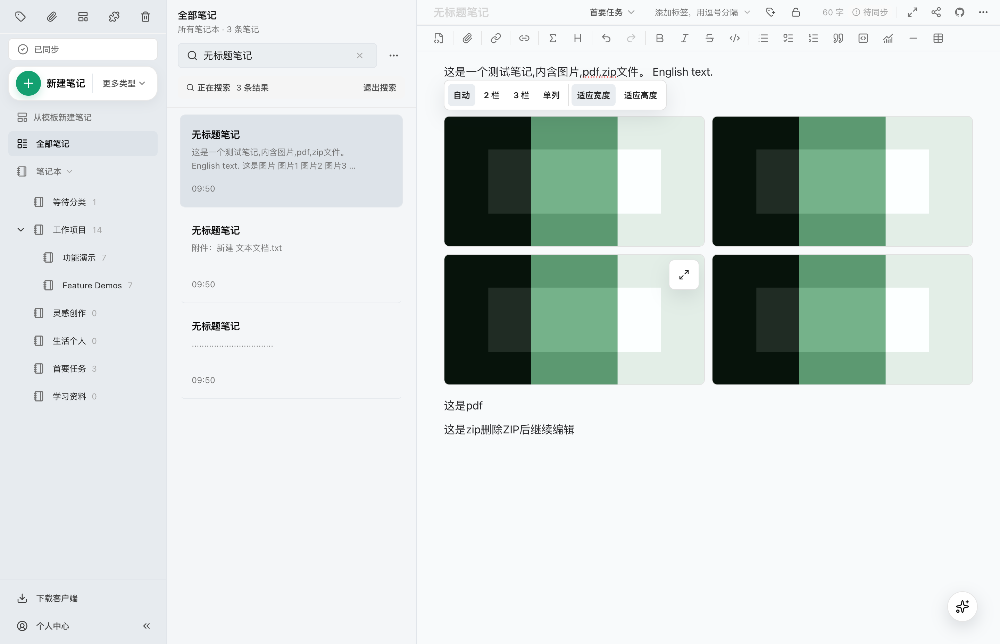

# Keep search results correct while editing notes

## Problem and goal

[Issue #751](https://github.com/tianma-if/edgeever/issues/751) reports that on Windows v2.16.1, editing a search result containing PDF/ZIP attachments (for example, deleting a ZIP attachment) immediately makes the note disappear. Clearing and repeating the search restores it. A note that still matches the search must remain visible and editable after edits and autosave.

The additional screenshots search for `无标题笔记` (the canonical untitled label). The unmodified official macOS v2.16.1 client reproduces the failure with the same default title, four images, PDF/ZIP attachments, and Chinese/English body text: deleting the ZIP changes the local title from the default string to `null`, reducing three results to two. Server synchronization normalizes it back to the default string, and repeating the search restores three results. The attachment is not a required search condition; local empty titles and the server default have inconsistent search semantics.

## Allowed changes

- Fix search-result updates during editing and saving so a note that still satisfies the search, notebook, tag, and filter constraints remains visible and selected. Reuse the existing search, list cache, Repository, and save entry points.
- Search in the Web local mirror and desktop sidecar treats `null` or empty-string titles as the existing canonical default `无标题笔记`, matching server title normalization. Do not rewrite locally saved titles or change matching for other nonempty titles, body text, tags, or localized display labels.
- Preserve genuine search-membership changes: deleting the only matching text must not permanently retain a nonmatching note. Repeating the search must agree with the saved content.
- Extend the existing end-to-end tests with a regression that fails on the original implementation before applying the fix. Cover editing a searched note with PDF/ZIP attachments, autosave, further editing, and repeating the search. Include a body-only search term beyond the excerpt so a summary cannot substitute for full-text matching. Add isolated tests only for concrete behavior that end-to-end coverage cannot effectively exercise.
- Reuse browser end-to-end coverage and the native sidecar's real JSON-RPC/SQLite tests. Keep untitled notes in search before synchronization, after the server acknowledgement, and when repeating the search; renaming to an explicit nonmatching title must still remove the note. Verify that the fix reads existing empty-title data created by the official native client without a migration.

## Unchanged boundaries

No new search syntax, filters, settings, network retries, or request fallbacks. Preserve attachment-deletion permissions and semantics, autosave timing, sorting contracts, and pagination protocols. Do not change database schemas, migrations, authentication, sync protocols, native installation, or automatic updates. Add no dependencies and publish no release. Leave unrelated work untouched.

## Risks and rollback

Incorrect result reconciliation could hide matching notes, retain nonmatching notes, or switch the active editor. Verify the actual interface, saved content, and selected note. Reverting the related code restores the previous implementation without a data migration. Native Windows validation is outstanding; browser evidence does not replace it.

## Acceptance

Run the focused end-to-end regressions and inspect the actual interface. Run `bun run typecheck`, `bun run typecheck:mobile`, and `bun run build:web`. Reconcile the final diff against this scope and distinguish code checks, native-platform validation, commits, pushes, and deployments.

## Implementation decision

Normalize empty-title semantics in queries rather than changing saved values or waiting for synchronization to refresh the list. This also handles existing local empty-title notes while preserving saving, synchronization, and data formats. Desktop rows and counts continue to share one search condition; Web still filters the existing local mirror. No queries or reads are added. Existing custom-title and body-text matching remains unchanged.

The browser regression uses the minimal trigger, editing the body of an untitled search result, rather than treating attachment contents as a prerequisite. The native-client scenario covers actual attachment deletion.

## Completion check

- Product changes are limited to the local search field in `apps/web/src/lib/local-mirror.ts` and the search condition in `crates/desktop-sidecar/src/memo.rs`. Empty titles match the canonical default during queries; locally saved titles remain `null`. No migrations, queries, input restrictions, or synchronization policies were added.
- The new browser regression first confirmed that the original implementation loses the selected result after a local body save with a `null` title. All 3 Chromium scenarios in `tests/e2e/note-search.spec.ts` pass after the fix. The new case covers local saves, further editing, and clearing/repeating the search. After releasing the real synchronization response, it waits for the acknowledgement to reach the local mirror before checking that all three results and the current editor contents remain. An explicit nonmatching rename correctly reduces three results to two.
- The native JSON-RPC/SQLite regression first exposed the missing result with the official v2.16.1 sidecar; `bun scripts/test-desktop-sidecar.mjs` passes after the fix. The fixed binary also read the existing empty-title data left by that old version: the title remained `null`, the note matched, and its contents were identical before and after querying.
- The official macOS v2.16.1 runtime with the fixed sidecar was tested against isolated data and a real local API using four images, Chinese/English body text, and PDF/ZIP attachments. Deleting the ZIP and PDF retained all three search results, the active note, further edits, and all four images. Repeating the search after synchronization also worked. The actual interface was inspected; see the comparison below.
- `bun run typecheck`, `bun run typecheck:mobile`, and `bun run build:web` pass. Native Windows and Linux interfaces remain untested. Release-package installation and automatic updates were not exercised in this task.

### Before: deleting the ZIP leaves two results and switches the editor to another note

### After: deleting both the ZIP and PDF retains three results and continued editing

