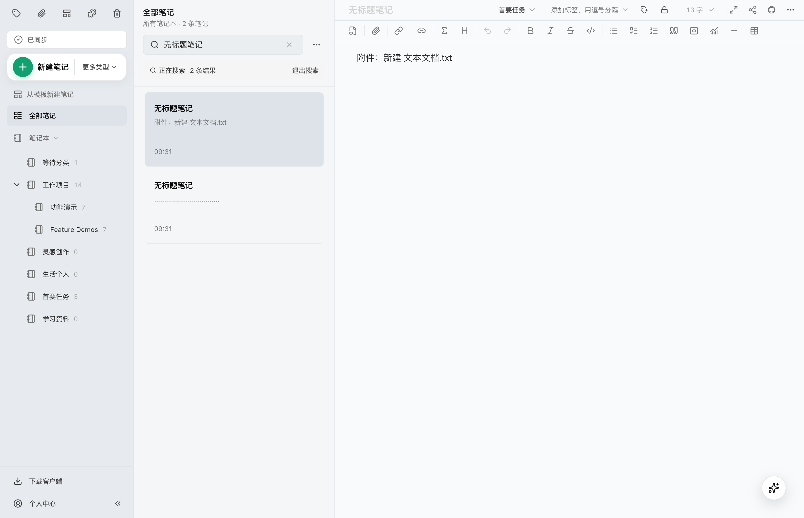
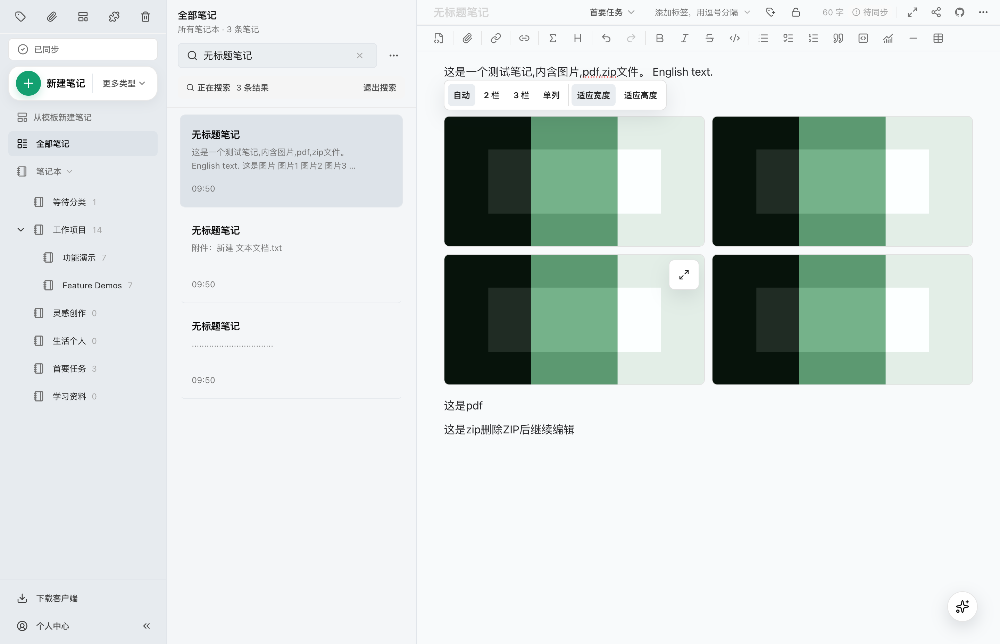

# 搜索后编辑笔记时保留正确结果

## 问题与目标

[Issue #751](https://github.com/tianma-if/edgeever/issues/751) 报告 Windows v2.16.1 中，搜索笔记后编辑含 PDF、ZIP 附件的笔记（例如删除 ZIP）会使笔记立即消失，清空并重新搜索才恢复。目标是让仍匹配搜索条件的笔记在编辑、自动保存后继续可见，并保留当前编辑对象。

补充截图中的搜索词为“无标题笔记”。在未修改的 macOS 正式 v2.16.1 中，使用同样的默认标题、4 张图片、PDF/ZIP 及中英文正文已复现：删除 ZIP 后，本地标题从默认字符串变成 `null`，搜索结果由 3 条变成 2 条；云端同步将标题规范化为默认字符串后，重新搜索又恢复 3 条。附件不是必要的搜索条件，问题在于本地空标题与云端默认标题的搜索含义不一致。

## 允许的变更清单

- 修复搜索结果在编辑和保存过程中的更新，使仍匹配当前搜索、笔记本、标签和筛选条件的笔记保持可见、可继续编辑；复用现有搜索、列表缓存、Repository 与保存入口。
- Web 本地镜像和桌面 sidecar 搜索将 `null` 或空字符串标题按既有规范默认值 `无标题笔记` 匹配，与服务端标题规范化一致；不改写本地保存的标题，不改变其他非空标题、正文、标签的匹配方式或本地化展示。
- 保留真实的搜索结果变化：删除唯一匹配的文本后，不得把不再符合条件的笔记永久保留在结果中；重新搜索应与保存后的内容一致。
- 在现有端到端测试中增加可复现缺陷的场景，先确认原实现失败，再验证修复。覆盖搜索后编辑含 PDF/ZIP 附件的笔记、自动保存、继续编辑与重新搜索；检验正文中位于摘要之外的搜索词，避免用摘要代替全文判断。只有端到端无法有效覆盖的具体行为才补充隔离测试。
- 复用浏览器端到端测试和原生 sidecar 的真实 JSON-RPC/SQLite 测试。验证默认标题笔记在本地未同步、云端回执到达和重新搜索时均保留；改为不匹配的明确标题后正常移出结果。以原生正式版产生的本地空标题数据验证修复版读取，无需迁移。

## 保持不变的边界

不新增搜索语法、筛选项、配置、网络重试或调用兜底；不改变附件删除权限、资源删除语义、自动保存延迟、排序契约或分页协议。不修改数据库结构、迁移、认证、同步协议、原生安装与自动升级机制，不新增依赖，不发布版本。不处理其他任务的改动。

## 风险与回滚

错误的结果协调可能使仍匹配的笔记消失、误留不匹配笔记或切换当前编辑对象。使用真实界面和保存后读回验证结果与编辑对象；回退本次相关代码即可恢复原实现，无需数据迁移。Windows 原生客户端尚未验证，不能用浏览器结果替代。

## 验收方式

运行上述定向端到端回归，检查实际界面；运行 `bun run typecheck`、`bun run typecheck:mobile` 与 `bun run build:web`。完成后以实际 diff 双向核对本清单，并区分代码验证、原生平台验证、提交、推送与部署状态。

## 实施决策

采用查询侧统一空标题含义，而不修改保存值或等待同步后再刷新；这样也能读取已有本地空标题笔记，并保持保存、同步和数据格式不变。桌面列表与计数继续共用同一个搜索条件，Web 仍在既有本地镜像中筛选，不增加查询或读取次数。自定义标题与正文搜索的原有逻辑不变。

浏览器自动回归使用“默认标题 → 修改正文”这个最小触发场景，避免把附件内容当成必要条件；真实附件删除由原生客户端场景覆盖。

## 完成核对

- 产品改动仅涉及 `apps/web/src/lib/local-mirror.ts` 的本地搜索字段，以及 `crates/desktop-sidecar/src/memo.rs` 的搜索条件；空标题在查询时匹配规范默认标题，本地保存值仍为 `null`，未增加迁移、查询、输入限制或同步策略。
- 浏览器新增回归在原实现下确认：本地正文已保存、标题为 `null` 时，搜索结果中的当前笔记消失。修复后 `tests/e2e/note-search.spec.ts` 的 3 个 Chromium 场景通过；新增场景覆盖本地保存、继续编辑、清空后重新搜索。放行真实同步响应后，等待回执写入本地镜像，再确认 3 条结果和当前编辑内容仍保留；改为不匹配标题后正常从 3 条变成 2 条。
- 原生 JSON-RPC/SQLite 回归在正式 v2.16.1 sidecar 下先暴露漏搜，修复后 `bun scripts/test-desktop-sidecar.mjs` 通过。修复版还直接读取了该旧版留下的空标题数据：标题仍为 `null`，能够命中搜索，查询前后的笔记内容完全一致。
- macOS 正式 v2.16.1 运行时搭配修复后的 sidecar，在隔离数据与真实本地 API 中验证了 4 张图片、中英文正文和 PDF/ZIP：连续删除 ZIP、PDF 后，仍有 3 条搜索结果，当前笔记和后续编辑保留，4 张图片保持完整；同步后重新搜索仍正常。已检查实际界面，见下方对比。
- `bun run typecheck`、`bun run typecheck:mobile`、`bun run build:web` 均通过。Windows、Linux 原生界面尚未实测；本任务未进行发行包安装或自动升级验收。

### 修复前：删除 ZIP 后只剩 2 条结果，编辑器跳到另一条笔记

### 修复后：删除 ZIP 和 PDF 后仍有 3 条结果，可以继续编辑

