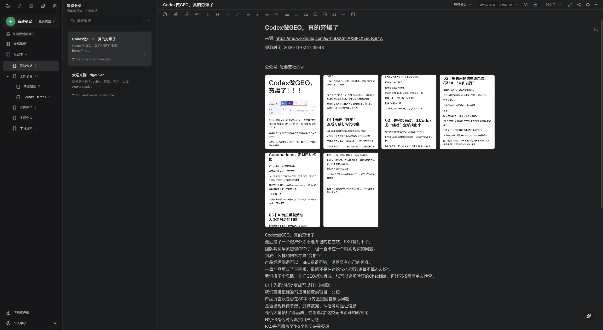

# Clip WeChat picture posts

[简体中文](2026-11-02-wechat-picture-clipping.zh-CN.md) · [Issue #756](https://github.com/tianma-if/edgeever/issues/756)

## Problem and outcome

WeChat picture posts place their title, description and carousel differently from ordinary articles, causing rejected clips or missing images. Preserve the source title, visible description, available account/author/publication metadata and every original image in source order.

## Changes

1. Resolve the title from the visible heading, then the page's `og:title`, then its document title. If all are empty, keep the unreadable-content error rather than inventing a default. Descriptions may be empty; preserve authored text, including a first line that repeats the title. Do not add the separate share cover or surrounding interaction controls.
2. Use the existing MAIN-world probe to read the current post URL and `cgiDataNew.picture_page_info_list[].cdn_url`, without executing site inline scripts. Compare the snapshot with both the source URL and declared page identity: retain short/query aliases, but reject conflicting identities within the same URL form. Missing, empty or malformed image lists and non-HTTP(S) image URLs report incomplete content rather than saving a partial gallery. Unreadable posts never fall back to whole-page capture.
3. Reuse toolbar/context-menu entry points, selection priority, notebook selection and image archival, including existing limits and partial-image feedback. Ordinary WeChat articles and other platforms retain their behavior.

## Decisions and boundaries

Read the complete original-image list from loaded page state because a virtual carousel mounts only part of the gallery. Check the visible carousel rather than relying solely on a placeholder that becomes hidden after rendering.

No new permissions, dependencies or image-count/size limits; no API, database, authentication, native-client or release-mechanism changes. Existing notes are not rewritten. Roll back the WeChat reader and probe wiring; already clipped notes remain ordinary usable notes.

## Acceptance

Titles, descriptions, image order and attachment persistence meet the expected behavior, with ordinary-article regression coverage passing. Native toolbar clipping and reopening are verified on macOS Chromium. Windows/Firefox runtime and native context-menu clicks remain unverified.

## Screenshot

