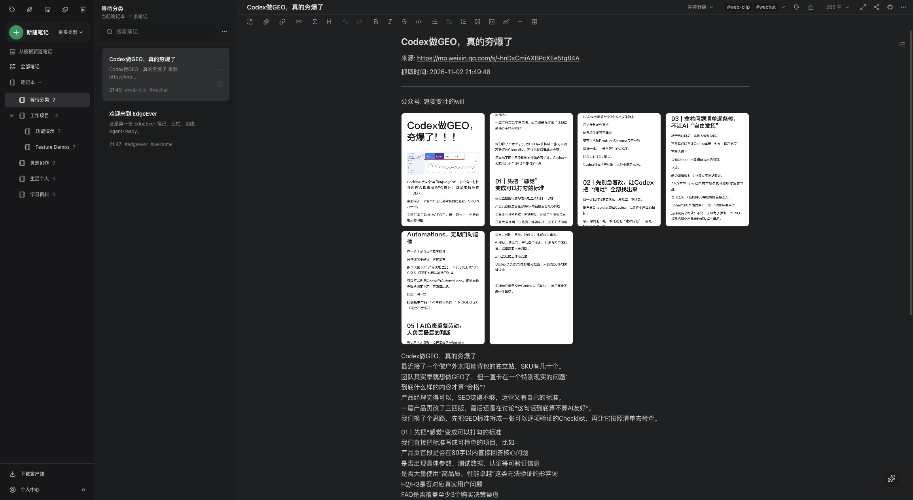

# 微信公众号贴图剪藏

[English](2026-11-02-wechat-picture-clipping.md) · [Issue #756](https://github.com/tianma-if/edgeever/issues/756)

## 问题与目标

微信贴图消息的标题、说明和轮播布局不同于普通文章，原读取器会拒绝剪藏或遗漏图片。支持保留来源标题、可见说明、可用的公众号／作者／发布时间，以及按原顺序排列的全部原图。

## 变更范围

1. 标题依次取可见标题、页面 `og:title`、文档标题；均为空时仍提示无法读取，不虚构默认标题。说明可以为空，已有说明原样保留，包括与标题相同的首行；不额外插入分享封面或外围互动内容。
2. 通过既有 MAIN world 探针读取当前消息 URL 和 `cgiDataNew.picture_page_info_list[].cdn_url`，不执行站点内联脚本。快照同时与来源 URL、页面声明身份比对：保留长短链接别名，同一种 URL 形式中的身份冲突须拒绝。图片列表缺失、为空、结构异常或含非 HTTP(S) 地址时提示内容不完整，不保存残缺轮播；不可读贴图不回退整页采集。
3. 复用工具栏／右键入口、选区优先级、笔记本选择和图片转存流程，保留既有额度及部分图片失败提示。普通微信文章和其他平台保持原行为。

## 决策与边界

完整原图列表以页面已加载状态为准，避免虚拟轮播只挂载部分图片而漏图；可读性检查使用可见轮播，不把渲染后隐藏的占位节点作为唯一依据。

不新增权限、依赖或图片数量／体积上限，不修改 API、数据库、认证、原生客户端及发布机制，不重写已有笔记。回滚只需撤回微信读取器及探针接线，已剪藏笔记仍可作为普通笔记使用。

## 验收结论

标题、说明、图片顺序和附件保存符合预期，普通文章回归通过；macOS Chromium 原生工具栏剪藏及重开显示已验证。Windows／Firefox 运行时和原生右键菜单点击未验证。

## 截图

