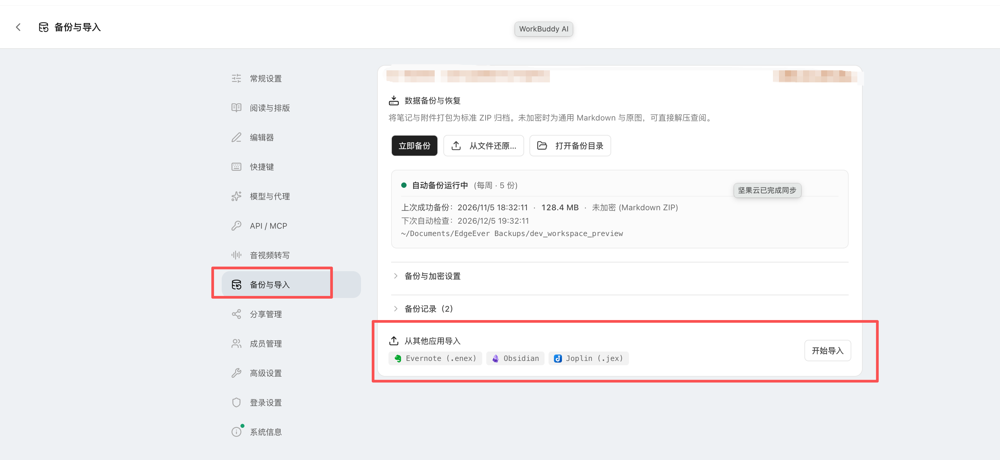
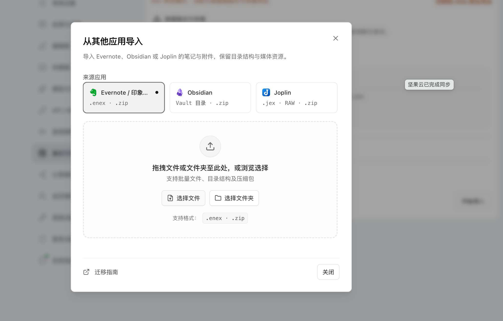

# Third-Party Notes Import Guide

[简体中文](note-migration-guide.md) | [English](note-migration-guide.en-US.md)

EdgeEver supports importing notes from other products directly. Two methods are available: **Native One-Click Import** and **AI Agent (MCP) Migration**.

---

## 1. Native One-Click Import (Evernote / Obsidian / Joplin)

Operate directly in EdgeEver Web or Desktop without CLI commands or MCP setup.

### Step 1: Open the Import Entrance

Go to **Settings → Backup & Import → Import from Other Apps**, then click **Start Import**.



### Step 2: Select Source and Load Files

Select your source platform in the dialog, then drag and drop or browse files:



- **Evernote**:
  - Right-click a notebook in the desktop client and choose **Export Notebook...** to export as `.enex` (ensure tags and timestamps are checked).
  - Supports single/multiple `.enex` files, folders containing ENEX files, or bundled `.zip` archives.
- **Obsidian**:
  - Drag and drop your local Vault folder directly, or compress the Vault into a `.zip`.
  - Automatically parses Front Matter, tags, and Wiki-link images (`![[image.png]]`), while ignoring `.obsidian` and `.git`.
- **Joplin**:
  - In the desktop client, go to **File → Export all** and export as a **.jex** file (or RAW / Markdown directory).
  - Drag and drop the `.jex` file or a directory zipped as `.zip`. Embedded resource attachments are resolved automatically.

### Step 3: Confirm Import and Verify

1. EdgeEver runs a client-side preflight check and displays note, notebook, and attachment counts.
2. Choose to import as top-level notebooks or mount under an existing notebook, then click **Confirm Import**.
3. Once completed, click **Open Note** next to any item in the result list to verify formatting and attachments.

---

## 2. AI Agent Import (Notion / flomo / Memos, etc.)

For platforms without a built-in GUI parser, use EdgeEver's Remote MCP with your AI assistant (Claude Code, Cursor, Codex, WorkBuddy, etc.) via a single prompt.

### Step 1: Configure EdgeEver MCP

In EdgeEver, go to **Settings → API / MCP**, generate a Token, and click **Copy Full MCP Config** to add it to your AI assistant.

### Step 2: Send a Prompt to Start Migration

#### Scenario 1: Notion Migration (Cloud-to-Cloud Dual MCP)

Enable both **Notion MCP** and **EdgeEver MCP** in your AI assistant, then send:

```text
You are my migration assistant. You now have access to both my Notion MCP and EdgeEver MCP services.
Please migrate all specified pages and databases from Notion to EdgeEver:
1. Call Notion MCP tools to read page contents (including titles, content blocks, creation times, tags, and properties);
2. Convert them into standard Markdown and nested structures, then call EdgeEver MCP tools to import them into a "Notion Migration" notebook;
3. When finished, summarize total notes imported, attachment status, and any formatting anomalies.
```

#### Scenario 2: flomo Migration (HTML Export Archive)

1. In flomo web or desktop, go to **Settings → Account Details**, scroll to the bottom, and download the full HTML export ZIP.
2. Replace the path below and send it to your AI assistant connected to EdgeEver MCP:

```text
Using the configured EdgeEver MCP, please migrate all notes from the local archive `/path/to/flomo-export.zip` into the `flomo` notebook in EdgeEver.
Requirements:
1. Retain note text, tags (#tag), historical creation timestamps, and embedded images;
2. Create notes incrementally, verify data integrity, and summarize total imported notes upon completion.
```

#### Scenario 3: Memos Migration (Cloud-to-Cloud Dual MCP)

Enable both **Memos MCP** and **EdgeEver MCP** in your AI assistant, then send:

```text
You are my knowledge base migration assistant. You are connected to both my old Memos MCP and EdgeEver MCP.
Please migrate all historical memos to EdgeEver:
1. Call Memos MCP tools to fetch all memos (including text, tags, visibility, and timestamps) in batches;
2. Call EdgeEver MCP tools to create notes under a "Memos" notebook;
3. Upon full migration, report the total imported notes and verification summary.
```
