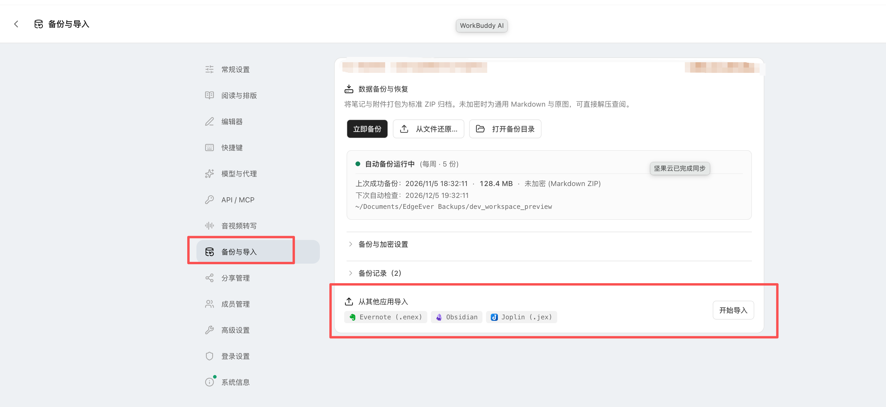
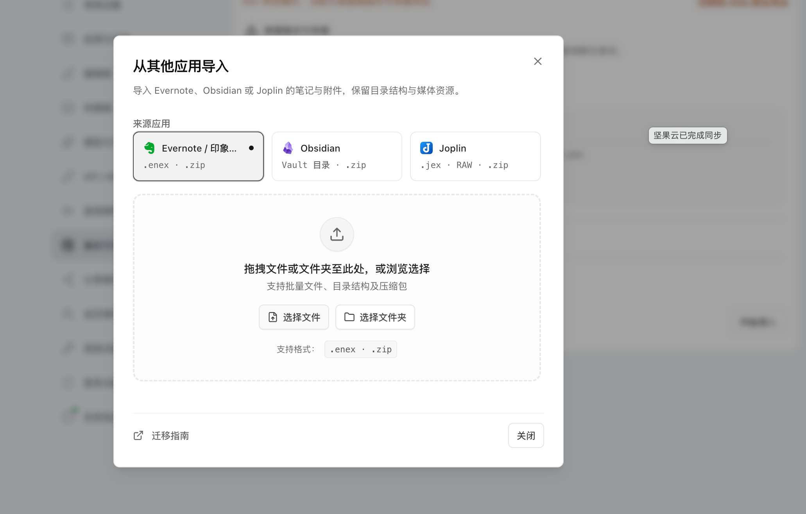

# 第三方笔记导入指引

[简体中文](note-migration-guide.md) | [English](note-migration-guide.en-US.md)

EdgeEver 支持从其他笔记产品直接导入数据。目前提供**原生一键导入**与 **AI Agent (MCP) 协同导入**两种方式。

---

## 一、原生一键导入（Evernote / Obsidian / Joplin）

无需配置命令行或 MCP，在 Web 网页端或桌面端直接操作。

### 步骤 1：打开导入入口

进入 **设置 → 备份与导入 → 从其他应用导入**，点击 **开始导入**。



### 步骤 2：选择来源并载入文件

在弹出的对话框中选择对应来源，直接拖拽或点选文件：



- **印象笔记 / Evernote**：
  - 在客户端右键笔记本选择 **导出笔记本...**，导出为 `.enex` 格式（勾选包含标签与时间）。
  - 支持单个/多个 `.enex` 文件、包含多个 ENEX 的文件夹，或打成 `.zip` 压缩包直接拖入。
- **Obsidian**：
  - 直接拖入本地 Vault 文件夹，或将 Vault 打包为 `.zip` 拖入。
  - 自动保留 Front Matter、标签与 Wiki 双链图片（`![[image.png]]`），自动忽略 `.obsidian` 与 `.git` 等配置目录。
- **Joplin**：
  - 在客户端点击 **文件 → 导出全部**，导出为 **.jex** 文件（或 RAW / Markdown 目录）。
  - 将 `.jex` 文件或目录打包的 `.zip` 拖入，自动关联并转存正文中的资源附件。

### 步骤 3：确认导入并核验

1. 系统在本地预检统计笔记本数、笔记数与附件数。
2. 选择导入为顶层笔记本或挂载在现有笔记本下，点击 **确认导入**。
3. 导入完成后可在结果列表中点击 **打开笔记** 快速核验排版与附件。

---

## 二、通过 AI Agent 导入（Notion / flomo / Memos 等）

对于暂未内置原生解析器的平台，借助 EdgeEver 的 Remote MCP 接口，通过 AI 助手（Claude Code、Cursor、Codex、WorkBuddy 等）一条 Prompt 即可完成迁移。

### 步骤 1：配置 EdgeEver MCP

在 EdgeEver 中进入 **设置 → API / MCP**，生成 Token 并点击 **复制完整 MCP 配置**，添加到你的 AI 助手工具配置中。

### 步骤 2：发送一条 Prompt 开始导入

#### 场景 1：Notion 迁移（双 MCP 云对云互联）

在 AI 助手中同时启用 **Notion MCP** 与 **EdgeEver MCP**，发送：

```text
你是我的数据迁移助手。现在你已同时连接了我的 Notion MCP 和 EdgeEver MCP 服务。
请帮我把 Notion 里的所有指定页面与数据库迁移到 EdgeEver：
1. 调用 Notion MCP 接口读取我的页面内容（包含标题、正文 Block、创建时间、标签与属性）；
2. 转换为规范的 Markdown 与层级结构，调用 EdgeEver MCP 写入接口批量导入到「Notion 迁移」笔记本中；
3. 迁移完成后，统计成功篇数、附件转存情况与潜在格式异常。
```

#### 场景 2：flomo 迁移（HTML 导出包快速入库）

1. 在 flomo 网页版或客户端中，进入 **设置 → 账号详情**，滑动至底部下载全局 HTML 导出 ZIP；
2. 替换下方路径后发送给已连接 EdgeEver MCP 的 AI 助手：

```text
请通过已配置的 EdgeEver MCP，将本地路径 `/path/to/flomo-export.zip` 中的全部 flomo 笔记迁移到 EdgeEver 的 `flomo` 笔记本中。
要求：
1. 完整保留正文、标签（#tag）、历史创建时间及内嵌图片附件；
2. 流式创建并校验完整性，迁移完成后向我汇总报告导入总篇数与结果。
```

#### 场景 3：Memos 迁移（双 MCP 云对云直连）

在 AI 助手中同时启用 **Memos MCP** 与 **EdgeEver MCP**，发送：

```text
你是我的知识库迁移助手。现在你已同时连接了旧 Memos MCP 和 EdgeEver MCP。
请帮我把旧 Memos 里的所有笔记迁移到 EdgeEver：
1. 调用 Memos MCP 分批读取所有历史笔记（包含文本、标签、可见性与创建时间）；
2. 调用 EdgeEver MCP 写入接口批量创建笔记，归入「Memos」笔记本；
3. 全量迁移完成后，统计成功导入篇数并报告核验结果。
```
